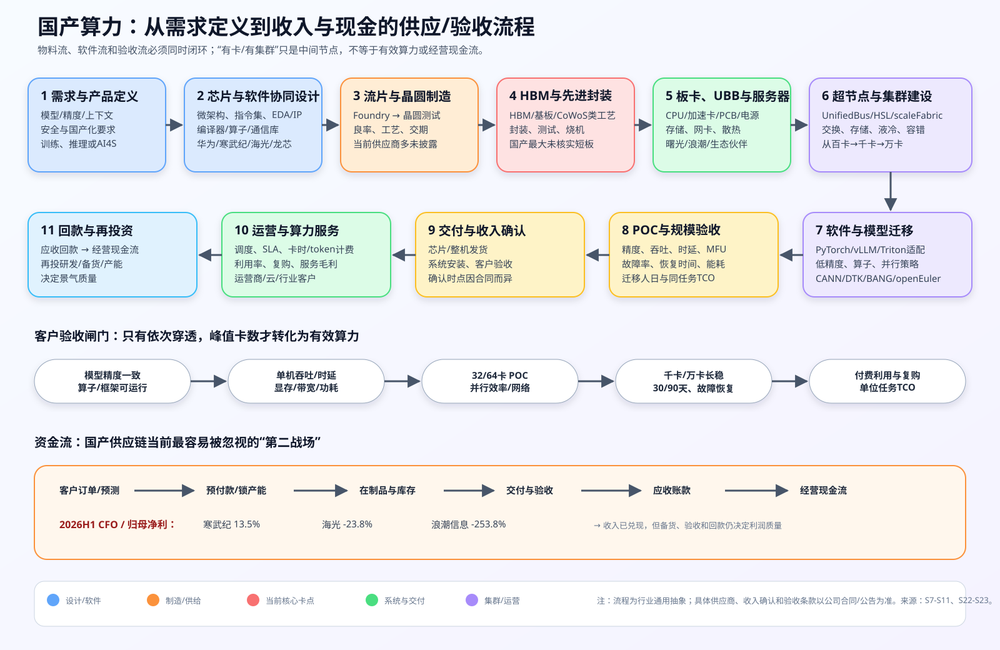
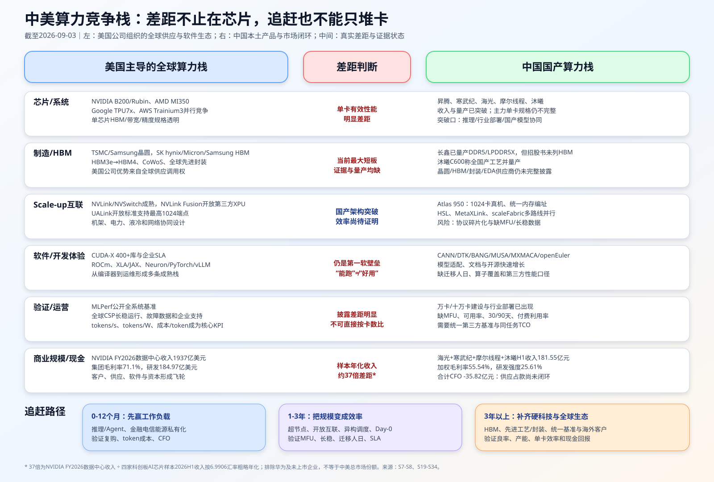

# 国产算力替代产业专题调研

<script setup>
import companyCatalogUrl from './国产算力公司名录.json?url'
</script>

- **报告类型：** 产业链调研 / 国产算力全栈替代
- **信息截止日期：** 2026-10-28（本轮深化产业分工、训练过程与资源需求映射；财务和商用进展沿用上轮已注明期间，未作全行业刷新）
- **研究范围：** 中国数据中心与智算中心；AI 加速器、服务器 CPU、服务器/集群、互联/存储/散热、基础软件与主要需求方；A 股与关键未上市产业锚
- **投资期限：** 6-12 个月验证、1-3 年产业兑现
- **数据可靠性：** 中等；本轮新增官方技术文档、产品页及开源仓库的职责核验；上轮厂商进展和两家公司2026Q3公告保留原期间。独立集群效率、HBM制造来源/良率、国产份额和实际单位任务成本仍有重大缺口

> 本文为研究记录，不构成个性化投资建议。技术路线、量产时间、机构观点和估值结果均需以可核验来源为准。

## 投资结论

**公司名录入口：** [产业链总表](#industry-chain-list) → [107个公司及业务主体逐项说明](#company-catalog)。共20个环节、124条映射，按产品职责组织；涵盖国产计算平台、配套、制造上游和运营服务，不把名单当作统一受益或推荐组合。

**2026-10-28分工补充：** “国产算力”需要分别研究制造供给、计算与数据搬运、软件执行、系统交付、运营服务五类职责。芯片公司提供运算单元和底层工具，服务器公司组织整机与集群，网络/存储公司解决数据供给与交换，云平台把设备变成可使用的作业资源，模型团队定义训练目标和算法。公司可能跨层经营，不能按一个“算力增长率”推导全部公司的收入。先读[第3.5—3.10节的技术分工](#compute-roles)、[第7.3节的公司职责](#company-roles)和[第8.8节的需求传导](#demand-by-layer)。本轮不改变中性观察结论。[S51-S69]

**2026-10-25进度结论：** 国产AI算力已进入“部分场景规模商用、向通用平台追赶”的阶段。华为披露910C超节点部署超1000套、950规模商用；DeepSeek发布Ascend 950计算库和通信库，软件协同开始深入底层实现。两家已披露三季报的代表公司继续高增，进一步验证商业需求，但现金占用仍重。由此上调对规模商用和生态进步的确认度，维持对同任务经济性、尖端训练通用性和全供应链自主的审慎判断。以下阶段划分是本报告判断，不是行业官方评级。[S35-S40][S43]

**算法效率与增长复盘：** 中期算力需求增长仍为本报告基准情景，但单任务效率提高、任务量与任务复杂度共同决定总计算；“更便宜必然用得更多且超过节省量”需要需求弹性验证。国产产业还可通过份额提升获得增长，份额、交付、成本和现金决定兑现。维持产业进步积极、投资中性观察，不据此承诺持续高速增长或估值回报。[S44-S46]

**小模型反向检验：** 小模型、任务微调与端侧部署增加，是单位任务云资源需求下降的真实力量。部分新增应用利用既有PC/手机CPU或NPU，并不形成新增AI服务器采购。模型发布数量、调用量、总计算、高端训练卡需求和国产供应商收入必须分开统计；本轮进一步降低仅凭应用增长推断高端卡持续高增的确定性。[S47-S50]

| 替代层次 | 当前走到哪一步 | 仍需要证明什么 |
|---|---|---|
| 政企/行业本地部署、已适配模型推理 | 已跨过演示和试点，存在规模商用 | 同精度、上下文、并发和服务等级下的每百万token成本与复购 |
| 国产大模型训练 | 系统与软件可用性进步，进入规模工程验证 | 前沿模型长周期训练、扩展效率、故障恢复、总训练成本及可迁移性 |
| 超节点与集群 | 950商用；25.6万卡950集群在部署；960系统在测试 | 建设规模能否转化为验收、付费利用和稳定有效算力 |
| 软件生态 | 特定关键库出现API兼容和国产硬件实现 | 常用工作负载覆盖、调优人力、版本维护和端到端性能 |
| 上游供应自主 | 已有自研HBM技术披露，制造与规模供给仍待穿透 | 晶圆、HBM制造、堆叠封装的来源、良率、产能、交期与成本 |

**边界：** 不能把25.6万卡“在部署”写成完成验收，不能把百万卡扩展能力写成百万卡已长稳运行，不能把DeepGEMM/DeepEP接口对齐写成CUDA生态整体替代，也不能由厂商自研HBM设计推导出制造全链条已自主。[S36-S38][S42]

**核心判断：** 国产算力替代已从“有没有芯片”进入“芯片—互联—软件—集群—服务能否形成可持续生产力”的第二阶段。美国竞争栈也不是单一 NVIDIA，而是 `NVIDIA全栈 + AMD开放GPU + Google/AWS云ASIC + NVLink Fusion/UALink互联 + 全球HBM/代工/封装` 的多路线体系。国产当前突破口是以超节点扩大 scale-up 域、以推理和行业本地部署避开最难的通用训练正面战、用 CANN/DTK/BANG/MUSA/MXMACA/openEuler 降迁移成本，并争取接入开放互联标准。未来 6-12 个月看规模收入、现金回款和长稳运行，未来 1-3 年看能否把系统规模转化为同任务 TCO；HBM与先进工艺则是更长期的硬约束。[S1][S2][S5-S10][S19-S34]

**市场可能误判的地方：** 第一，工信部披露的 2,185 EFLOPS 智算规模不等于国产芯片份额，浪潮信息 92.51% 的服务器业务暴露也不等于国产算力纯度；第二，Atlas 950 的 1,024 张 NPU 与 GB200 NVL72 的 72 张 GPU 不能按卡数比较，二者单芯片、精度/稀疏度、内存、互联和软件口径不同；第三，“适配主流模型”“完成万卡/十万卡建设”不等于 MFU、可用率、客户付费和 TCO 已与海外方案等价；第四，H200/MI325X 逐案许可会改变短期供给，但国外路线已从 H200/B200 继续推进至 288GB HBM3e 的 AMD MI350 和 288GB HBM4/22TB/s 的 NVIDIA Rubin，国产替代面对的是移动靶而非静态旧产品。[S1][S4][S11][S18-S22]

**最受益的产业链环节和公司：** 一阶高纯度从原来的寒武纪、海光扩展为四家可比样本：海光/寒武纪已贡献全部样本扣非盈利，摩尔线程/沐曦收入和毛利率已跨过早期验证但扣非仍亏、现金占款更重；未上市的华为昇腾仍是系统生态锚。一阶系统能力看中科曙光；二阶规模受益看浪潮信息但国产/海外芯片收入未拆。上游长鑫的DDR5量产改善服务器内存供给，却不能当作HBM突破。[S5][S7-S13][S15-S17][S31-S34]

**关键百分比变化：** 2026 年 6 月智能算力 2,185 EFLOPS（FP16）、同比 +177%；海光、寒武纪、摩尔线程、沐曦 2026H1 合计收入 181.55 亿元、加权毛利率 55.54%、研发强度 25.61%，但合计 CFO 为 -35.82 亿元、相当于合计扣非净利润的 -99.58%。按 6.9906 元/美元粗略年化，四家样本收入约 51.94 亿美元，而 NVIDIA FY2026 数据中心收入 1,937.37 亿美元，约为 37.3 倍；该口径排除华为等未上市企业，不等于中美市场份额。[S1][S7-S8][S23][S31-S34]

**最需要警惕的投资风险：** 高估“卡数”而低估有效算力；软件栈分裂导致重复适配和迁移锁定；HBM、晶圆、封装、IP 与 EDA 供应受限；备货和预付款吞噬现金；海外高端芯片供给恢复引发价格战；高估值先于利润与现金流兑现。[S2][S4][S7][S18]

**最关键的证伪条件：** 若国产芯片龙头连续两个半年度收入增速低于 20%、毛利率较当前再下降超过 5 个百分点且滚动 12 个月 CFO/归母净利润仍低于 30%；若十万卡项目长期不披露有效卡数、30/90 天稳定运行、MFU/吞吐或付费客户；或海外芯片逐案许可转化为大规模稳定供货、国产方案 TCO 优势不成立，则应下调“国产算力平台化替代”判断。

## 关键信息栏

> 本栏是基于产业结论、受益公司映射、经营情景和风险条件形成的研究观察，不构成个性化投资建议。

| 项目 | 内容 | 依据 / 数据截点 |
|---|---|---|
| 投资观点 | **中性观察，规模商用确认度提高，经济性与现金兑现待验证** | 950商用与关键库进展；海光/寒武纪2026年前三季度收入增长57.58%/106.76%，CFO/归母净利-85.82%/6.13%；本轮未刷新估值 [S35][S37-S40][S43] |
| 适合阶段 | 财报与集群运行跟踪 | 部分场景规模商用，前沿训练与跨平台迁移仍须验证；25.6万卡集群是“在部署” [S36] |
| 重点观察环节 | AI 加速芯片+软件栈；HBM/先进封装；开放互联；异构超集群；算力服务 | 这些环节决定有效算力、迁移成本和利润池，而不只是卡数 [S2][S5-S10][S27-S34] |
| 观察价格/估值区间 | **未设定**；本轮未取得同截点终端一致预期和完整目标价原文 | 不用零散二手目标价替代估值覆盖；先看经营闸门 |
| 提高关注触发条件 | 芯片收入保持 >30% 增长、毛利率稳定；滚动 12 个月 CFO/净利润 >60%；万卡集群披露长稳与付费利用；国产方案在中性TCO情景下有效吞吐/利用率明显改善 | 阈值为本报告研究假设，不是公司指引 |
| 分层观察对象 | 已盈利高纯度：寒武纪、海光；高弹性：摩尔线程、沐曦；一阶系统：中科曙光；规模：浪潮信息；DDR上游：长鑫；未上市锚：华为 | 业务暴露与证据层级见第 7 节 |
| 目标估值区间 | **未核实 / 不提供** | 缺少公司分部预测、同截点价格和机构估值原文 |
| 上行空间 | **无法计算** | 缺当前价格与目标估值的统一截点和分母 |
| 下行风险 | 高；芯片景气与估值可能同时均值回归，系统商还叠加低毛利与营运资金风险 | 经营敏感性见第 8-9 节 |
| 持有周期假设 | 6-12 个月验证；1-3 年兑现 | 集群稳定、软件生态和客户迁移不是单季度事件 |
| 核心催化剂 | 运营商/互联网国产集群采购；摩尔/沐曦新产品放量与CFO改善；超节点长稳；UALink互通；国产主流模型 Day-0；HBM/封装认证 | [S5-S10][S14][S29-S34] |
| 退出 / 降低关注条件 | 收入增速与毛利率同步失速；库存/预付持续高增且现金恶化；集群只披峰值不披有效利用；海外供给恢复后国产方案无法保份额 | 第 9-10 节 |
| 风险等级 | **高** | 技术迭代快、供应链集中、数据披露不完整、市场预期高 |

## 一页摘要

| 维度 | 结论 | 关键百分比/时间点 | 证据与观察指标 |
|---|---|---:|---|
| 技术路线变化 | 单卡替代转向超节点、异构集群、开放软件与算力服务 | 2026 为国产超节点集中商用窗口 | Atlas 950 1024卡真机；昇腾384超节点750+套；HSL/UnifiedBus/scaleFabric [S5-S10][S22] |
| 国外竞争 | NVIDIA全栈、AMD开放GPU、Google/AWS云ASIC和NVLink Fusion/UALink多路线并进 | B200→Rubin；TPU7x/Trainium3 | HBM/带宽、云分发、开放互联、CUDA/ROCm/XLA/Neuron [S19-S30] |
| 产业链受益环节 | 芯片+软件栈 > 集群系统 > 调度服务 > 通用卖铲子 | 6-12 个月看收入与现金；1-3 年看生态锁定 | 分部收入、毛利、CFO、客户认证 |
| 核心成长驱动力 | 智算扩容、推理结构提升、供应安全、行业 AI 落地 | 智算规模同比 +177% | 有效算力、token 产出/TCO、付费利用率 [S1-S2] |
| 量产节奏 | 海光/寒武纪已盈利；摩尔/沐曦收入与毛利突破但扣非/现金未闭环；曙光进入万卡/十万卡验证 | 四家H1收入181.55亿元 | 客户、ASP、库存/预付、MFU、30/90天 [S7-S10][S31-S34] |
| 当前突破口 | 推理/Agent、存量机房风冷超节点、金融电信能源本地部署、国产模型协同优化 | 0-12个月最现实 | Atlas 850E 96卡、4.0TB/s；DeepSeek-vLLM适配；行业复购 [S22][S26] |
| 前沿方向与遗漏风险 | UALink兼容、超节点、云ASIC、推理优化纳入；国产 HBM/CPO 待跟踪 | 2026-2029 | 量产互通、订单、良率、标准化基准 |
| 投资风险 | 规模≠利用率，适配≠低迁移成本，收入≠现金，半价硬件≠低TCO | 四家CFO/扣非净利-99.58% | 有效吞吐、利用率、现金、库存、预付 [S34] |
| 受益公司 | 已盈利看寒武纪/海光；弹性看摩尔/沐曦；系统看曙光；规模看浪潮；DDR看长鑫 | 2026H1 | 公司映射见第 7 节 |

## 1. 主题边界与产业变化

### 1.1 这次变化是什么

- **事实：** 2026 年 6 月中国智能算力规模达到 2,185 EFLOPS（FP16）、同比 +177%，建成 52 个万卡以上智算设施；寒武纪、海光等上市公司已经出现规模收入和盈利兑现。[S1][S7-S8]
- **判断：** 产业竞争单元已由“单颗芯片参数”升级为“有效算力生产系统”。芯片只是成本与性能的起点，模型框架、算子库、通信、存储、容错、运维、电力与散热共同决定 token 产出、训练时间和 TCO。
- **待验证：** 国产卡占新增智算规模的比例、万卡以上设施的实际有效卡数和利用率、国产集群与海外方案在统一模型和相同精度下的 MFU/吞吐/能耗对比。

本报告把“国产算力替代”拆成三层，避免把不同成熟度混为一谈：

1. **通用计算替代：** 海光 x86 兼容路线迁移成本相对低；鲲鹏以 Arm+openEuler 建生态；龙芯以 LoongArch 追求指令集自主，但原生软件和虚拟化迁移工作更重。[S5][S7][S12-S13]
2. **AI 加速替代：** 昇腾、寒武纪、海光 DCU 承接训练/推理；核心差距不能只看峰值 FLOPS，而要看模型覆盖、低精度、算子、通信、集群稳定和开发工具。[S5-S8]
3. **系统级替代：** 中科曙光等把多品牌加速卡、存储、网络、液冷与调度组合为超节点/超集群；只有形成付费利用和稳定交付，才从“工程样板”进入产业利润。[S9-S10]

### 1.2 旧方案 vs 新方案

| 性能/商业维度 | 旧方案：海外单一生态为主 | 新方案：国产异构全栈 | 改善幅度/百分比 | 对下游产品的影响 | 来源 |
|---|---|---|---:|---|---|
| 采购与供应 | 高端 GPU、HBM、网络和软件集中于少数海外供应商 | 多国产芯片+多系统商，强调供应安全 | 无统一国产份额；监管边际变化 | 降低单一来源风险，但增加适配成本 | [S4][S18] |
| 软件迁移 | CUDA/x86 工具链成熟、开发者惯性强 | CANN、DTK、BangC、openEuler 等并行发展 | 开发者/生态规模已扩大，迁移成本未量化 | 多栈维护、算子优化和人才成本上升 | [S2][S5-S8][S13] |
| 集群互联 | NVLink/NVSwitch、InfiniBand 等成熟体系 | UnifiedBus、HSL、scaleFabric/开放网络路线 | 厂商披露从 384 卡到万卡/十万卡 | 竞争焦点由单卡转向超节点和容错 | [S5][S7][S9-S10] |
| 训练/推理结构 | 大模型集中训练优先 | 推理、Agent、行业部署权重提升 | CAICT 引用预测推理占 72.6% | 推动低时延、高吞吐、资源池化和边缘部署 | [S2] |
| 财务模式 | 卖卡/卖服务器 | 芯片+整机+集群+调度+算力服务 | 尚无行业统一服务收入拆分 | 利润池可能向软件、运维和高利用率运营迁移 | [S2][S14] |
| 能耗与散热 | 风冷/冷板逐步升级 | 高密度液冷与系统级能效优化 | 曙光厂商口径 PUE 低至 1.04 | 支撑高密度部署，但 PUE 不代表计算效率 | [S9-S10] |

### 1.3 前沿方向扫描与空白地图

| 候选方向 | 为什么升温 | 证据类型 | 成熟度 | 可投资映射 | 是否纳入 | 未纳入原因/边界 |
|---|---|---|---|---|---|---|
| 国产超节点/超集群 | 单卡性能差距需要系统级扩展弥补 | 年报、产品路线、集群上线 | 商业化/运行验证 | 华为、海光、中科曙光 | 是 | 需补 MFU、故障率、付费利用率 |
| 推理优先与 PD 分离 | Agent 和调用量提升，推理更分布式 | CAICT、寒武纪软件进展 | 商业化 | 寒武纪、海光、运营商云 | 是 | 需补 token 单位成本和客户规模 |
| 算子编程与开源兼容 | 降低 CUDA 迁移和模型适配成本 | CANN/Triton/PyTorch/BangC | 生态建设 | 华为、寒武纪、openEuler | 是 | 开源范围、上游合并和性能仍需核验 |
| 异构调度/算力网络 | 多芯片、多区域导致资源碎片化 | CAICT、运营商披露 | 商业化早期 | 运营商、中科曙光、云平台 | 是 | 商业模式、毛利与利用率未拆 |
| 国产 HBM/先进封装 | 带宽成为训练/推理核心瓶颈且受外部控制 | 监管、产业线索 | 验证/待量产 | 存储、封测、设备材料 | 待跟踪 | 缺代际、良率、产能、客户和收入一手数据 |
| 光互联/CPO/OCS | 集群规模扩大推动带宽与能耗矛盾 | 公司 IR、本地研究 | 800G/1.6T 商业化，CPO/OCS 研发/验证 | 光迅科技等 | 待跟踪 | 不是国产芯片替代的直接同义词 [S16] |
| Chiplet/玻璃基板 | 大芯片、互联密度和封装尺寸压力 | 海光术语、既有本地研究 | 研发/验证 | 先进封装链 | 待跟踪 | 缺国产算力芯片客户订单和收入 |
| 模拟/算法降算力 | 模型蒸馏、量化、稀疏化可降低硬件需求 | 技术路线线索 | 商业化 | 软件/模型平台 | 是，作为反共识风险 | 它可能压低单位任务卡数，但也扩大总调用量 |

### 1.4 遗漏风险表

| 可能遗漏方向 | 遗漏原因 | 可能影响 | 需要补充的来源 | 下次复查触发器 |
|---|---|---|---|---|
| 燧原、壁仞及云厂商自研芯片 | 未上市或最新分部财务未统一取得 | 低估国产 GPU/ASIC 竞争、错估四家上市样本份额 | 招股书、融资材料、客户公告、统一基准 | 上市/财报、头部客户万卡采购 |
| 长鑫/国产 HBM | 缺产品代际、良率和客户一手数据 | 低估供给突破或高估短期可得性 | 公司招股书、量产公告、客户交叉验证 | HBM 样品认证、量产收入 |
| 云厂商自研芯片 | 部分不上市且披露口径有限 | 压缩独立芯片商份额或扩大国产生态 | 云厂商年报、采购公告、开发者资料 | 大规模集群上线、外部商用 |
| 地方智算中心真实利用率 | 卡数披露多，付费利用率少 | 高估需求、形成闲置资产 | 审计报告、政府绩效、运营商利用数据 | 利用率/收入/回款披露 |
| 海外芯片许可落地 | 规则动态变化 | 改变国产方案价格与交付窗口 | BIS 许可证、厂商财报、中国客户采购 | H200/MI325X 批量出货确认 |

## 2. 需求驱动与下游影响

| 下游需求 | 当前瓶颈 | 国产方案解决什么 | 关键百分比指标 | 受益时间窗口 | 来源 |
|---|---|---|---:|---|---|
| 互联网大模型训练 | 单卡、HBM、互联、故障恢复和软件效率 | 供应安全、定制优化、集群扩展 | 智算规模同比 +177%；国产份额未披露 | 2026-2028 | [S1][S7-S10] |
| 大模型推理/Agent | 高吞吐、低时延、KV cache、PD 分离、单位 token 成本 | 更广芯片选择、资源池化、行业本地部署 | CAICT 引用预测推理占 72.6% | 2026-2029 | [S2][S8] |
| 金融/电信/能源 | 安全、合规、旧应用迁移和连续运行 | 本地软硬件、x86 兼容或行业适配 | 寒武纪/海光披露规模落地但无客户分母 | 近端商业化 | [S5][S7-S8] |
| 政务/信创通用计算 | 指令集、操作系统、数据库、中间件适配 | 海光/鲲鹏/龙芯多路线选择 | openEuler 2100+成员、24000开发者 | 1-3 年 | [S5][S7][S12-S13] |
| 科研/AI4S | 大规模并行、存储带宽、精度与长稳运行 | 超智融合、国产集群与存储 | 曙光披露万卡/十万卡，独立效率缺口 | 2026-2028 | [S9-S10] |
| 运营商算力服务 | 跨域调度、利用率和计费 | 算网融合、资源池化、国产集群采购 | 中国移动智算 11.27 万 PFLOPS、服务收入 +14% | 2026-2029 | [S14] |

**判断：** 需求总量已经得到官方数据和上市公司收入验证，但“国产份额”和“有效算力”仍是两个缺失分母。未来行业 KPI 应从采购卡数转向 `有效卡时 × 利用率 × 单位卡时 token/任务产出 × 服务价格`。

## 3. 产业链图谱

### 3.0 产业链总览与公司导航 {#industry-chain-list}

**2026-10-28名录扩展：20个环节、107个公司及业务主体、124条环节映射。** 覆盖主要国产平台和国内外AI项目的中国配套企业；这是研究对象池，不是全国工商全集，也没有可据以声称“市占率覆盖大部分”的统一分母。公司可跨环节经营，表中名称可能重复；主体数量按名录键去重，不按出现次数计算。

先看三条并行关系：

```text
制造链：EDA/IP与设计 → 晶圆制造 → 封装测试 → 芯片/模组 → 服务器与集群
                       ↑设备材料        ↑基板          ↑PCB、连接器、电源
运行链：数据/模型 → CPU与加速器 ↔ 内存/存储 ↔ 互联网络 → 训练或推理结果
运营链：供电与散热 → IDC承载 → 云/资源平台 → 模型开发与应用服务
基础软件贯穿运行链；云与模型团队的需求再反馈到芯片和系统设计。
```

下表先列公司，点击环节可跳到逐家公司产品说明。**客户位置是该环节的通用价值链关系，不是已经确认的客户名单或采购合同。** 列入设备、材料和IDC企业，表示需要研究这层供给，不代表其收入都来自LLM或国产替代。

| 环节 | 负责的交付 | 公司／业务主体（详表见链接） |
|---|---|---|
| [设计工具、IP与定制芯片](#catalog-eda) | 把架构和电路设计转换成可制造方案 | 华大九天、概伦电子、广立微、芯原股份 |
| [AI加速器与GPU](#catalog-accelerator) | 执行并行运算，配套底层软件 | 华为昇腾、寒武纪、海光信息（DCU）、摩尔线程、沐曦股份、壁仞科技、燧原科技、昆仑芯、天数智芯、景嘉微 |
| [服务器CPU](#catalog-cpu) | 运行主机程序、处理数据和管理I/O | 华为鲲鹏、海光信息（CPU）、龙芯中科、飞腾、兆芯 |
| [晶圆代工](#catalog-foundry) | 将芯片设计制造成裸片 | 中芯国际、华虹公司、晶合集成 |
| [半导体制造与检测设备](#catalog-equipment) | 完成刻蚀、沉积、清洗、平坦化和检测 | 北方华创、中微公司、拓荆科技、盛美上海、华海清科、中科飞测 |
| [半导体工艺材料](#catalog-materials) | 提供硅片、靶材和高纯化学材料 | 沪硅产业、安集科技、江丰电子 |
| [封装测试与封装基板](#catalog-packaging) | 连接裸片/芯粒并测试，形成可装配器件 | 长电科技、通富微电、华天科技、甬矽电子、盛合晶微、深南电路（基板）、兴森科技（载板） |
| [存储芯片、模组与内存接口](#catalog-memory) | 保存模型/数据，提供不同层级的容量与带宽 | 长鑫、长江存储、兆易创新、澜起科技、江波龙、佰维存储 |
| [服务器、ODM与集群集成](#catalog-server) | 把器件组合成整机、机柜与集群 | 浪潮信息、中科曙光、工业富联、联想、新华三、中兴通讯、神州数码（神州鲲泰）、拓维信息（兆瀚）、华勤技术、华为Atlas及生态系统 |
| [交换芯片、网卡与网络系统](#catalog-network) | 承载跨卡、跨机和存储通信 | 华为网络、新华三（网络）、中兴通讯（网络）、锐捷网络、盛科通信、云脉芯联 |
| [光芯片、光器件与光模块](#catalog-optics) | 完成光信号产生、处理与电光传输 | 中际旭创／InnoLight、新易盛、光迅科技、天孚通信、源杰科技、仕佳光子、光库科技 |
| [PCB制造](#catalog-pcb) | 提供板级电气连接和高速信号通道 | 沪电股份、深南电路（PCB）、胜宏科技、生益电子、景旺电子、兴森科技（PCB）、鹏鼎控股 |
| [覆铜板、铜箔与电子材料](#catalog-laminate) | 提供电路板基材及封装/板材填料 | 生益科技、华正新材、南亚新材、建滔积层板、金安国纪、德福科技、联瑞新材 |
| [PCB加工设备](#catalog-pcb-tools) | 钻孔、加工、检测与生产自动化 | 大族激光相关PCB设备业务 |
| [连接器与高速线缆](#catalog-connector) | 完成板间、设备间电/光/液连接 | 立讯精密、中航光电、沃尔核材／乐庭智联、鼎通科技 |
| [供配电与服务器电源](#catalog-power) | 把外部电力稳定送到机柜和芯片 | 华为数字能源、科华数据、科士达、中恒电气、欧陆通 |
| [液冷与温控](#catalog-cooling) | 搬走设备热量并维持运行温度 | 英维克、申菱环境、曙光数创、高澜股份、同飞股份、中航光电（液冷连接） |
| [IDC与数据中心园区](#catalog-idc) | 提供机房空间、电力、制冷和运营 | 润泽科技、数据港、奥飞数据、光环新网、宝信软件／宝之云、万国数据、世纪互联、科华数据（IDC） |
| [云与算力服务](#catalog-cloud) | 分配计算资源、提供训推/模型服务并计费 | 华为云、阿里云、腾讯云、百度智能云、火山引擎、中国移动／移动云、中国电信／天翼云、中国联通／联通云、金山云、优刻得、青云科技 |
| [操作系统、计算软件与模型系统](#catalog-software) | 衔接硬件执行、模型开发和线上服务 | 麒麟软件、统信软件、DeepSeek、华为计算软件、海光软件、寒武纪软件、摩尔线程MUSA、沐曦MXMACA |

读公司时再区分五种关系：**国产计算平台**看设计与软件能力；**系统与配套**同时可能服务海外和国产AI；**制造上游**先受晶圆厂/封装厂投资与产量影响；**运营服务**看付费使用和履约；**模型软件**看技术、使用量及商业化。关系不同，不能共享一个增长率、毛利率或估值框架。



### 3.1 从需求定义到回款的完整供应流程

```text
需求/模型定义
  → 芯片架构 + 软件栈协同设计
  → 流片/晶圆制造
  → HBM/基板/先进封装/测试
  → OAM/板卡/UBB
  → CPU + AI服务器 + 存储 + 网络 + 液冷
  → 超节点/千卡/万卡集群
  → 框架/算子/模型迁移
  → POC（精度、吞吐、时延、MFU、功耗）
  → 30/90天长稳与故障恢复
  → 客户验收/收入确认
  → 算力运营、付费利用率与复购
  → 应收回款/经营现金流
```

这条链同时包含三条互相约束的流：

- **物料流：** 晶圆、HBM、基板、先进封装、板卡、服务器、交换/光模块、存储、液冷；任一部件缺货都可能阻断系统交付。NVIDIA 2026 财年 10-K 直接披露了 TSMC/Samsung 晶圆、SK hynix/Micron/Samsung 显存、CoWoS 和 Hon Hai/Wistron/Fabrinet 等组装测试链，说明海外领先产品同样是多供应商联合产物。[S23]
- **软件流：** 模型框架、编译器、算子库、通信库、调度、容器、监控和企业支持。国外用 CUDA-X/AI Enterprise 把研发到运维串成一体；国产由 CANN、DTK、BANG/CNNL/CNCL、openEuler 等多栈并行追赶。[S6-S8][S13][S24][S26]
- **验收与资金流：** 小规模 POC 通过后才进入百卡/千卡/万卡扩容；系统验收后形成收入和应收，回款才进入 CFO。2026H1 寒武纪/海光/浪潮 CFO/归母净利润为 13.5%/-23.8%/-253.8%，说明供应和验收占用是产业的第二战场。[S7-S8][S11]

| 流程节点 | 核心投入 | 输出物 | 客户/下一环节验收门槛 | 谁可能有议价权 | 当前国产状态 |
|---|---|---|---|---|---|
| 需求与产品定义 | 模型、精度、上下文、并发、安全等级 | 芯片/系统规格书 | 同任务目标与采购预算明确 | 头部互联网/运营商/行业客户 | 需求强，但有效算力和国产份额缺分母 |
| 芯片与软件协同设计 | 架构、指令集、EDA/IP、编译器、算子 | 可流片设计与软件预览版 | 功能仿真、生态适配计划 | 芯片平台/关键EDA/IP | 海光/寒武纪/华为有体系能力；供应商口径不透明 |
| 流片与晶圆制造 | 晶圆、工艺、掩膜、产能 | 裸片 | 良率、频率、功耗、可靠性 | 先进 Foundry | 国内公司多为 Fabless；部分供应商难替代 [S7][S8][S18] |
| HBM与先进封装 | HBM、基板、硅中介层/先进封装、测试 | 可封装 AI 芯片 | 显存容量/带宽、热、封装良率 | HBM/先进封装供应商 | **最大未核实短板**；尚无统一国产量产数据 |
| 板卡/UBB | OAM、PCB、电源、连接器、固件 | 加速卡/UBB | 单卡稳定、PCIe/RDMA、散热 | 芯片商与高端板卡商 | 产品已商用；当前主力单卡公开规格不完整 [S7-S8][S26] |
| 服务器与超节点 | CPU、卡、交换、存储、液冷 | 8/16/96/384/1024卡系统 | 互联、带宽、RAS、功耗、机房条件 | 互联协议与系统平台 | Atlas/曙光进入规模系统阶段；HSL/UnifiedBus/scaleFabric并行 [S7][S9-S10][S22] |
| 软件与模型迁移 | PyTorch/vLLM/Triton、算子、并行策略 | 可运行训练/推理环境 | 精度一致、吞吐、时延、迁移人日 | 成熟软件生态 | CANN开放加速；寒武纪完成多模型适配，但同口径基准不足 [S8][S22][S26] |
| POC与扩容 | 典型业务、数据集、测试集群 | 32/64卡→百卡/千卡方案 | MFU、可用率、故障恢复、TCO | 客户架构团队/系统商 | 多行业已部署；第三方长稳和MFU仍缺 |
| 交付与运营 | 安装、验收、SLA、调度计费 | 收入、算力服务、复购 | 付费利用率、SLA、回款 | 能提供高利用率服务的平台 | 运营商与国家算力网推进中，服务利润口径未拆 [S2][S14] |

### 3.2 产业链环节与利润池

| 环节 | 核心产品/工艺 | 关键公司/平台 | 技术壁垒 | 收入或利润弹性 | 数据期间与来源 |
|---|---|---|---|---|---|
| 服务器 CPU | x86 兼容、Arm、LoongArch | 海光、华为鲲鹏、龙芯中科 | 指令集/微架构、内存/I/O、OS 与应用生态 | 海光已合并收入确认；龙芯 AI 暴露低 | [S5][S7][S12] |
| AI 加速芯片 | NPU/GPGPU、板卡、整机 | 华为昇腾、寒武纪、海光 DCU | 低精度、HBM、编译器、算子、通信、良率 | 高；寒武纪云端收入占 99.98%，海光未拆 DCU | [S5][S7-S8] |
| 软件栈 | CANN、DTK、基础系统软件、openEuler | 华为、海光、寒武纪、openEuler | 框架/模型 Day-0 适配、调试、性能与稳定性 | 难单独量化，但决定芯片留存和毛利 | [S5-S8][S13] |
| 超节点互联 | UnifiedBus、HSL、scaleFabric 等 | 华为、海光、中科曙光 | 带宽、时延、拓扑、容错、开放协议 | 中高；需订单和系统毛利验证 | [S5][S7][S9-S10] |
| 服务器/整机 | AI 服务器、通用服务器、Agent 主机 | 中科曙光、浪潮信息、华为生态伙伴 | 供应链、系统设计、交付与售后 | 规模大、毛利低；浪潮服务器毛利率 8.73% | [S5][S9-S11] |
| 存储/网络/液冷 | 分布式存储、交换、RDMA、冷板/浸没 | 中科曙光及多类供应商 | IO、拥塞、冷却可靠性、能效 | 二阶；必须区分通用 AI 景气与国产替代 | [S9-S10][S15-S16] |
| 上游制造 | 晶圆、HBM、先进封装、IP、EDA、设备材料 | 未作公司级归因 | 先进工艺、良率、带宽、供给与监管 | 可能是最大瓶颈，当前收入映射证据不足 | [S7][S18] |
| 算力运营/调度 | 资源池、跨域调度、计费、MaaS | 运营商、云厂商、国家超算互联网 | 利用率、异构兼容、网络时延、SLA | 从一次性 Capex 转向服务收入，利润口径缺失 | [S2][S10][S14] |
| 下游客户 | 互联网、金融、电信、能源、政务、科研 | 运营商/云/行业客户 | 应用 ROI、数据治理、迁移与安全 | 决定回款和复购 | [S5][S7-S8][S14] |

产业价值传导可写成：

`外部供给不确定 + AI需求增长 → 国产芯片采购 → 模型/软件适配 → 服务器与超节点集成 → 长稳运行与算力调度 → 付费利用率/回款 → 芯片与系统利润`

任何一环断裂，卡数都不能自动转化为利润。

### 3.3 海外与国产两条供应链的结构差异

```text
海外主流栈：
NVIDIA/AMD设计与软件 → TSMC/Samsung晶圆 → SK hynix/Micron/Samsung HBM
→ CoWoS/先进封装 → ODM/OEM与网络系统 → CUDA/ROCm → 全球CSP/企业客户

国产主流栈：
华为/寒武纪/海光等设计与软件 → 晶圆/封装供应商（多未披露） → HBM/基板（核心缺口）
→ 曙光/浪潮/生态伙伴整机 → UnifiedBus/HSL/scaleFabric → CANN/DTK/BANG/openEuler
→ 互联网/运营商/金融/能源/政务/AI4S
```

**判断：** 海外链条的优势不是“全部自制”，而是核心供应商明确、量产规格透明、软件栈统一、标准化基准和全球客户反馈形成快速闭环。国产链条的优势是中国市场可获得性、安全合规、行业定制和本地服务；短板是上游供应披露与 HBM、同口径性能、多个软件/互联栈之间的碎片化。[S7-S8][S18][S23-S25]

### 3.4 从订单到现金：不同环节的确认差异

| 商业模式 | 典型业务 | 收入形成点 | 最容易被高估的前置指标 | 现金流风险 | 应跟踪 |
|---|---|---|---|---|---|
| 芯片/板卡销售 | 寒武纪、海光 | 发货并满足合同控制权转移条件 | 设计导入、适配、意向订单 | 备货、预付款、应收 | 库存/收入、预付/收入、CFO/净利 |
| 服务器整机 | 浪潮、中科曙光 | 整机交付或项目验收 | 中标金额、服务器台数 | 低毛利、大额采购、账期 | 分部毛利、应收周转、全年CFO |
| 超节点/集群项目 | 华为生态、中科曙光等 | 安装、集成、阶段或整体验收 | 峰值卡数、建成、接入 | 验收延迟、追加调优、运维成本 | 有效卡数、30/90天、客户SLA |
| 算力服务 | 运营商、云/国家算力网 | 按时间、卡时、token或服务履约 | 建设规模、上架率 | 利用率低、折旧和电力先发生 | 付费利用率、ARR/服务收入、单卡毛利 |

> 上表为行业通用会计与商业流程抽象，不替代各公司具体合同条款和会计政策。

### 3.5 国产算力分别负责什么：先按交付物拆开 {#compute-roles}

**判断：** 一套LLM系统要同时做到“算得动、装得下、搬得快、连续跑、有人用”。前四项决定资源能否完成任务，最后一项决定设备是否产生服务收入。下表的“国产代表”仅表示其具有相关产品或业务，**不表示这些公司共同供应同一个项目，也不表示产品全部物料国产**。

| 层级 | 实际负责什么、交付什么 | 在LLM中的作用 | 国产代表与核验边界 |
|---|---|---|---|
| 芯片设计与开发工具 | 设计运算单元、指令、缓存、内存控制器和芯片互联，配套编译与调试工具 | 决定能执行哪些数值格式与操作，以及理论计算/搬运能力 | 昇腾、寒武纪、海光、摩尔线程、沐曦；EDA/IP也是投入，不能由“自研芯片”推导全部工具自主 [S5-S8][S31-S32] |
| 晶圆制造 | 把芯片设计变成裸片，管理工艺、缺陷、良率和产能 | 决定能以什么功耗、成本和数量供货 | 中芯国际是晶圆代工角色示例；本轮未确认它与表内任何具体加速器的代工关系 [S64] |
| 封装、基板与测试 | 连接裸片、芯粒、内存和外部引脚，并测试成品 | 高密互联、信号完整性、散热及成品良率 | 长电科技为封装测试角色；深南电路有封装基板业务；不是一项“先进封装能力”即可证明完整HBM系统供货 [S59][S65] |
| AI加速器 | 执行矩阵乘、注意力、激活函数等；交付芯片、模组或加速卡 | 训练的前向/反向和推理前向中，大量并行运算在这里发生 | 昇腾NPU、寒武纪MLU、海光DCU、摩尔/沐曦GPU等；不同名称不是性能等级 [S5-S8][S31-S32] |
| 主机CPU | 运行操作系统、准备数据、提交计算、管理I/O和部分服务逻辑 | 组织任务；不是只“给GPU打下手”，CPU也承担数据处理、检索和控制服务 | 海光CPU、鲲鹏、龙芯；同一家海光的CPU与DCU须分开分析 [S5][S7][S12] |
| 设备内存、主机内存与接口 | 设备内存放权重/状态，DDR放主机工作数据，接口芯片改善模组信号与传输 | 容量决定能否容纳，带宽决定数据供给速度 | 长鑫的既有证据对应DRAM；澜起的DDR5接口芯片不是DRAM颗粒或HBM [S33][S56] |
| 板卡、服务器与超节点 | 组合CPU、加速器、内存、PCIe、供电、固件和散热；交付可维护系统 | 将单芯片能力变为单机及多机可用能力 | 浪潮信息、中科曙光、华为系统及生态；需逐型号核实所用加速器 [S5][S9-S11] |
| 网络与光连接 | 网卡接入、交换机转发、链路传输、拥塞控制 | 搬运梯度、参数分片、激活值和MoE专家输入/输出 | 新华三等网络系统；中际旭创的InnoLight、光迅等光模块；模块不是交换机，也不执行模型矩阵运算 [S16][S55][S57] |
| 数据存储 | 数据集与检查点的持久保存、并发读取和故障恢复 | 持续喂数据，并在中断后恢复训练；不同于设备内存 | 曙光等存储系统及云存储；存储系统厂商不等于NAND颗粒制造商 [S9][S61] |
| 基础与执行软件 | 驱动、运行时、编译器、算子、通信库、框架适配 | 把模型程序转换成硬件指令及跨卡协作 | CANN、DTK、寒武纪基础软件、MUSA、MXMACA；各层职责见3.7 [S26][S51-S53][S62-S63] |
| 电力与散热 | 供配电、备用电源、冷板、CDU、冷源和监控 | 在额定温度与供电范围内持续运行，影响可部署功率和可靠性 | 华为数字能源、英维克、曙光相关系统；业务归属和项目边界须逐合同核验 [S9][S58][S60] |
| 资源平台与运营 | 分配节点、启动作业、排队、监控、容错、计费 | 把设备时间变为可交付的训练/推理服务 | 云厂商、运营商、专业算力服务商；ModelArts文档可用于理解平台边界 [S2][S14][S61] |
| 模型及应用团队 | 定义数据、网络、损失、优化器、评测及服务产品 | 决定“算什么、算多少、质量是否达标” | DeepSeek等模型团队，也可能自研系统软件；模型研发不等于制造芯片 [S37-S38][S54] |

“国产”还应逐层问三个问题：**谁拥有设计与软件能力，谁实际制造与供应，谁完成系统交付和服务。** 三者可以来自不同企业和地区，不能以服务器品牌代替整机物料溯源。

### 3.6 沿着一次MoE训练更新，看各环节怎样协作

以下是通用机制示意，参照论文调研中的V3类MoE结构，**不是DeepSeek某次训练的采购清单，也不声称其历史训练使用以下国产平台**。实际实现会把多个步骤流水化、融合和重叠。[S69]

| 训练动作 | 发生了什么 | 主要硬件／软件责任 | 慢下来时先查什么 |
|---|---|---|---|
| ① 读取与组批 | 读取已经清洗/分词的数据，组织成当前batch；分词也可提前完成 | 持久存储、存储网、CPU和DDR；数据加载器 | 存储带宽、数据加载等待、CPU处理、主机到设备传输 |
| ② 前向计算 | token变成向量，经过注意力和各层矩阵运算，得到预测 | 加速器计算单元、设备内存；框架、编译器和算子库 | 矩阵形状是否适合硬件、算子覆盖、内存带宽、kernel启动开销 |
| ③ MoE专家分发 | 路由器选择专家，把token中间向量送给相应专家，计算后合并 | 路由/重排算子、专家计算库、通信库和实际互联 | 专家负载是否失衡、跨节点流量、小batch效率；传的主要是激活张量，不是每次搬运全部专家权重 |
| ④ 计算损失与反向传播 | 比较预测与训练目标，求梯度；必要时重算部分激活 | 模型/自动微分框架、加速器、设备内存；重计算策略 | 数值稳定性、激活占用、反向算子、重计算额外成本 |
| ⑤ 多卡同步与更新 | 按并行策略同步或分片归约梯度，读取优化器状态并更新参数 | 训练并行引擎、集合通信库、网络和加速器；有些方案向CPU卸载 | DP/TP/PP/EP配置、通信重叠、同步尾部、优化器状态占用 |
| ⑥ 保存与恢复 | 定期保存权重、优化器、进度及随机状态等；出错后恢复 | 分布式存储、训练框架、集群运维 | 检查点写入耗时、恢复是否完整、丢失工作量、节点替换时间 |
| ⑦ 评测并继续训练 | 检查损失和任务能力，再决定继续、调整或停止 | 模型团队定义评测；资源平台分配作业 | 更快的step是否仍达到同等质量；吞吐上升是否伴随收敛变差 |

训练引擎负责组织计算与通信，云平台负责把作业放到可用资源上，两者不是同一个调度层。主机CPU控制和存储I/O也不应因“GPU算力”口径而被遗漏。ModelArts的资源/代码分工、TorchNPU的适配层和MindSpeed的训练并行能力分别给出了这些边界的官方例子。[S52-S53][S61]

### 3.7 软件不是一层：CANN、PyTorch、DeepEP、DeepInfer各管什么

| 软件层 | 具体工作 | 代表组件 | 不能用它替代什么 |
|---|---|---|---|
| 模型代码与训练配方 | 定义层结构、路由、损失、优化器及训练数据规则 | 模型团队代码 | 有硬件SDK不意味着拥有训练配方或数据 |
| 通用深度学习框架 | 张量操作、自动微分、模型与优化器接口 | PyTorch；其他框架可走独立技术路径 | 框架本身不是某款加速卡的全部驱动与高性能实现 |
| 硬件后端适配 | 将框架操作分发给指定设备 | 昇腾TorchNPU；其他平台各自的适配组件 | 接口可调用不等于每个操作都有高效实现 [S52] |
| 分布式训练引擎 | 切分模型/数据/状态，安排流水线、重计算和通信重叠 | MindSpeed Core等 | 不决定晶圆产能，也不能代替模型质量评估 [S53] |
| 编译与运行时 | 将程序转换为设备可执行任务，管理内存、stream和任务提交 | CANN、DTK、MUSA、MXMACA中的对应组件 | SDK是多组件集合；不能只凭一个兼容接口判定全栈替代 [S7][S62-S63] |
| 算子与计算库 | 实现矩阵乘、归一化、注意力等底层运算 | CNNL；DeepGEMM-Ascend等 | 局部矩阵乘加速不等于整模型同幅提速 [S26][S37] |
| 通信库 | 实现集合通信、点对点交换和专家dispatch/combine等 | HCCL、CNCL、DeepEP-Ascend等 | 通信库可减少等待，但不会制造物理链路带宽；专用MoE库不是所有集合通信的替代品 [S26][S38][S51] |
| 推理引擎 | 组织prefill/decode、批处理、内存与专家调度，执行生成 | DeepInfer及其他推理框架 | 不承担预训练的完整反向更新流程；也不自动等于生产API服务 [S54] |
| 集群/服务平台 | 节点资源池、权限、作业排队、监控、扩缩容、路由计费 | 云平台、运营商平台、企业集群平台 | 对外能调用API不代表底层所有芯片都国产 [S61] |

**DeepSeek在这张图的位置：** 它既研究模型，也开发算子、通信和推理系统。DeepGEMM-Ascend着重计算内核，DeepEP-Ascend着重专家通信，DeepInfer组织推理执行。后者公开README列出的支持硬件包括SM100与Ascend 950；同时说明完整KV系统、分离式部署和跨副本负载均衡仍需外部补齐。因此它能为国产硬件提供软件入口，但不能据此宣称“训练、制造、在线服务全链已经由一个项目解决”。[S37-S38][S54]

### 3.8 存储、内存和互联最容易混在一起

**先分三种存放位置。** 下表是常见部署方式，不排除统一内存、分层缓存或卸载；它们的容量和带宽不能直接相加后视为等效设备显存。[S33][S56][S61][S69]

| 位置 | 放什么 | 关键指标 | 常见误读 |
|---|---|---|---|
| 加速器设备内存，可能采用HBM或其他显存 | 权重、梯度、优化器分片、激活；推理KV状态等 | GB容量、GB/s或TB/s带宽、分配碎片 | 总参数大主要增加权重/状态，不代表每token都访问全部专家 |
| 主机DDR内存及接口 | 数据加载、CPU任务、缓存和可选offload状态 | 容量、通道带宽、CPU/设备互连速度 | DDR增容不等于HBM增容；澜起接口芯片不负责保存全部模型数据 |
| SSD／文件或对象存储 | 数据集、模型文件、检查点、日志 | 容量、并发读写、有效吞吐、恢复时间 | “模型文件装得下”不等于“能以目标时延运行模型” |

**再分网络职责。** scale-up与scale-out按互联域和系统组织定义，不能简单等同于机内与机外；超节点的紧耦合域也可能跨机柜。H3C文档另将集群网络划分为参数网、存储网、业务网与带外管理网，实际项目可以有不同的物理承载方式。[S10][S55]

| 部件／网络 | 负责什么 | 与谁配合 |
|---|---|---|
| scale-up互联 | 在紧耦合域内提供低延迟、高带宽的数据交换 | 加速器互联控制器、专用交换、通信库与拓扑设计 |
| scale-out网络 | 连接多个计算节点/互联域，承载跨节点协作 | RDMA网卡、数据中心交换机、链路及拥塞控制 |
| 光模块与光纤／铜缆 | 承载链路信号；光模块完成电光转换 | 两端网卡/交换机端口；不是所有短距离连接都需要光模块 [S57] |
| 集合通信软件 | 安排谁把哪些张量发给谁，采用何种通信算法 | 实际硬件链路；链路规格好仍需要正确算法与配置 [S51] |
| 存储网与管理网 | 分别搬运持久数据、执行控制及故障管理 | 存储系统、CPU管理节点及带外控制器 [S55] |

因此，“网络更忙”也不能直接推出所有光模块收入同比增加：还要知道新增端口数、速率、链路距离、拓扑、光铜比例、是否复用，以及供应商是否进入该项目。

### 3.9 训练和推理，对各环节的要求为什么不同

| 负载 | 资源压力及原因 | 更应关注的交付能力 | 验收指标 |
|---|---|---|---|
| 大规模预训练 | 前向＋反向＋更新，保留大量训练状态；长作业反复同步 | 计算、状态容量、互联、容错与检查点共同完成 | 达到目标质量的总时间/成本、扩展效率、有效训练时长 |
| 全参数微调／参数高效微调 | 可训练参数和优化器状态不同；输入长度及激活仍可能很大 | 不能把LoRA等同于“无须大显存”或按参数比例直接缩减全部资源 | 同质量微调成本、峰值内存、吞吐、适配人力 |
| 推理prefill | 并行处理输入并建立注意力状态；输入很长时工作量显著 | 注意力实现、计算和状态容量；不同架构差异很大 | 首token时间TTFT、输入吞吐、并发下尾延迟 |
| 推理decode | 每条序列逐步生成；小batch时常受权重/KV搬运限制 | 内存带宽、批处理、缓存、专家调度和低延迟互联 | 每token延迟TPOT、输出吞吐、同服务等级成本 |
| RL采样与Agent | 反复生成、调用工具、验证，再进行参数更新或继续服务 | 推理、CPU工具执行和资源调度；用途账本须分清 | 每个有效样本/成功任务成本、等待与超时占比 |
| 端侧小模型 | 本地内存、能耗和实时性限制明显 | 终端CPU/NPU与压缩部署；可能复用既有设备 | 设备功耗、端侧延迟、云请求替代量 |

上述是机制判断，不是每种负载固定绑定一种瓶颈。大batch、量化、长上下文或不同MoE路由会改变计算与搬运的比例；要用实际profile判定。[S51-S54][S69]

### 3.10 一个MoE算术例子：参数翻倍后，究竟谁的工作增加

**假设：** A模型总参数100B、B模型总参数200B，二者每token激活参数都为10B；训练token量同为1T，权重都用2字节表示。通过增加同规模专家形成总参数差异，固定激活路径、层数、隐藏维度、top-k与上下文。本例不代表真实模型，忽略注意力附加项、辅助损失与重计算，仅比较近似主体。[S69]

| 项目 | A | B | 对产业职责的含义 |
|---|---:|---:|---|
| 单份权重容量，十进制GB | 200 GB | 400 GB | 权重存储增加；训练另有梯度、优化器、激活，推理另有KV和工作区 |
| 主体训练FLOPs，按6×激活参数×token | 6×10²² FLOP | 6×10²² FLOP | 该假设下不因总参数翻倍而翻倍 |
| 按80 GB/卡算的纯权重容量下限 | 3卡 | 5卡 | 仅为向上取整算术，不是可运行部署：未留状态空间且未考虑并行整除、带宽、冗余 |
| 每token专家分发流量 | 不能只由总参数确定 | 不能只由总参数确定 | 要看激活向量、top-k、跨节点比例与专家放置，不能机械写“翻倍” |
| 实际训练时间与卡时 | 待实测 | 待实测 | 更多专家可能让每个专家收到的batch变小、带来碎片与负载失衡，软件/互联效率会影响结果 |

若增加的是训练token量，则主体FLOPs随之增加；若增加的是激活专家、层宽或层数，则计算及通信可能一起变化；若只是提高推理并发，主要改变批处理和服务容量。**“模型变大”必须先说明哪个维度变大，才能找到对应的产业环节。**

## 4. 核心难点与卡点



| 难点 | 痛点 | 为什么难 | 当前进展 | 量产/商业卡点 | 验证指标 | 来源 |
|---|---|---|---|---|---|---|
| HBM 与内存带宽 | 峰值算力无法被喂满 | 制造、堆叠、封装、良率和供应受限 | 海光产品已使用 HBM 概念；国内量产数据未取得 | 代际、容量、带宽、良率、供货 | 单卡 HBM、交期、良率、客户认证 | [S7][S18] |
| 软件生态 | 模型可运行但性能/稳定性不一定达标 | 框架、算子、编译器、通信和工具链层层耦合 | CANN/DTK/寒武纪软件持续开放和适配 | 版本同步、性能调优、开发者迁移 | Day-0 适配、算子覆盖、迁移人日、MFU | [S5-S8] |
| 超大规模互联 | 卡越多，通信和故障放大越快 | 拓扑、拥塞控制、容错、同步和布线复杂 | 384 卡、万卡、十万卡路线已披露 | 有效卡数、故障隔离、断点恢复 | 30/90 天可用率、MTBF、恢复时间 | [S5][S9-S10] |
| 先进制程与封装 | 性能/功耗/成本受工艺制约 | 设备、EDA、IP、晶圆和封测集中 | 公司加大备货与研发 | 良率、单位成本、存货过时 | 毛利率、库存周转、预付款、跌价 | [S7][S18] |
| 异构碎片化 | 每种芯片重复迁移和运维 | 协议、运行时和工具不统一 | openEuler/异构调度/开放互联推进 | 是否形成事实标准 | 跨芯片任务迁移、调度效率、付费客户 | [S2][S5][S7][S13] |
| 商业回款 | 订单增长不等于现金 | 大项目验收、备货、账期和预付款拉长 | 2026H1 收入高增 | CFO 持续落后净利润 | 12个月CFO/净利、合同负债、应收和存货 | [S7-S11] |

### 4.1 国外算力的定量竞争基准

| 平台 | 单加速器内存/带宽 | Scale-up 形态 | 软件栈 | 商业阶段 | 与国产比较时的 caveat |
|---|---|---|---|---|---|
| NVIDIA H200 | 141GB HBM3e；4.8TB/s | HGX 8卡；上一代成熟基线 | CUDA/CUDA-X/NCCL/TensorRT/AI Enterprise | 规模商用 | 2026 对华为逐案许可；不是海外最新代 [S4][S19][S24] |
| NVIDIA B200 / GB200 NVL72 | B200 180GB HBM3e、最高8TB/s；NVL72合计13.4TB/576TB/s | 72 GPU NVLink域；130TB/s交换带宽；1.8TB/s/GPU | CUDA-X、NVLink/NCCL、InfiniBand/Spectrum-X | 规模商用 | NVIDIA的30x推理/4x训练是特定模型与时延口径，不外推 [S20] |
| NVIDIA Vera Rubin NVL72 | 单GPU 288GB HBM4、22TB/s；整柜20.7TB/1,580TB/s | 72 GPU；NVLink 6 Switch 260TB/s | CUDA下一代全栈 | 初步规格/未来代际 | 规格标注 preliminary；代表国产追赶的是移动靶 [S20] |
| AMD MI325X | 256GB HBM3e；6TB/s | 8卡UBB 2.0，合计2.048TB；环形互联总带宽896GB/s | ROCm/PyTorch/RCCL | 产品化/商用 | AMD官网性能比较为厂商测算 [S21] |
| AMD MI350/MI355X | 最高288GB HBM3e；8TB/s | 8卡平台合计约2.3TB、64TB/s聚合显存带宽 | ROCm开放软件、Day-0框架支持 | 产品化/导入 | 形成除CUDA外的第二海外开放路线 [S21] |
| 华为 Atlas 950 | **未披露单NPU HBM/功耗**；整套256TB统一编址 | 已展示1024卡真机，1EF FP8/2EF FP4、3μs RTT；路线最高8192 NPU | CANN/Mind/PyTorch/vLLM/Triton/UnifiedBus | 1024卡真机；384超节点750+套商用 | 卡数、FP8/FP4与GPU稀疏/稠密口径不能直接比；缺第三方基准 [S5][S22] |
| 华为 Atlas 850E | 官方披露4.0TB/s内存带宽，未给完整单卡表 | 96卡风冷超节点，面向存量IDC | CANN、低精度格式、推理优化 | 商用部署路线 | 10ms级时延为厂商场景口径；优势在免液冷改造 [S22] |
| 寒武纪当前云端平台 | 2026H1未披露主力产品HBM/带宽/功耗 | 披露集群软件、训练与推理适配，未给统一scale-up域 | BANG/CNNL/CNCL/MagicMind/vLLM适配 | 已收入确认、金融/互联网规模部署 | 公开旧卡规格不能代替当前主力平台；竞争力以收入和客户验证为主 [S8][S26] |
| 海光DCU | 2026H1未拆DCU单卡规格与收入 | HSL连接CPU与xPU；支持分布式训推 | DTK/DAS/DAP | 多行业数百场景 | CPU/DCU合并披露，无法与海外单GPU做财务或性能映射 [S7] |

### 4.2 国内外竞争：八个维度的真实位置

| 竞争维度 | 国外领先点 | 国产当前进展 | 当前判断 | 决定能否追平的证据 |
|---|---|---|---|---|
| 单芯片性能与能效 | H200/B200/MI350/Rubin公开显存、带宽、功耗与多精度规格 | 当前主力国产卡公开规格不完整 | **国外明显领先/国产不可审计** | 单卡同模型、同精度、同功耗基准 |
| HBM与先进封装 | HBM3e/HBM4、CoWoS及供应商体系成熟 | 国产HBM量产、良率、代际和客户未核实 | **最大硬件短板** | 量产良率、月产能、客户认证、收入 |
| Scale-up互联 | NVLink已形成72 GPU高带宽域与成熟工具 | Atlas 950以1024卡/统一编址扩大系统域，HSL/scaleFabric并行 | **国产最明显架构突破**，但缺独立效率 | 实际MFU、通信占比、故障恢复、长稳 |
| Scale-out网络 | InfiniBand/Spectrum-X、NCCL/Magnum IO和全球系统经验 | RDMA/RoCE、国产交换、国家算力网与曙光系统推进 | 系统可建，效率和标准统一度待验证 | 拥塞、跨节点带宽、线性扩展、SLA |
| 软件与开发体验 | CUDA约20年沉淀、400+CUDA-X库、企业SLA和全生命周期工具 | CANN全量开源、67项目/1244万+行；DTK/BANG/openEuler完善 | **差距缩小但仍是第一壁垒** | 主流模型Day-0、迁移人日、算子覆盖、性能调优成本 |
| 标准化基准 | NVIDIA/AMD/TPU参与MLPerf训练，结果公开可复现 | MLPerf Training v5.0官方名单未见华为/寒武纪/海光 | **披露与第三方验证缺口** | MLPerf或等价公开、同行评审结果 [S25] |
| 中国市场可获得性 | 受出口许可、客户资格和政策变化影响 | 本地供应、安全合规、服务响应占优 | **国产结构性优势** | 实际交期、价格、客户复购、供货稳定 [S4] |
| 行业本地化与数据安全 | 全球CSP和通用软件生态强 | 金融、电信、能源、政务、制造等本地方案已落地 | **国产近端最现实胜场** | 生产系统复购、项目毛利、SLA、付费利用 |

### 4.3 为什么“1024张国产卡 vs 72张海外GPU”不能直接比较

1. **计算单元定义不同：** NPU/GPU核心、张量单元和低精度格式并不等价；FP4/FP8还涉及稀疏或稠密口径。
2. **单卡内存缺口：** GB200/Rubin公布每卡及整柜 HBM 容量/带宽，Atlas 950主要披露整套统一编址和总算力，缺少单NPU同口径数据。[S20][S22]
3. **互联域大小与效率不是一回事：** 1024卡域更大可以容纳更大模型，但卡数增加会放大通信、故障和功耗；必须看 MFU、通信占比与恢复时间。
4. **软件决定可用算力：** CUDA-X/NCCL/AI Enterprise已覆盖开发、通信、调度和企业运维；国产需同时证明模型适配速度和性能调优成本。[S24][S26]
5. **结论：** 卡数只说明架构尺度。真正可比指标应是 `同一模型 + 同一精度 + 同一收敛目标 + 相同SLA` 下的训练时间、tokens/s、能耗、故障恢复和总成本。

### 4.4 国外竞争不是只有 NVIDIA

- **AMD：** 以 256-288GB 大显存、6-8TB/s 带宽和 ROCm 开放栈，争夺大模型和 HPC 客户；这意味着国产不但要跨越 CUDA，也要面对更开放的海外替代路线。[S21]
- **云厂商自研 ASIC：** NVIDIA 2026 10-K 把 Alphabet、Amazon、Microsoft、阿里、百度等内部 AI 芯片团队列为竞争者。对国产独立芯片商而言，最大客户也可能成为竞品。[S23]
- **代际推进：** 海外基准已从 H200 进入 B200/GB200，并向 Rubin HBM4 演进。若国产只对标受限旧卡，可能在商业化时再次落后一个代际。[S19-S20]
- **软件产品化：** 国外开始把库、微服务、调度、虚拟化、安全补丁和 SLA 打包为企业软件；国产若只卖硬件，系统集成成本会由客户或服务商承担，压低硬件议价权。[S24]

### 4.5 美国算力竞争栈已经形成“四路夹击”

| 美国路线 | 代表平台 | 单芯片/系统公开规格 | 核心护城河 | 对国产路线的压力 |
|---|---|---|---|---|
| 商用全栈GPU | NVIDIA B200/Rubin | B200 180GB HBM3e/最高8TB/s；Rubin 288GB HBM4/22TB/s | CUDA、NVLink、网络、机架、软件SLA与全球供应链 | 国产需同时追硬件、互联、软件和交付节奏 [S19-S24] |
| 开放GPU | AMD MI325X/MI350 | 256-288GB HBM3e、6-8TB/s | ROCm、PyTorch Day-0、大显存与OEM生态 | “不想被CUDA锁定”的客户不必只选国产 [S21] |
| 云内ASIC | Google TPU7x | 4.614PFLOPS FP8、192GiB HBM、7.38TB/s；最高9216芯片Pod | 与Google Cloud、JAX/PyTorch、模型和调度深度协同 | 云服务按任务出售，弱化单卡品牌对客户的重要性 [S27] |
| 云内ASIC | AWS Trainium3 | 2.52PFLOPS FP8、144GB HBM3e、4.9TB/s；144芯片UltraServer | Neuron、PyTorch/vLLM、AWS分发与客户闭环 | 用价格/token和可获得性竞争，直接覆盖国产推理突破口 [S28] |

**判断：** 中国追赶的目标不是一条静态的 CUDA/GPU 路线。美国同时用商用GPU、开放GPU、云内ASIC和半开放互联形成竞争，任何单一国产芯片即使追平某代硬件，也可能在云分发、软件、互联或下一代产品节奏上再次落后。

### 4.6 互联标准之争：国产机会与新的反制

| 路线 | 开放程度 | 规模 | 当前状态 | 对中国的含义 |
|---|---|---:|---|---|
| NVIDIA NVLink/NVSwitch | 原为专有全栈 | NVL72：72加速器域 | 大规模商用 | 性能和软件成熟，形成事实标准 [S20] |
| NVIDIA NVLink Fusion | 向定制CPU/XPU伙伴开放 | NVLink 6：72 XPU、3.6TB/s/XPU、260TB/s域 | 伙伴导入 | NVIDIA把互联和机架变成平台，吸纳竞争芯片，削弱“开放异构”差异 [S30] |
| UALink 1.0 | 多公司开放标准 | 最高1024端点；800Gb/s/station | 规格/生态建设 | 阿里、字节、腾讯云、H3C、盛科、中兴等已在联盟内，中国可借全球标准降低自建协议成本 [S29] |
| UnifiedBus | 华为公布规范、围绕昇腾/鲲鹏生态 | Atlas 950路线最高8192 NPU | 1024卡真机/商业扩展 | 规模领先叙事强，但需更多芯片和系统伙伴、第三方效率数据 [S5][S22] |
| HSL/MetaXLink/scaleFabric | 厂商各自开放或自研 | HSL连接CPU/xPU；MetaXLink 2-128卡 | 产品化/集群部署 | 多路线加速创新，也可能形成互不兼容的孤岛 [S7][S9-S10][S32] |

**突破判断：** 最优路径可能不是每家国产芯片独建一套 NVLink，而是形成“国内高性能互联 + UALink/CXL/以太网等开放接口”的双层兼容。若国内协议不能互通，软件和系统商将重复适配，国产总拥有成本反而上升。

### 4.7 国产第二梯队已经越过产品验证，但未越过现金验证

| 公司 | 2026H1收入 | 毛利率 | 扣非归母 | 研发/收入 | CFO | 商业突破 | 尚未突破 |
|---|---:|---:|---:|---:|---:|---|---|
| 摩尔线程 | 17.36亿元，+147.42% | 56.95% | -1.51亿元 | 44.30% | -21.69亿元 | MTT S-5000/夸娥集群放量；云端收入97.49% | 存货35.50亿元、+166.48%；CFO/收入-124.9%；客户集中 [S31] |
| 沐曦 | 13.24亿元，+44.67% | 57.22% | -0.49亿元 | 39.65% | -12.97亿元 | C600全国产工艺于2026-05量产；MXMACA兼容6000+CUDA应用、1000+模型 | 表观净利由8.87亿元公允价值收益驱动；预付/收入165.9%；主力单卡规格未披 [S32] |

两家公司的毛利率已接近海光和寒武纪，说明客户愿意为国产GPU产品付费；但合计收入30.60亿元、经营现金流-34.66亿元，现金流出甚至大于收入。这一阶段的核心问题不是“有没有需求”，而是为锁定晶圆、存储和封装供给付出的资金代价能否在后续交付中回收。

### 4.8 四家国产AI芯片样本与NVIDIA的商业量级

| 指标 | 国产四家样本：海光+寒武纪+摩尔线程+沐曦 | NVIDIA | 可比结论 |
|---|---:|---:|---|
| 收入口径 | 2026H1 181.55亿元人民币 | FY2026数据中心1937.37亿美元 | 按6.9906汇率将国产样本粗略年化为51.94亿美元，NVIDIA约37.3倍；排除华为，非市场份额 [S23][S34] |
| 毛利率 | 合计55.54% | 集团71.1% | 约差15.56pct，但NVIDIA为集团而非数据中心分部口径 [S23][S34] |
| 研发 | H1合计46.49亿元，收入强度25.61% | FY2026 184.97亿美元，总收入强度8.57% | 国产投入强度高但绝对资源小；粗略年化后NVIDIA约13.9倍，且未计华为 [S23][S34] |
| 扣非盈利 | 合计35.97亿元，全部来自海光/寒武纪 | FY2026净利1200.67亿美元（集团） | 新进入者仍处亏损/放量期，口径不可直接比 [S23][S34] |
| 经营现金流 | H1合计-35.82亿元 | NVIDIA为成熟正现金平台，本表不做同口径金额比较 | 国产CFO/合计扣非净利-99.58%，供应占款和验收回款是硬约束 [S34] |

### 4.9 HBM差距的可审计边界

- **事实：** 长鑫招股书公开产品为 DDR4/DDR5、LPDDR4X/LPDDR5/5X和相关模组/晶圆，未列 HBM 产品或 HBM 收入；其2024年全球DRAM销售额份额约3.24%，而三星、SK海力士、美光长期合计超过90%。[S33]
- **判断：** 国产DDR5量产有助于服务器主存国产化，但不能解决AI加速器片上/封装侧的HBM容量与带宽问题；“国产内存突破”不能自动写成“国产HBM突破”。
- **验证闸门：** 只有同时取得 HBM 代际、堆叠层数、I/O、带宽、功耗、良率、月产能、GPU客户认证和收入确认，才把国产HBM纳入Base。
- **产业含义：** 在HBM尚未补齐时，国产路线只能通过更大芯片数量、模型量化、缓存/通信优化和更大scale-up域缓解带宽约束；这些手段会转化为更高电力、网络、散热和运维成本，因此最终仍必须回到TCO。

## 5. 量产时间线与验证指标

> **本轮状态更新（2026-10-25）：** 华为9月披露950规模商用；960DT/960PR分别计划2027Q1/2027Q3就绪，取代此前2027Q4的旧路线图。960系统目前处于测试阶段；不能将芯片就绪计划、超节点规格发布与客户批量验收合并为同一节点。[S35-S36]

| 阶段 | 时间点/窗口 | 关键事件 | 量化指标 | 证据来源 | 投资含义 |
|---|---|---|---:|---|---|
| 产品可用 | 2025-2026 | 龙芯 3C6000、昇腾/鲲鹏产品组合、海光/寒武纪产品迭代 | 规格、模型覆盖 | [S5][S7-S8][S12] | 仅证明技术进入市场，不等于利润 |
| 软件/模型适配 | 2025-2026 | CANN 开源、国产主流大模型适配、低精度和推理优化 | 模型数、Day-0、迁移效率 | [S6][S8] | 生态黏性开始形成 |
| 行业规模商用 | 2026H1 | 寒武纪金融/互联网规模部署；海光多行业落地 | 收入 +108.13%/+66.52% | [S7-S8] | 芯片收入从验证转向商业化 |
| 万卡集群 | 2026H1 | 曙光 3 套万卡集群试运行 | 3 万卡；运行状态 | [S10] | 系统工程能力进入验证 |
| 十万卡/超节点 | 2026 | 曙光 8000、华为 SuperPoD 路线 | 十万卡；384 NPU 等 | [S5][S9-S10] | 需从峰值规模切换到有效利用 KPI |
| 收入与现金闭环 | 2026H2-2027 | 芯片/系统订单验收和回款 | CFO/净利、库存/收入、预付/收入 | [S7-S11] | 决定景气质量与估值可持续性 |
| 上游自主供给 | 2026-2028 | HBM、先进封装、设备材料认证 | 良率、产能、客户、收入 | [S18] | 当前最大证据缺口，不进入 Base |

### 5.1 热点线索与证据分层

| 热点线索 | 是否已核实 | 原始证据 | 产业链环节 | 可量化影响 | 还缺什么证据 |
|---|---|---|---|---:|---|
| “国产智算同比大增” | 已确认总量，未确认国产份额 | 工信部 | 基础设施 | 2,185 EFLOPS、+177% | 国产卡分母与有效利用率 |
| “寒武纪已规模商用” | 已确认收入与行业部署 | 2026H1 报告 | AI 芯片 | 收入 +108.13%，云端占 99.98% | 客户、卡数、ASP、MFU |
| “海光 CPU/DCU 双轮驱动” | 产品已确认，分部收入未拆 | 2026H1 报告 | CPU/DCU | 合计收入 +66.52% | CPU/DCU 各自收入、毛利、销量 |
| “全国产十万卡已落地” | 公司/交易所确认建设与接入 | 中科曙光、上交所 | 超集群 | 十万卡 | 有效卡数、稳定期、付费利用率 |
| “服务器龙头等于国产替代龙头” | **未能证实** | 浪潮 2026H1 | 服务器 | 服务器占 92.51% | 国产/海外芯片拆分 |
| “国产 HBM 已形成大规模收入” | **未取得可核验证据** | 仅有监管与市场线索 | 存储/封装 | 未核实 | 量产良率、产能、客户订单 |
| “CPO 直接受益国产算力” | 仅为二阶线索 | 本地光迅研究 | 光互联 | 800G 已批量；CPO 仍研发 | 国产集群订单与收入分母 [S16] |

### 5.2 本轮新增：系统、软件、服务的证据阶段

| 新进展 | 已核实的证据阶段 | 对产业判断的影响 | 尚缺的交付/效果证明 |
|---|---|---|---|
| 910C超节点超1000套、950规模商用 | 华为2026-09-17厂商披露 [S35] | 替代已形成系统商业化基础 | 客户独立确认、同任务TCO和长稳记录 |
| 25.6万卡950集群、960 NPO系统 | 前者在部署，后者在测试 [S36] | 从单卡推进至超节点/集群系统 | 完成时间、有效卡数、作业成功率和训练收敛 |
| DeepGEMM-Ascend | 2026-09-30发布，950上开发验证，特定矩阵算子API兼容 [S37] | 模型厂商参与底层算子，迁移摩擦有望下降 | 所有模型/算子的覆盖与端到端节省 |
| DeepEP-Ascend | 官方开源MoE通信实现，基准使用特定PoC HDK [S38] | 通信效率成为实际优化对象 | 商业HDK实际可获得性与客户可重复性能；未凭10月中旬计划认定完成 |
| 950集群云服务 | 9月18日公告计划国内9月30日、海外11月30日商用 [S41] | 由客户自建扩展到云服务交付的线索 | 本轮未取得实际开通、付费客户和利用率证明 |

**判断：** 预先适配、任务边界固定的推理部署通常更容易按吞吐/时延验收；前沿训练还需要考察训练质量、收敛、通信与故障恢复。因此，本报告更看好推理和行业部署先扩大替代，再逐步扩展到更广训练任务。推理内部也分Prefill/Decode、长上下文和MoE，不能笼统认定所有推理任务都容易替代。[S37-S38][S42]

**HBM口径修订：** 华为已披露自研HiBL/HiZQ，不能继续笼统表述为“国产HBM没有进展”；原文“HBM未确认/无量产证据”特指制造来源、良率、持续规模供给及全链自主尚未核验。设计自主、芯片商用和制造全链自主分别判断。[S42]

## 6. 核心成长驱动力

### 6.1 目前最值得跟踪的突破口：按成熟度排序

| 优先级 | 突破口 | 为什么现在能打 | 已有证据 | 成熟度 | 主要受益 | 下一道验证闸门 |
|---|---|---|---|---|---|---|
| A1 | **推理/Agent，而非只攻最前沿通用训练** | 推理对吞吐、显存、时延和部署成本敏感，可通过低精度、PD分离、KV cache与模型定制优化 | 寒武纪完成多款国产模型适配；Atlas 850E支持96卡风冷、4.0TB/s、10ms级厂商时延口径 | 商业化/扩容 | 寒武纪、华为昇腾、海光DCU、系统商 | tokens/s/瓦、首token/逐token时延、客户复购 [S8][S22][S26] |
| A2 | **金融/电信/能源/政务的本地部署** | 安全合规、数据不出域、服务响应和供应可获得性比单卡极限更重要 | 昇腾384超节点750+套；寒武纪金融/互联网规模部署；海光数百场景 | 已收入/规模商用 | 华为生态、寒武纪、海光、中科曙光 | 生产系统客户数、续单、项目毛利、SLA [S7-S8][S22] |
| A3 | **超节点扩大scale-up域** | 用统一内存、低时延互联和更大域减少横向扩展通信瓶颈，弥补单卡/HBM受限 | Atlas 950 1024卡真机、256TB统一编址；HSL/scaleFabric；曙光万卡/十万卡 | 真机/规模验证 | 华为、海光、中科曙光、互联/液冷 | MFU、通信占比、30/90天长稳、故障恢复 [S7][S9-S10][S22] |
| A4 | **存量机房可部署的风冷/相变散热超节点** | 大量企业IDC无法快速完成高密度液冷改造，降低改造门槛比追求最高密度更易成交 | Atlas 850E官方披露96卡风冷部署；中科曙光具液冷系统能力 | 商业导入 | 华为生态、服务器/散热/电源 | 单柜功耗、机房改造成本、温控可靠性、订单 [S9][S22] |
| B1 | **模型—芯片协同与Day-0适配** | 国产大模型迭代快，若硬件与模型共同优化，可绕过通用生态的部分劣势 | 寒武纪基于vLLM适配DeepSeek-V4；CANN对PyTorch/vLLM/Triton开放 | 生态加速 | 寒武纪、华为、模型公司、软件服务商 | 新模型适配时间、算子覆盖、同精度性能 [S6][S8][S22][S26] |
| B2 | **x86兼容CPU + 国产加速器异构** | Agent与推理扩大CPU编排、内存和I/O需求；x86兼容可降低旧业务迁移成本 | 海光CPU/DCU、DTK和HSL；收入已增长但DCU未拆 | 商业化/平台化 | 海光、服务器厂商 | CPU/DCU分部收入、HSL伙伴、系统TCO [S7] |
| B3 | **算力服务与异构调度抽象硬件差异** | 用户购买任务结果/卡时而非自建集群，可把迁移和运维交给平台 | CAICT提出异构协同；中国移动算力服务收入+14%；国家算力网接入 | 商业化早期 | 运营商、中科曙光、云平台 | 付费利用率、服务毛利、跨芯片迁移效率 [S2][S10][S14] |
| B4 | **接入UALink等开放互联标准** | 避免每家芯片重复建设私有scale-up生态，借全球IP/交换/测试体系降成本 | UALink 1.0支持1024端点，已有阿里、字节、腾讯云、H3C、盛科、中兴等中国成员 | 标准/生态建设 | 芯片、交换芯片、服务器、EDA/IP | 量产芯片/交换机、跨厂商互通、真实部署 [S29] |
| C1 | **国产HBM与先进封装** | 一旦形成可靠供给，将同时改善单卡性能、交期和系统成本 | 长鑫已量产DDR5/LPDDR5X，但招股书未列HBM产品；沐曦C600称全国产工艺 | DDR已商业化；HBM未确认 | 长鑫、封测、设备材料链 | HBM代际、良率、月产能、GPU客户认证、收入 [S32-S33] |

### 6.2 三阶段突破路线

```text
0-12个月：先赢“能落地的工作负载”
推理/Agent + 金融电信能源本地部署 + 存量机房风冷方案
验证：客户复购、tokens/s/瓦、项目毛利、CFO

12-36个月：把系统规模变成生产效率
超节点 + 异构调度 + 模型Day-0 + 长稳运维
验证：MFU、可用率、故障恢复、迁移人日、付费利用率

36个月以上：补齐最硬的上游短板
HBM + 先进制程/封装 + 统一互联标准 + 全球开发生态
验证：量产良率、单卡同口径基准、全球客户与现金回报
```

### 6.3 哪些还不能称为“突破”

- **国产 HBM：** 长鑫招股书只列 DDR/LPDDR 产品，未列 HBM；沐曦“全国产工艺”也未披露HBM/存储供应商。未取得代际、良率、产能、客户和收入一手证据，仍是候选方向而非已兑现主线。[S32-S33]
- **单卡追平 H200/B200/MI350：** 国产主力产品未给足单卡 HBM、带宽、功耗和标准化基准，无法审计。
- **十万卡有效运行：** “建成/接入”不是长稳运行，需要有效卡数、MFU、30/90天、故障恢复和付费利用率。
- **软件生态等价 CUDA：** CANN、DTK、BANG/openEuler已有实质进展，但库广度、企业SLA、跨行业应用和开发者迁移成本仍有差距。
- **收入等于现金：** 芯片和服务器收入增长已确认，但关键公司 CFO 显著落后净利润，供应/验收/回款尚未完全闭环。[S7-S11]

### 6.4 驱动因素与经营传导

| 成长驱动力 | 传导路径 | 对应产业链环节 | 增长公式 | 未来百分比假设 | 验证指标 | 失效条件 |
|---|---|---|---|---:|---|---|
| 智算总量扩张 | 模型/Agent需求→算力采购→芯片/服务器收入 | 全链 | 新增有效算力×国产份额×单位算力价格 | Base：官方增速显著放缓但仍正增长；不外推 177% | 智算规模、上架率、有效利用 | 新增算力闲置或 Capex 下修 |
| 国产份额提升 | 外部约束/安全需求→国产采购→生态复购 | 芯片/软件/系统 | 总需求×国产渗透率×ASP | 未取得基准，不给数值份额 | 国产卡采购、客户复购、分部收入 | 海外稳定供给且国产 TCO 不占优 |
| 推理结构提升 | token 调用→高吞吐推理→更多分布式算力 | AI 芯片/调度/运营 | 请求量×tokens/请求÷单位卡吞吐 | 结构方向积极；72.6%为外部预测 | token、并发、时延、卡时利用率 | 模型效率提升快于总调用增长 |
| 超节点规模化 | 互联/容错提升→有效卡数增加→训练时间下降 | CPU、互联、系统、液冷 | 卡数×可用率×MFU | Base：从样板转向多客户；不以峰值卡数代替收入 | 30/90 天稳定、MFU、故障率 | 规模扩大后效率显著下降 |
| 软件生态开放 | 降迁移成本→更多模型/开发者→硬件留存 | CANN/DTK/openEuler/寒武纪软件 | 开发者×活跃率×付费/部署转化 | 只跟踪，不用注册开发者数估收入 | 上游合并、Day-0、付费客户 | 多栈碎片化加重、版本滞后 |
| 现金转化改善 | 交付验收→回款→再投入 | 芯片/系统 | CFO/净利润 | 研究闸门：滚动12月 >60% | CFO、应收、存货、预付 | 收入增长依赖持续备货和垫资 |

## 7. 受益公司映射

### 7.1 国产路线的竞争定位

| 路线/平台 | 最强能力 | 与国外竞争的切入点 | 当前短板 | 商业证据 | 投资映射 |
|---|---|---|---|---|---|
| 华为昇腾+鲲鹏 | 芯片、互联、整机、CANN/openEuler、云和行业渠道一体化 | 用超节点规模、统一编址、行业交付和本地服务构建全栈替代 | 单NPU规格、独立收入/毛利和第三方基准不透明 | 384超节点750+套、2000+政企核心客户（厂商口径） | 华为未上市；映射其服务器、光互联、液冷、PCB等供应链需逐单核验 [S22] |
| 寒武纪 | AI芯片纯度高、基础软件和模型协同、上市财务透明 | 互联网/金融规模部署，推理、国产模型Day-0和自主软件栈 | 当前主力单卡规格、客户集中、scale-up域、CFO质量未披露/偏弱 | 2026H1收入59.96亿元、+108.13%，云端占99.98% | 一阶高弹性，但高估值需现金和客户复购支撑 [S8][S26] |
| 海光CPU+DCU | x86兼容CPU、GPGPU DCU、DTK、HSL异构协同 | 降低通用业务迁移成本，以CPU+加速器承接Agent编排和行业核心负载 | CPU/DCU收入与毛利未拆，供应和库存压力高 | 2026H1收入90.99亿元、+66.52%，多行业数百场景 | 一阶平台，但必须取得DCU分部证据 [S7] |
| 中科曙光scaleX/曙光8000 | 多品牌加速卡、存储、互联、液冷和超集群工程 | 把不同国产芯片包装成可运营的整套系统，降低客户集成难度 | 有效卡数、MFU、利用率和服务收入未披露 | 3套万卡试运行、十万卡系统、1650MW液冷交付 | 一阶系统商，利润弹性低于芯片但验证价值高 [S9-S10] |
| 龙芯LoongArch | 指令集自主、CPU全栈可控 | 党政/关键行业通用计算与特定服务器，安全自主优先 | AI加速器不是主线，原生生态迁移较重 | 3C6000规格已发布，本报告未取得AI服务器收入 | 长期自主路线观察，不与GPU主题同估值 [S12-S13] |
| 摩尔线程MUSA/夸娥 | 全功能GPU、图形+AI、TB级片间互联和云端集群 | 用MUSA软硬件统一架构承接智算、渲染、边缘和具身智能 | 扣非亏损、CFO/收入-124.9%、存货+166.48%，主力卡规格不完整 | 2026H1收入17.36亿元、+147.42%，云端占97.49% | 一阶高弹性/高供应占款，先验证现金与华山芯片 [S31] |
| 沐曦MXMACA/MetaXLink | CUDA兼容软件、2-128卡互联、全国产工艺C600 | 以兼容迁移、国产供应与行业集群切入 | 扣非亏损、预付/收入165.9%、无同口径单卡/MLPerf | 2026H1收入13.24亿元、+44.67%，C600于5月量产 | 一阶高弹性/高财务质量风险，先看C600放量与CFO [S32] |
| 其他国产GPU/ASIC | 补充推理、云自研或图形/AI路线 | 特定客户和工作负载 | 本轮未取得统一财务、客户与基准 | **未核实** | 不排序；列入遗漏风险 |

### 7.2 上市公司与产业锚分层

| 分层 | 公司 | 证券代码 | 受益环节 | 技术/产品暴露 | 收入/利润证据 | 成长弹性 | 估值关联 | 催化剂 | 风险 |
|---|---|---|---|---|---|---|---|---|---|
| 未上市产业锚 | 华为 | 未上市 | 昇腾+鲲鹏+SuperPoD+CANN/openEuler | 从芯片到软件、互联、整机和云 | 未披露独立收入/利润；开发者和部署规模可核验 | 高但不可直接投资映射 | 仅作产业标杆 | SuperPoD、CANN 开放、行业部署 | 财务分部透明度低、供应约束 [S5-S6] |
| 一阶高纯度 | 寒武纪 | 688256.SH | AI 加速芯片、板卡、整机、软件 | 云端训练/推理和集群软件 | 2026H1 收入 59.96 亿元，+108.13%；云端占 99.98%；毛利率 55.25% | **最高** | 需高增速和现金兑现支撑，未建目标价 | 互联网/金融扩单、低精度/推理优化 | CFO/净利 13.5%、客户/ASP未披露、估值高波动 [S8] |
| 一阶高纯度 | 海光信息 | 688041.SH | CPU+DCU+DTK+HSL | x86 兼容通用计算与 GPGPU 加速 | 2026H1 收入 90.99 亿元，+66.52%；毛利率 55.21%；未拆 CPU/DCU | 高 | 需同时验证 DCU 占比、毛利和库存 | 超节点、Agent CPU、国产模型适配 | 毛利率 -4.94pct、CFO为负、库存/预付和供应集中 [S7] |
| 一阶高弹性 | 摩尔线程 | 688795.SH | 全功能GPU、MUSA、夸娥集群 | 云端GPU与集群 | 2026H1收入17.36亿元、毛利率56.95%、扣非亏损1.51亿元 | 高 | 收入放量期，需以现金和库存折价 | S-5000/夸娥、华山/推理芯片 | CFO-21.69亿元、存货35.50亿元、客户集中 [S31] |
| 一阶高弹性 | 沐曦股份 | 688802.SH | 训推GPU、MXMACA、MetaXLink | C500/C600、集群和软件 | 2026H1收入13.24亿元、毛利率57.22%、扣非亏损0.49亿元 | 高 | 表观净利不可直接用于PE | C600全国产量产、模型/API生态 | CFO-12.97亿元、预付21.96亿元、公允价值收益不可持续 [S32] |
| 一阶系统 | 中科曙光 | 603019.SH | 服务器、存储、互联、液冷、超集群 | 全栈系统工程和国家超算互联网 | 2026H1 收入 74.66 亿元，+27.62%；毛利率 27.23%；十万卡路线 | 中高 | 系统能力溢价取决于付费利用和产品结构 | 万卡/十万卡复制、液冷交付 | 卡数≠有效算力；CFO为负；分部毛利未拆 [S9-S10] |
| 二阶规模 | 浪潮信息 | 000977.SZ | 服务器及部件 | 大规模整机/系统交付 | 服务器及部件 780.62 亿元，占 92.51%；毛利率 8.73% | 收入规模高、国产纯度未知 | 更适合看 P/E+现金周转，不应给芯片纯度估值 | AI服务器、Agent基础设施、利润率改善 | CFO/净利 -253.8%；未拆国产/海外芯片 [S11] |
| 自主路线观察 | 龙芯中科 | 688047.SH | LoongArch 服务器 CPU | 3C6000 16/32/64核、单机最高128核 | 产品规格已核；本报告未取得 AI 服务器收入 | 中长期、近端 AI 弹性低 | 生态成熟度折溢价 | 虚拟化/OS/行业核心系统适配 | 迁移成本、生态规模、收入验证不足 [S12-S13] |
| 上游边界 | 长鑫科技 | 688825.SH | DDR5/LPDDR5X及服务器内存 | 通用DRAM而非已披露HBM | 招股书产品表未列HBM；2024全球DRAM销售额份额约3.24% | DDR国产化高，HBM弹性未证实 | 不给HBM主题估值 | DDR5/LPDDR6、服务器客户 | HBM缺席、资本开支/折旧、存储周期 [S33] |
| 需求侧 | 中国移动 | 600941.SH | 智算采购与算力服务 | 运营商算力网络 | 2026H1 智算 11.27 万 PFLOPS，服务收入 +14% | 对上游订单有牵引 | 不是芯片纯度标的 | 算力服务商业化、token 套餐 | Capex 回报和利用率 [S14] |
| 仅二阶/主题 | 光模块、PCB/CCL、液冷链 | 多家公司 | 网络/材料/散热 | 受 AI 集群共同拉动 | 本地报告显示部分产品已收入，CPO/HBM等仍待验证 | 取决于订单与产品升级 | 不给“国产替代”统一溢价 | 800G/1.6T、高速材料、液冷 | 海外 AI 需求与国产需求难拆、主题错配 [S15-S17] |

**排序结论：** 若研究“已盈利的国产芯片纯度”，优先寒武纪、海光；若研究“收入弹性与新架构期权”，摩尔线程、沐曦更高但现金和扣非风险也更高；若研究“国产集群工程化”，优先中科曙光；若研究“AI服务器总量”，浪潮信息规模最大但国产替代纯度最难确认；长鑫只按DDR/服务器内存映射，不能提前按HBM估值。不同暴露不可混用同一估值框架。

### 7.3 主要国产平台分别负责哪段，不只看公司标签 {#company-roles}

下表解释技术分工，既有经营数字见7.1—7.2；**不据产品页做性能、份额或投资优先级排名**。兼容性需要用“模型＋精度＋软件版本＋集群规模”的实际组合验证。

| 公司／平台 | 自己交付的关键能力 | 仍依赖或需要协同的环节 | 做LLM时应具体核验什么 |
|---|---|---|---|
| 华为昇腾／鲲鹏 | 昇腾承担AI加速、鲲鹏承担通用CPU工作；CANN及适配软件连接框架与硬件；系统/云业务可跨多层交付 | 存储、互联、整机生态及制造供给；“全栈产品”不意味着所有上游物料自制 | 驱动/CANN/TorchNPU/引擎版本配套，目标模型收敛或推理质量，集群长稳 [S5-S6][S51-S54] |
| 海光 | CPU与DCU两条产品线；DTK为DCU提供开发运行基础，HSL属于互联体系 | 整机、存储、制造及客户应用；CPU的x86软件兼容不能替代DCU算子适配 | DCU模型支持与吞吐、CPU/DCU各自收入和毛利；合并收入不能直接当AI卡销售 [S7] |
| 寒武纪 | MLU芯片、板卡及系统相关产品；BANG开发工具、CNNL计算库和CNCL通信库等 | 主机、集群、供应链及业务软件 | 算子缺口、训练稳定性、多机通信、同SLA推理效率；云端产品收入不等于纯LLM收入 [S8][S26] |
| 摩尔线程 | GPU、MUSA编程/工具链、框架适配和集群相关产品 | 整机与制造生态；图形、科学计算、AI是不同工作负载 | CUDA代码迁移后是否正确且高效，训练镜像及通信组件是否配套；不能用图形能力推导LLM表现 [S31][S62] |
| 沐曦 | GPU及MXMACA软件平台，覆盖计算/通信库和开发工具 | 系统、制造及模型生态 | 目标模型的算子实现、通信与长期运行；官网“兼容”表述不能代替二进制兼容和完整性能测试 [S32][S63] |
| 昆仑芯 | AI芯片、加速卡及多卡加速器组 | 主机CPU、服务器与框架/业务系统协同 | 本轮官网确认产品类别，不将页面展示的旧型号当最新代际；具体采购须核型号与适配矩阵 [S66] |
| 壁仞 | 自研芯片配套BIRENSUPA软件，含加速库、框架支持与推理工具 | 制造供给、系统与客户应用 | 目标模型训练/推理实现和规模化交付；本轮仅核软件角色，未补统一财务或实测 [S67] |
| 燧原 | GCU平台及框架适配、训练/推理模型示例；官方组织提供vllm-gcu | 制造、服务器、存储网络及业务部署 | 仓库支持型号、模型与依赖；本轮不将代码仓存在当作最新芯片量产证明 [S68] |
| 龙芯 | LoongArch CPU及其生态 | 对LLM加速还须具体加速器与适配方案 | 通用服务器任务与AI矩阵任务分别评估；不能当同类GPU直接横比 [S12] |

还需要避免几个常见身份混淆：**海光与中科曙光是芯片/软件平台和系统集成层的不同研究对象；浪潮信息、浪潮软件及集团其他业务不能互相代用；华为的昇腾、数字能源、云产品属于不同交付职责。** 新华三、InnoLight等产品主体映射到上市公司时，还要核对当期合并范围及分部披露，不能把品牌名称直接当成可投资利润。[S7][S9][S11][S55][S57][S60-S61]

### 7.4 配套公司到底解决哪个问题，怎样确认收入相关性

| 对象 | 可以确认的产品／职责 | 与“国产算力增长”的连接条件 | 不能直接推出的结论 |
|---|---|---|---|
| 中科曙光 | 服务器、存储、互联与集群工程；相关液冷方案 | 目标国产平台项目交付、验收、运维收入；按合并主体拆分 | 海光芯片收入与曙光整机收入直接相加等于终端市场规模 [S9-S10] |
| 浪潮信息 | 服务器及部件，系统设计、供应链、固件管理和交付 | 新增服务器台数/配置/ASP，国产加速器项目占比和回款 | 国内服务器品牌等于全部使用国产加速器 [S11] |
| 新华三 | 数据中心网络、服务器与存储等，本文重点核网络职责 | 参数网/存储网的端口、速率、拓扑和网络项目验收 | 交换机销售增加就等于交换芯片自主率增加 [S55] |
| 中际旭创InnoLight／光迅科技 | 光收发模块及相关光通信产品 | 目标项目光端口数量、产品速率、认证和供应份额 | 海外AI订单与国产芯片替代订单可以无差别合并 [S16][S57] |
| 澜起科技 | DDR5内存接口及配套芯片 | 服务器内存模组代际、配置数量与产品价值量 | MRDIMM等于HBM，或接口芯片是存储颗粒 [S56] |
| 长鑫 | 既有核验证据中的DDR/LPDDR存储产品 | 对应CPU主机/终端内存需求与实际认证供货 | 已完整解决加速器HBM供给 [S33] |
| 深南电路 | PCB、封装基板、装联等不同产品层 | 哪块板/哪种基板、层数材料、面积与客户导入 | 有PCB或基板能力即可确认进入某高端GPU封装 [S59] |
| 英维克 | 冷板液冷链及不同CDU产品，本文核风液CDU例 | 项目热负荷、冷却方案、配套范围与交付数量 | 一个冷却方案能覆盖所有机房条件，或PUE下降意味着训练FLOPs下降 [S58] |
| 华为数字能源等供配电主体 | 供电、温控、机柜和管理系统 | 机房功率密度、可接入电力、冗余要求与项目落地 | 电力建设规划等于已经上架并产生付费算力 [S60] |
| 云／运营平台 | 将硬件、存储网络和软件包装为资源或API服务 | 付费使用、SLA、计费价格和服务毛利 | 上架率或设备在线率等于付费利用率 [S2][S14][S61] |

**责任怎样落地：** 模型团队对数据、算法和评测目标负责；芯片平台对硬件及约定软件支持负责；系统集成方对合同内整机/网络/机房协同验收负责；运营方对资源可用与服务SLA负责。复杂故障需要联合定位，最终商务责任取决于合同，不能把“模型效果不好”全部归因于芯片，也不能把“卡能开机”当作训练项目验收完成。[S69]

### 7.5 按产业环节列公司：广覆盖名录 {#company-catalog}

本节对应第3.0节的20个环节，共107个公司及业务主体、124条产品/环节映射。可<a :href="companyCatalogUrl" download="国产算力公司名录.json">下载结构化公司名录</a>用于后续筛选。

**阅读口径：** “本轮核验”表示读到了官方产品页、公司披露或它们的搜索正文摘录，不能等同于独立性能复现；“既有证据”是沿用前轮来源；“待重核”表示该条来自已有研究归档，尚未重新核对原始产品资料。清单不统一填证券代码与上市状态，因为本轮没有逐一刷新，尤其不能把“产业主体”默认为“未上市”。

华为的芯片、网络、云和数字能源按一个名录主体归并；神州鲲泰、兆瀚、宝之云、乐庭等品牌/子主体不额外扩张计数。中科曙光与曙光数创、生益科技与生益电子等可分别列示研究对象，但存在合并/关联边界，**主体去重不是集团收入消重**。

#### 设计工具、IP与定制芯片 {#catalog-eda}

负责：把架构和电路设计转换成可制造方案。典型服务对象：芯片设计公司、晶圆厂、系统客户。

| 公司／业务主体 | 具体产品与工作 | 与算力的关系及边界 | 核验与来源 |
|---|---|---|---|
| 华大九天 | 模拟、数字、制造与封装相关EDA及基础IP | 工具环节；不能把整个集团收入当AI设计工具收入 | 本轮核验[S70] |
| 概伦电子 | 建模、仿真、设计EDA、IP和测试系统 | 产品覆盖不等于前沿GPU全部设计流程可独立完成 | 本轮核验[S71] |
| 广立微 | 测试芯片EDA、DFT/DFM、WAT/WLR与良率分析 | 软件和测试设备双重属性；对应制造良率 | 本轮核验[S72] |
| 芯原股份 | 处理器/接口等IP、芯片定制及委外量产管理 | 定制设计服务；不是自有晶圆厂或纯AI卡厂 | 本轮核验[S73] |

#### AI加速器与GPU {#catalog-accelerator}

负责：执行并行运算，配套底层软件。典型服务对象：服务器厂商、云/模型团队、行业客户。

| 公司／业务主体 | 具体产品与工作 | 与算力的关系及边界 | 核验与来源 |
|---|---|---|---|
| 华为昇腾 | NPU、加速模组/系统及CANN生态 | 国产AI平台；设计、制造、供货自主程度逐层核验 | 既有证据[S5][S6][S51][S52] |
| 寒武纪 | MLU芯片、加速卡及基础软件 | 云端产品不只LLM；CPU/存储/网络仍需协同 | 既有证据[S8][S26] |
| 海光信息（DCU） | DCU加速器、DTK及互联软件体系 | 须与同公司CPU业务分拆 | 既有证据[S7] |
| 摩尔线程 | GPU、MUSA与集群相关产品 | 图形、科学计算、AI负载分开评测 | 既有证据[S31][S62] |
| 沐曦股份 | GPU与MXMACA软件平台 | 接口兼容不等于无需调优或性能等价 | 既有证据[S32][S63] |
| 壁仞科技 | 芯片配套BIRENSUPA软件、计算库和推理工具 | 本轮未建立统一销量/性能排名 | 既有证据[S67] |
| 燧原科技 | GCU及模型/推理框架适配 | 核对具体型号和软件版本，不由仓库存在推定量产 | 既有证据[S68] |
| 昆仑芯 | AI芯片、加速卡及多卡系统 | 公开展示型号不代表当前全部产品 | 既有证据[S66] |
| 天数智芯 | 通用GPU训练/推理产品及软件 | 须分训练和推理配置，官网展示不当性能排名 | 本轮核验[S89] |
| 景嘉微 | GPU与图形处理相关产品/软件 | 图形产品路线；前沿LLM训练竞争力另核 | 本轮核验[S90] |

#### 服务器CPU {#catalog-cpu}

负责：运行主机程序、处理数据和管理I/O。典型服务对象：服务器整机厂与通用计算用户。

| 公司／业务主体 | 具体产品与工作 | 与算力的关系及边界 | 核验与来源 |
|---|---|---|---|
| 华为鲲鹏 | 服务器CPU及生态 | 主机通算职责；与昇腾分开 | 既有证据[S5] |
| 海光信息（CPU） | 服务器通用CPU | 通用CPU收入不能全部算成AI加速器收入 | 既有证据[S7] |
| 龙芯中科 | LoongArch服务器CPU与软件生态 | 通用计算自主路线；不是GPU同类项 | 既有证据[S12] |
| 飞腾 | 腾云服务器CPU | 负责主机与通用计算，不直接替代所有AI算子 | 本轮核验[S91] |
| 兆芯 | 开胜服务器CPU及整机配套 | 主机软件兼容与加速器适配分别核验 | 本轮核验[S92] |

#### 晶圆代工 {#catalog-foundry}

负责：将芯片设计制造成裸片。典型服务对象：Fabless芯片设计企业。

| 公司／业务主体 | 具体产品与工作 | 与算力的关系及边界 | 核验与来源 |
|---|---|---|---|
| 中芯国际 | 晶圆代工与工艺服务 | 不推定与任一具体AI芯片存在未披露代工关系 | 既有证据[S64] |
| 华虹公司 | 特色工艺晶圆代工 | 电源/模拟/存储等配套重要；不能直接标为前沿GPU代工 | 本轮核验[S83] |
| 晶合集成 | 显示驱动、图像传感、电源管理等晶圆代工 | 属制造支撑，AI训练芯片直接暴露尚未核实 | 本轮核验[S84] |

#### 半导体制造与检测设备 {#catalog-equipment}

负责：完成刻蚀、沉积、清洗、平坦化和检测。典型服务对象：晶圆制造与封装厂。

| 公司／业务主体 | 具体产品与工作 | 与算力的关系及边界 | 核验与来源 |
|---|---|---|---|
| 北方华创 | 刻蚀、薄膜沉积等半导体装备 | 面向多类芯片制造，需求先经过晶圆厂资本开支 | 本轮核验[S74] |
| 中微公司 | 刻蚀及沉积相关设备 | 不同工艺设备的认证/订单阶段不能合并 | 本轮核验[S75] |
| 拓荆科技 | PECVD、ALD及3D集成相关设备 | 制造和先进封装设备；不是GPU本身 | 本轮核验[S76] |
| 盛美上海 | 清洗、电镀及相关半导体设备 | 前道/封装应用按产品拆分 | 本轮核验[S77] |
| 华海清科 | CMP、磨划、湿法及晶圆再生服务 | 抛光设备与抛光液材料是不同环节 | 本轮核验[S78] |
| 中科飞测 | 半导体检测与量测设备 | 量测/缺陷控制不等于晶圆制造；本轮无同任务AI收入占比 | 本轮核验[S79] |

#### 半导体工艺材料 {#catalog-materials}

负责：提供硅片、靶材和高纯化学材料。典型服务对象：晶圆制造与封装厂。

| 公司／业务主体 | 具体产品与工作 | 与算力的关系及边界 | 核验与来源 |
|---|---|---|---|
| 沪硅产业 | 半导体硅片 | 不是光伏硅料；芯片类型与客户结构决定AI相关性 | 本轮核验[S80] |
| 安集科技 | CMP抛光液、湿电子化学品、电镀材料 | 消耗品需求取决于工艺步骤与晶圆量 | 本轮核验[S81] |
| 江丰电子 | 超高纯金属溅射靶材 | 兼有其他应用；不能把全部收入当AI制造用量 | 本轮核验[S82] |

#### 封装测试与封装基板 {#catalog-packaging}

负责：连接裸片/芯粒并测试，形成可装配器件。典型服务对象：芯片公司、模组和系统厂。

| 公司／业务主体 | 具体产品与工作 | 与算力的关系及边界 | 核验与来源 |
|---|---|---|---|
| 长电科技 | 封装测试及芯粒异构集成 | 能力不等于已向指定国产GPU/HBM供货 | 既有证据[S65] |
| 通富微电 | 倒装、FCBGA、SiP、扇出等封装测试 | 服务国内外芯片；全球HPC配套与国产替代分开 | 本轮核验[S85] |
| 华天科技 | 基板/晶圆级等封装及测试 | 不同产品良率、产能与客户验证阶段分开 | 本轮核验[S86] |
| 甬矽电子 | Bumping/RDL、倒装、SiP等封装测试 | 规划中的先进封装项目不计作现有产能 | 本轮核验[S87] |
| 盛合晶微 | 晶圆级与芯粒多芯片先进封装 | 技术发布、验证、批量交付须分层 | 本轮核验[S88] |
| 深南电路（基板） | 封装基板 | 与该公司的板级PCB业务不同 | 既有证据[S59] |
| 兴森科技（载板） | IC封装基板与相关制造 | 复用既有归档；指定GPU载板收入待核 | 既有归档／待重核[S17] |

#### 存储芯片、模组与内存接口 {#catalog-memory}

负责：保存模型/数据，提供不同层级的容量与带宽。典型服务对象：服务器、存储系统及终端厂。

| 公司／业务主体 | 具体产品与工作 | 与算力的关系及边界 | 核验与来源 |
|---|---|---|---|
| 长鑫 | DRAM及服务器内存相关产品 | 不能自动标为已解决HBM量产与供给 | 既有证据[S33] |
| 长江存储 | 3D NAND晶圆/颗粒、嵌入式存储及SSD | 持久存储角色，不等于HBM | 本轮核验[S93] |
| 兆易创新 | Flash、利基DRAM及相关控制产品 | 服务器固件/配套存储与训练显存区分 | 本轮核验[S96] |
| 澜起科技 | DDR5内存接口及配套芯片 | 接口芯片不是存储颗粒；MRDIMM不是HBM | 既有证据[S56] |
| 江波龙 | SSD、内存模组及嵌入式存储 | 产品/模组能力与上游颗粒来源分开 | 本轮核验[S94] |
| 佰维存储 | 企业级SSD及存储产品 | 企业级与消费级收入分别核验；SSD容量不等价显存 | 本轮核验[S95] |

#### 服务器、ODM与集群集成 {#catalog-server}

负责：把器件组合成整机、机柜与集群。典型服务对象：云厂商、运营商、政企及模型团队。

| 公司／业务主体 | 具体产品与工作 | 与算力的关系及边界 | 核验与来源 |
|---|---|---|---|
| 浪潮信息 | AI/通用服务器及系统交付 | 与浪潮软件等主体区分；所用芯片须逐型号核验 | 既有证据[S11] |
| 中科曙光 | 服务器、存储与超节点/集群工程 | 不是海光同一个产品主体；关联采购不能重复算终端市场 | 既有证据[S9][S10] |
| 工业富联 | 服务器ODM/JDM及机柜、网络制造 | 全球AI配套，不等于纯国产加速器替代 | 本轮核验[S97] |
| 联想 | AI服务器与整套系统 | 多技术平台；按具体产品识别芯片来源 | 本轮核验[S98] |
| 新华三 | 服务器、存储、网络及系统方案 | 研究紫光股份映射时需核当期合并口径 | 既有证据[S55] |
| 中兴通讯 | 服务器、存储、网络及资源池方案 | 系统提供者，不由整机品牌推定芯片自主率 | 本轮核验[S101] |
| 神州数码（神州鲲泰） | 鲲鹏/昇腾相关服务器与超节点 | 与神州信息等公司区分；品牌不再另计一家 | 本轮核验[S99] |
| 拓维信息（兆瀚） | 国产服务器及昇腾相关产品 | 与软件服务等业务拆分；兆瀚品牌不单独计数 | 本轮核验[S100] |
| 华勤技术 | AI/通用/存储服务器与交换机设计制造 | 与手机等ODM业务拆分，国产芯片占比待核 | 本轮核验[S102] |
| 华为Atlas及生态系统 | 加速器系统与超节点方案 | 生态伙伴各自交付范围按合同确认 | 既有证据[S5][S35][S36] |

#### 交换芯片、网卡与网络系统 {#catalog-network}

负责：承载跨卡、跨机和存储通信。典型服务对象：系统集成商、数据中心与云平台。

| 公司／业务主体 | 具体产品与工作 | 与算力的关系及边界 | 核验与来源 |
|---|---|---|---|
| 华为网络 | 数据中心互联与网络系统 | 与计算芯片、光模块和云业务分别研究 | 既有证据[S5] |
| 新华三（网络） | 数据中心交换机、RoCE网络与管理 | 交换芯片、光模块来源另查 | 既有证据[S55] |
| 中兴通讯（网络） | 智算与数据中心网络系统 | 不以集团通信业务全部映射AI | 本轮核验[S101] |
| 锐捷网络 | 数据中心/智算交换机与网络方案 | 与星网锐捷关联映射不重复合计；不能推定交换芯片国产率 | 本轮核验[S103] |
| 盛科通信 | 以太网交换芯片及配套产品 | 转发网络数据，不承担LLM矩阵计算 | 本轮核验[S104] |
| 云脉芯联 | RDMA智能网卡/DPU | 网卡与交换机职责不同；不与云豹智能混同 | 本轮核验[S105] |

#### 光芯片、光器件与光模块 {#catalog-optics}

负责：完成光信号产生、处理与电光传输。典型服务对象：光模块厂、网络设备厂和数据中心。

| 公司／业务主体 | 具体产品与工作 | 与算力的关系及边界 | 核验与来源 |
|---|---|---|---|
| 中际旭创／InnoLight | 数据中心光模块 | 全球AI和国产集群需求分开，品牌并入同一条 | 既有证据[S57] |
| 新易盛 | 光模块及相关产品 | 数通/电信、国内/海外不同需求分开 | 本轮核验[S106] |
| 光迅科技 | 光器件与光模块 | 不能把器件、模块及不同应用混作同质收入 | 既有证据[S16] |
| 天孚通信 | 精密光器件、光互连制造与配套 | 与完整光模块厂不同；具体产品范围逐项核对 | 本轮核验[S107] |
| 源杰科技 | 激光器等光芯片 | 光模块上游；不属于训练用GPU芯片 | 本轮核验[S108] |
| 仕佳光子 | PLC/AWG/DFB、光纤连接及光缆材料 | 光芯片、器件、光缆与材料分部要分开 | 本轮核验[S138] |
| 光库科技 | 光器件、电光调制及光子集成产品 | 长距通信、工业激光和AI互联暴露分别核验 | 本轮核验[S134] |

#### PCB制造 {#catalog-pcb}

负责：提供板级电气连接和高速信号通道。典型服务对象：服务器、交换机、加速卡等设备厂。

| 公司／业务主体 | 具体产品与工作 | 与算力的关系及边界 | 核验与来源 |
|---|---|---|---|
| 沪电股份 | 高速通信、服务器与交换机PCB | 全球AI配套与国产项目拆分 | 既有归档／待重核[S17] |
| 深南电路（PCB） | 板级PCB及电子装联 | 与封装基板收入区分 | 既有证据[S59] |
| 胜宏科技 | 高多层、HDI等PCB | 具体AI卡/客户收入需当前公告确认 | 既有归档／待重核[S17] |
| 生益电子 | PCB制造 | 与生益科技CCL和合并报表避免重复计量 | 既有证据[S133] |
| 景旺电子 | PCB、多层板等 | 既有汽车等业务不可全部映射AI | 既有归档／待重核[S17] |
| 兴森科技（PCB） | PCB样板/小批量及相关制造 | 与IC载板分部区分 | 既有归档／待重核[S17] |
| 鹏鼎控股 | PCB/FPC等 | 消费电子暴露重要，服务器AI相关性待核 | 既有归档／待重核[S17] |

#### 覆铜板、铜箔与电子材料 {#catalog-laminate}

负责：提供电路板基材及封装/板材填料。典型服务对象：PCB、基板和封装材料厂。

| 公司／业务主体 | 具体产品与工作 | 与算力的关系及边界 | 核验与来源 |
|---|---|---|---|
| 生益科技 | 覆铜板、粘结片及相关材料 | 通过生益电子涉及PCB；合并收入不可再加子公司 | 既有证据[S133] |
| 华正新材 | 覆铜板与复合材料 | 高端AI材料收入和客户认证需核 | 既有归档／待重核[S17] |
| 南亚新材 | 覆铜板及电子材料 | 不是台塑集团的南亚塑胶；高端占比待核 | 既有归档／待重核[S17] |
| 建滔积层板 | CCL及相关上游材料一体化 | 不是把建滔集团全部业务都算入CCL | 既有证据[S133] |
| 金安国纪 | 覆铜板 | 通用CCL与高端AI板材暴露不同 | 既有归档／待重核[S17] |
| 德福科技 | 电子电路铜箔 | 与锂电铜箔业务分开 | 既有归档／待重核[S17] |
| 联瑞新材 | 球形硅微粉等电子级填料 | 材料间接支撑；不等于已进入某HBM封装 | 既有归档／待重核[S17] |

#### PCB加工设备 {#catalog-pcb-tools}

负责：钻孔、加工、检测与生产自动化。典型服务对象：PCB及基板制造厂。

| 公司／业务主体 | 具体产品与工作 | 与算力的关系及边界 | 核验与来源 |
|---|---|---|---|
| 大族激光相关PCB设备业务 | 钻孔、加工与检测设备 | 集团与相关业务/子公司的收入边界要穿透 | 既有归档／待重核[S17] |

#### 连接器与高速线缆 {#catalog-connector}

负责：完成板间、设备间电/光/液连接。典型服务对象：服务器、交换机及机房配套厂。

| 公司／业务主体 | 具体产品与工作 | 与算力的关系及边界 | 核验与来源 |
|---|---|---|---|
| 立讯精密 | 高速连接器/线缆及电源、热管理方案 | 与消费电子业务拆分；支持光/铜多路线 | 本轮核验[S127] |
| 中航光电 | 电、光、液互连及线缆组件 | 防务/汽车等不是AI收入，按产品和客户拆 | 本轮核验[S128] |
| 沃尔核材／乐庭智联 | 高速通信线缆 | 集团还含其他材料业务；母子主体按一条计 | 本轮核验[S129] |
| 鼎通科技 | 高速通讯连接器组件、结构件及散热 | 不是完整服务器或交换芯片 | 本轮核验[S130] |

#### 供配电与服务器电源 {#catalog-power}

负责：把外部电力稳定送到机柜和芯片。典型服务对象：机房建设方、服务器与机柜厂。

| 公司／业务主体 | 具体产品与工作 | 与算力的关系及边界 | 核验与来源 |
|---|---|---|---|
| 华为数字能源 | 供配电、机房管理和温控 | 设备部署功率不等于实际付费算力 | 既有证据[S60] |
| 科华数据 | UPS、供电系统、微模块等 | 与IDC运营等分部拆开 | 本轮核验[S109] |
| 科士达 | UPS、温控及模块化机房 | 与新能源业务拆开 | 本轮核验[S110] |
| 中恒电气 | HVDC与机房供配电 | 机房电源层，不等于服务器板上供电 | 本轮核验[S111] |
| 欧陆通 | 服务器PSU、CRPS与集中供电 | 服务器电源与机房UPS层次不同 | 本轮核验[S112] |

#### 液冷与温控 {#catalog-cooling}

负责：搬走设备热量并维持运行温度。典型服务对象：服务器、机柜、IDC建设运营方。

| 公司／业务主体 | 具体产品与工作 | 与算力的关系及边界 | 核验与来源 |
|---|---|---|---|
| 英维克 | 冷板液冷链、CDU与温控 | 按冷板/CDU/冷源拆产品，非所有方案同口径 | 既有证据[S58] |
| 申菱环境 | 数据中心环境系统与CDU | 与其他工业温控业务分开 | 本轮核验[S113] |
| 曙光数创 | 冷板/浸没式液冷基础设施 | 与中科曙光按各自产品和合并边界研究 | 本轮核验[S114] |
| 高澜股份 | 数据中心热管理及相关配套 | 电力/储能等液冷业务不全部算作AI | 本轮核验[S140] |
| 同飞股份 | 空冷、液冷、纯水冷却及换热器 | 数据中心只是多个应用领域之一 | 本轮核验[S141] |
| 中航光电（液冷连接） | 液体连接及液冷配套 | 与冷源/CDU整机厂职责不同 | 本轮核验[S128] |

#### IDC与数据中心园区 {#catalog-idc}

负责：提供机房空间、电力、制冷和运营。典型服务对象：云厂商、互联网和企业IT客户。

| 公司／业务主体 | 具体产品与工作 | 与算力的关系及边界 | 核验与来源 |
|---|---|---|---|
| 润泽科技 | 大规模数据中心园区与基础设施运营 | 规划MW、建成、上架与付费使用不同 | 本轮核验[S115] |
| 数据港 | 数据中心建设运营与托管服务 | 客户设备不一定是运营商自有 | 本轮核验[S116] |
| 奥飞数据 | IDC、网络及基础服务 | 自持算力、托管和网络收入分开 | 本轮核验[S117] |
| 光环新网 | IDC、云及算力服务 | 不同模式计费与毛利不同，不能全部称卖GPU | 本轮核验[S118] |
| 宝信软件／宝之云 | IDC与云基础设施，另有工业软件 | 云品牌合并计数；工业软件不是IDC租赁收入 | 本轮核验[S119] |
| 万国数据 | 数据中心托管、电力与制冷等服务 | 不等于替客户设计和训练模型 | 本轮核验[S120] |
| 世纪互联 | IDC托管及云/网络等服务 | 基础设施与终端模型收入分开 | 本轮核验[S137] |
| 科华数据（IDC） | 数据中心服务与运营 | 与其设备业务区分，集团内不重复合计 | 本轮核验[S109] |

#### 云与算力服务 {#catalog-cloud}

负责：分配计算资源、提供训推/模型服务并计费。典型服务对象：模型开发者、企业和应用团队。

| 公司／业务主体 | 具体产品与工作 | 与算力的关系及边界 | 核验与来源 |
|---|---|---|---|
| 华为云 | ModelArts等开发训练与部署服务 | 资源平台与模型、芯片业务分别计量 | 既有证据[S61] |
| 阿里云 | PAI建模、训练和在线部署 | 与阿里其他模型/芯片业务属于不同职责 | 本轮核验[S121] |
| 腾讯云 | HAI及异构算力/推理服务 | 具体套餐硬件来源和SLA另核 | 本轮核验[S122] |
| 百度智能云 | 百舸AI计算平台和相关云服务 | 平台服务不等于昆仑芯芯片销售 | 本轮核验[S123] |
| 火山引擎 | 机器学习开发、训练与部署平台 | 云服务主体与应用业务分别研究 | 本轮核验[S124] |
| 中国移动／移动云 | 算力网络及云/算力服务 | 是采购与服务方，不能按AI芯片公司口径衡量 | 既有证据[S14] |
| 中国电信／天翼云 | 训推服务、智算资源及算网服务 | 交付规模与付费资源使用分别核验 | 本轮核验[S125] |
| 中国联通／联通云 | 资源池、训推、容器和模型服务 | 云品牌不单独加总一家 | 本轮核验[S126] |
| 金山云 | GPU云与裸金属等资源服务 | 国内服务商不意味着底层芯片全国产 | 本轮核验[S139] |
| 优刻得 | 优云智算GPU资源及模型API | 套餐资源与平台调用分别计量 | 本轮核验[S135] |
| 青云科技 | 企业云与AI基础设施平台 | 平台软件收入和自持算力服务应拆分 | 本轮核验[S136] |

#### 操作系统、计算软件与模型系统 {#catalog-software}

负责：衔接硬件执行、模型开发和线上服务。典型服务对象：开发者、集成商与算力运营平台。

| 公司／业务主体 | 具体产品与工作 | 与算力的关系及边界 | 核验与来源 |
|---|---|---|---|
| 麒麟软件 | 服务器操作系统、集群基础环境 | 上市映射需另核；不能把OS等同CUDA替代 | 本轮核验[S131] |
| 统信软件 | 服务器操作系统与架构适配 | 操作系统和AI算子/编译执行层不同 | 本轮核验[S132] |
| DeepSeek | 模型、计算/通信库及推理框架 | 既是算力使用方也开发系统软件；不是芯片制造商 | 既有证据[S37][S38][S54] |
| 华为计算软件 | CANN、TorchNPU、MindSpeed等生态能力 | 公司产品、社区项目及各自许可边界不同 | 既有证据[S51][S52][S53] |
| 海光软件 | DCU工具链和AI相关软件 | 软件价值可能体现在硬件成交和留存 | 既有证据[S7] |
| 寒武纪软件 | BANG、CNNL、CNCL等 | 开发工具、计算库和通信库不是同一层 | 既有证据[S26] |
| 摩尔线程MUSA | 编译、运行时、加速库及开发工具 | 按支持矩阵核版本组合 | 既有证据[S62] |
| 沐曦MXMACA | 框架、计算/通信库和开发工具 | 兼容声明需在目标工作负载验证 | 既有证据[S63] |

**下一层穿透：** 从这张名录筛研究对象时，需要继续补每家公司的“相关产品收入/毛利占比、实际客户及认证、订单/交付/回款、国产与海外需求拆分”。本轮已经明确各家做什么，但未把这些公司都升级为完整财务覆盖。额外候选例如其他GPU/ASIC、设备零部件、特气、光刻材料、变压器和端侧SoC仍可继续纳入；不能因为未列入就判定没有产业位置。

## 8. 估值与市场预期

### 8.0 2026-10-25财务验证：收入兑现与现金占用并存

| 公司 | 2026年1-9月收入（亿元人民币） | 同比 | 归母净利润（亿元人民币） | CFO（亿元人民币） | CFO/归母净利润 |
|---|---:|---:|---:|---:|---:|
| 寒武纪 | 95.26 | +106.76% | 37.15 | +2.28 | 6.13% |
| 海光信息 | 149.55 | +57.58% | 28.47 | -24.43 | -85.82% |

来源：两家公司未经审计的2026Q3公告；金额由元换算亿元、比值由未四舍五入值计算。[S39-S40][S43] 海光包含CPU/DCU，不能作为纯AI芯片分部收入；本表与原四家2026H1样本期间及范围不同，不能直接作同比/环比或计算国产份额。

- **事实：** 寒武纪9月末存货116.65亿元、预付款30.44亿元，2025年末分别49.44亿元、7.45亿元；同期销售收现106.71亿元、采购支出89.94亿元。[S40]
- **事实：** 海光9月末存货89.21亿元、预付款58.85亿元，2025年末分别64.06亿元、28.85亿元。[S39]
- **判断：** 规模收入和主营盈利得到强化，资金占用仍需验证后续交付。低经营净现金流不能单独归因为客户不付款，更不能直接证明利润虚假；寒武纪销售收现与采购支出表明须进一步分解备货、税费和回款节奏。收现与收入还存在增值税和跨期差异。[S39-S40]
- **估值传导：** 产业进步提高商业化成功概率，但不能直接上调估值倍数。本轮维持既有估值缺口说明，不更新价格、盈利预测与目标价；提高关注仍要求库存/预付转为验收和现金、同任务成本可验证。[S43]

本轮未取得同一数据截点的 Wind/Choice/FactSet 一致预期、完整机构目标价原文和所有重点公司的可靠收盘价，因此不提供目标价、上行空间或单点估值结论。行业研究改用“估值成立所需经营闸门”。

| 公司/类型 | 市场常见叙事 | 适合的估值方法 | Base 成立所需经营闸门（本报告假设） | Bull 条件 | Bear 条件 |
|---|---|---|---|---|---|
| 寒武纪 | 国产 AI 芯片份额快速提升 | 前瞻 PE/PEG + 收入/现金交叉验证 | 收入增速 >30%；毛利率降幅 <3pct；滚动12月 CFO/净利 >60% | 大客户扩单、集群效率披露、软件生态形成复购 | 收入 <20%、毛利 -5pct、现金持续弱 |
| 海光信息 | CPU+DCU+超节点平台化 | 分部 SOTP；CPU/DCU 各自 PE | DCU 分部开始披露；毛利稳定；库存/预付增速低于收入 | HSL 形成开放生态、DCU训练/推理放量 | 供应受限、毛利继续下滑、库存减值 |
| 摩尔线程 | 全功能GPU与夸娥集群高增 | PS/收入增速；扣非转正后再用PE | 云端增长>50%；库存增速回落；CFO/收入>-50% | 华山芯片/夸娥复制、扣非转正 | 存货与债务继续高增、客户集中、CFO恶化 |
| 沐曦股份 | C600全国产与CUDA兼容 | PS/毛利；剔除公允价值后的经营利润 | C600收入可拆；扣非转正；预付/收入显著下降 | 全国产供应稳定、MXMACA生态转化为客户复购 | 表观利润依赖公允价值、采购现金持续外流 |
| 中科曙光 | 国产十万卡和液冷全栈 | PE + 系统/服务分部 SOTP | 万卡项目可复制；高端产品占比提升；全年 CFO 转正 | 付费利用率和服务收入可见 | 样板项目不复制、利用率低、资本开支回报弱 |
| 浪潮信息 | AI 服务器规模与利润率改善 | PE + 营运资本/现金折价 | 服务器毛利保持改善；全年 CFO 转正；国产/海外芯片口径更透明 | 产品结构升级、国内外需求共振 | 收入低增、现金持续大额流出、利润率回落 |
| 龙芯中科 | 完全自主指令集生态成熟 | PS/研发里程碑转盈利后再用 PE | 服务器收入、客户和生态应用可量化 | 核心行业迁移和原生软件加速 | 长期停留产品展示、生态迁移慢 |

### 8.1 经营敏感性，而非目标价

- **假设：芯片平台。** 若收入比 Base 低 20%，毛利率从 55% 降至 50%，则毛利由 `0.55R` 降至 `0.8R×50%=0.40R`，相对下降约 27.3%。这足以显著挑战高成长估值。
- **假设：服务器整机。** 若收入低 10%，毛利率由 10% 降至 8%，毛利由 `0.10R` 降至 `0.9R×8%=0.072R`，相对下降 28.0%；低毛利模式对产品结构和价格竞争极敏感。
- **假设：海光库存。** 以 2026H1 期末存货 75.1822 亿元为基数，若发生 5% 的示意性减值，税前影响约 3.759 亿元，相当于当期归母净利润的约 20.9%；这不是预测，仅用于展示备货风险的量级。[S7]

### 8.2 不能用峰值FLOPS衡量差距：有效算力公式

**假设：** 对客户真正有价值的不是标称峰值，而是：

`有效产出 = 理论峰值 × 工作负载适配系数 × MFU × 可用率 × 付费利用率 × 运行时间`

| 因子 | 含义 | 美国平台当前优势 | 国产需要披露的证据 |
|---|---|---|---|
| 理论峰值 | 指定精度下的矩阵/向量算力 | B200/Rubin、MI350、TPU7x、Trainium3规格完整 | 稠密/稀疏口径、单卡FP8/BF16/FP32/FP64 |
| 工作负载适配 | 模型、算子、并行策略能否吃满硬件 | CUDA/ROCm/XLA/Neuron持续跟进前沿模型 | Day-0、算子覆盖、模型精度一致、迁移人日 |
| MFU | 实际模型FLOPS/理论峰值 | MLPerf和云客户形成外部反馈 | 同模型、同规模、同精度MFU与通信占比 |
| 可用率 | 集群处于健康可计算状态的时间 | 全球CSP和成熟RAS/运维工具 | 30/90天长稳、MTBF、故障恢复、有效卡数 |
| 付费利用率 | 客户真正购买和使用的卡时 | 云服务、开发者和全球客户分发 | 付费卡时、算力服务收入、复购率 |

**判断：** 国产卡即使采购价更低，只要 MFU、可用率和适配效率较低，单位任务成本仍可能更高。因此“国产替代率”必须与“有效算力份额”分开统计。

### 8.3 中美单位任务TCO模型

完整模型：

`单位任务TCO =（硬件年化 + 网络/存储/机房年化 + 能源冷却 + 运维 + 首年迁移调优）÷ 有效产出`

为便于观察，将美国方案单位成本归一化，定义：

- `s`：美国方案中能源与冷却占单位TCO的比例；示意取 15%。
- `p`：国产硬件价格 / 美国硬件价格。
- `e`：国产单卡功耗 / 美国单卡功耗。
- `r`：国产单卡有效吞吐 / 美国单卡有效吞吐。
- `u`：国产可用率与付费利用率 / 美国。
- 不含迁移成本时：`国产/美国单位TCO = [(1-s)×p + s×e] ÷ (r×u)`。
- 盈亏平衡硬件价格：`p* = (r×u-s×e) ÷ (1-s)`。[S34]

| 情景 | r：有效吞吐比 | u：利用/可用比 | e：功耗比 | 国产硬件价格需低于美国 | 若国产价格为美国50%，单位TCO差异 |
|---|---:|---:|---:|---:|---:|
| 乐观 | 70% | 90% | 90% | 约58.2% | 约低11.1% |
| 中性 | 50% | 80% | 100% | 约29.4% | 约高43.8% |
| 悲观 | 35% | 70% | 110% | 约9.4% | 约高140.8% |

**结论：** 国产硬件“半价”并不自动意味着TCO更低。在中性假设下，半价硬件仍对应约高43.8%的单位任务成本；只有有效吞吐和利用率接近海外，价格优势才真正转化为客户经济性。若首年额外迁移/调优成本相当于美国方案总TCO的10%，中性情景的硬件盈亏平衡价会进一步从29.4%降到约17.6%。以上均为敏感性，不是实际报价或性能结论。

### 8.4 分工作负载的差距与可攻克顺序

| 工作负载 | 当前综合差距 | 为什么 | 国产切入策略 | 关键KPI |
|---|---|---|---|---|
| 前沿大模型预训练 | **大** | HBM、单卡、全局互联、低精度、长稳和生态同时受限 | 超节点+模型协同；避免只靠堆卡 | 训练时间、MFU、收敛精度、故障恢复 |
| 大模型后训练/RL | 中高 | 动态任务、通信与框架更新快 | 国产模型Day-0、强化学习框架/算子定制 | 样本吞吐、策略更新时延、稳定性 |
| 高吞吐离线推理 | 中 | 可通过量化、批处理、PD分离和模型定制弥补 | 低精度+大批量+国产模型联合优化 | tokens/s/卡、tokens/瓦、成本/百万token |
| 在线Agent/长上下文 | 中 | KV cache、时延、CPU编排和显存带宽重要 | 风冷超节点、CPU+加速器、缓存优化 | TTFT、TPOT、并发、P99时延 |
| 金融/能源/政务私有化 | 中低至中 | 安全、数据、服务和供货权重大 | 全栈交付、行业软件适配和本地SLA | 迁移周期、SLA、续单、项目毛利 |
| AI4S/FP64科学计算 | **大** | FP64、科学库、MPI/通信和应用生态积累长 | 从有国产应用和数据的垂直领域突破 | 应用求解时间、精度、科学库覆盖 |
| 通用CPU/数据库 | 中低至中 | 海光x86兼容降低迁移；鲲鹏/龙芯生态仍需适配 | 兼容优先或自主优先分场景 | TPS、时延、软件认证、迁移人日 |

### 8.5 美国云ASIC对国产突破口的含义

- Google TPU7x已公开 192GiB HBM、7.38TB/s、4.614PFLOPS FP8 和最高9,216芯片Pod；AWS Trainium3公开144GB HBM3e、4.9TB/s、2.52PFLOPS FP8和144芯片UltraServer。[S27-S28]
- 这些平台不追求通用板卡销售，而是把芯片、编译器、云调度和计费绑定，直接按任务结果和token经济性竞争。
- 因此国产“算力服务化”并非无竞争蓝海。若运营商/国家算力网不能提供更高利用率、统一迁移层和透明计费，只是把低利用率硬件集中起来，无法形成对AWS/Google的商业替代。

### 8.6 算法效率提高后，需求与国产增长如何成立

**事实与预测边界：** IEA在2026年报告估算，2025年全球数据中心用电增长17%、AI数据中心增长50%，同时观察到单任务能效改善；它仍预测2030年数据中心用电接近2025年两倍。该证据说明效率进步与总需求扩张可并存，但用电不是FLOPs/卡数，全球数据不代表中国国产芯片份额，预测也不是已兑现订单。[S44]

**任务结构：** Microsoft Research/Joule的2026研究同时讨论长推理/Agent增加能耗及模型、服务、硬件联合节能潜力。额外推理可能提高每任务资源消耗，量化、蒸馏和系统优化会降低它。不同效应必须同质量、同任务边界比较，不能把节能潜力写成全部算法已实现等倍提效。[S45]

**需求模型（情景，不是预测）：** 固定质量与任务类型时，总推理计算倍率`R=任务量倍率Q/同任务算法效率倍率A`；任务结构变化时加入复杂度指数K，即`R=Q*K/A`，训练计算另加。A=5、K=1时，Q=2/5/10分别对应R=0.4/1/2。杰文斯反弹是待验证机制，不是必然结论。硬件存量能力还取决于单卡有效吞吐与利用率，新增采购还取决于既有闲置和更新换代，因此总计算、采购额和利润须分别跟踪。[S46]

**国产收入模型（情景，不是份额估计）：** `国产供应商收入≈国内可采购AI硬件市场金额M×国产收入份额s`；特定公司还需乘以国产内部份额w。假设M增长20%，s由20%升至40%，国产整体收入可为原来的2.4倍；这里20%/40%均为示意，不是实际国产份额。份额提升可以对冲部分总盘减速，但有上限且会被竞争和价格变化影响。自建云ASIC、进口方案或其他国产厂商均可能分流某家公司的收入。[S46]

| 验证层次 | 增长成立条件 | 更有辨识力的指标 | 应下调判断的情形 |
|---|---|---|---|
| 总需求 | 任务量与复杂度增长超过效率节省 | 付费任务量、同质量成本、去重实际使用、复购 | 调用仅靠补贴、降价后付费需求仍弱、付费利用率持续下降 |
| 国产份额 | 同任务成本、供应可得性和迁移体验支持选择国产 | 客户验收与复购、模型覆盖、有效吞吐与交期 | 仅试点采购、迁移/运维成本过高、进口或国内竞品持续抢单 |
| 公司利润 | 验收收入能转现金，毛利覆盖研发与供应占款 | 毛利、滚动CFO、库存/预付、客户集中 | 收入和现金持续背离、备货减值、为保订单显著降价 |

**判断：** 国产算力的产业方向仍有支撑，增长叙事应从“总需求无限上升”收敛为“需求扩张＋份额争取＋经济性改善”。算法提效可能扩大可适配场景，也可能压低所需卡数/采购额；谁能把软件进步转为低单位正确任务成本，谁更容易获得订单。政策与供应安全提高国产采购意愿，无法单独保证每家公司盈利或股票回报。S39/S40收入增长验证已实现商业规模，尚不足以证明未来回报稳定。

### 8.7 为什么小模型增加：应用目标与能力前沿分层

**事实：** Google把Gemma 3 270M定位于分类、抽取、路由等明确任务的微调和端侧部署，并明确其不面向复杂对话；Microsoft在2026年6月披露Edge端侧语言/翻译API，以及支持较弱GPU和CPU推理的小模型预览。[S47][S49] 这支持低成本、低延迟和本地部署需求，但没有全行业小模型流量或训练预算占比数据，不能写成“所有厂商只训练小模型”。

**判断：** 前沿实验室追求通用能力上限，应用开发者常在满足质量门槛后优化单次合格任务成本、延迟和可部署性。定义明确的任务可以专门微调，小模型可减少部署资源；隐私和离线要求也可能推动本地运行。“训练”还应区分微调、蒸馏与从头预训练，三者预算不能混用。

**教师与学生：** Qwen3同一家族同时发布小稠密模型和大MoE模型，技术报告介绍从旗舰到小模型的蒸馏，以减少小模型后训练成本。教师训练/数据生成也是计算投入，但没有证据证明它必然抵消部署节省；不能把小模型节约自动解释成更多高端卡需求。[S48] 大小模型混合执行不同子任务是NVIDIA研究者提出的一条路线，属于研究立场，不是行业份额统计。[S50]

| 需求去向 | 小模型可能产生的影响 | 对国产算力的边界 |
|---|---|---|
| 高端训练集群 | 任务微调/蒸馏减少重复大训练；前沿训练仍由少数玩家投入 | 发布数量无法衡量预算，持续高增需独立证明 |
| 云端推理 | 同质量所需资源下降，低价可能扩大调用但弹性未定 | 客户数增加与每客户卡数下降可能同时发生 |
| 行业服务器/本地部署 | 硬件与迁移门槛降低，更适合部分边界清晰任务 | 有利于拓展场景，仍需客户验收、复购及收入证据 |
| PC/手机CPU与NPU | 部分任务分流至已有设备，可能无需新增服务器 | 应用增长不直接等于国产数据中心GPU收入增长 |

**结论修订：** 保留“中期总计算增长”的基准情景，但提高小模型、端侧分流与价格下降的权重；高端训练卡、云推理、行业服务器、端侧芯片分别验证增长与利润。未来跟踪大小模型的实际付费流量、资源/采购金额占比及端侧替代云调用比例，而不以模型发布数或token数作充分证据。

### 8.8 Scaling law的增长怎样分别传到产业链 {#demand-by-layer}

**机制判断：** 先把模型/业务变化翻译成资源需求，再从资源约束推导配置和交付，最后才估计收入。不能跳过中间两步，把训练FLOPs增长直接乘到每家公司的营收。[S69]

| 上游变化 | 首先变化的资源 | 可能增加的产品需求 | 会削弱传导的因素 |
|---|---|---|---|
| 同模型训练更多token | 累计计算、数据读取和运行时间 | 更多卡时，或为缩短工期增加集群；存储吞吐可能升级 | 现有设备有闲置、训练周期可延长、算子提效 |
| 稠密模型或MoE激活路径扩大 | 每token运算和部分状态/通信 | 加速器有效吞吐、内存与互联的联合扩容 | 更高数值效率、更好并行、目标训练次数减少 |
| 只增加MoE总专家 | 权重/优化器容量、专家分布与调度复杂度 | 容量型扩容、专家调度及通信优化 | 激活不变、压缩/卸载、既有显存余量；FLOPs不必同比增长 |
| 输入上下文或并发上升 | 注意力计算、KV状态、带宽和服务峰值 | 内存容量、推理资源池，必要时存储/网络协同 | 注意力压缩、前缀缓存、请求合批和不同路由 |
| Agent链条及推理时计算增加 | 多次生成、验证、工具CPU工作和等待 | 推理服务、CPU资源及编排软件 | 缓存、较小模型承担子任务、失败请求减少 |
| 卡数或机柜功率密度增加 | 节点连接、供电与散热 | 交换端口、光/铜连接、PCB、电源、液冷 | 复用设施、拓扑改变、能效改善；不是等比例新增 |
| 总计算不变，国产平台份额上升 | 计算任务在供应商之间重新分配 | 国产硬件及迁移服务可能增长 | 国产单价下降、替换一次性结束、海外配套收入减少 |

公司级收入应从其**交付单位**估计：芯片看芯片/板卡数量×净售价，服务器看台数与配置，网络看端口/交换设备和速率，光模块看连接方案与模块数量，液冷看对应热负荷及产品范围，运营看付费资源时间或有效服务量×价格。软件若随硬件附送，价值可能体现在硬件成交、留存和毛利，而不是独立软件收入。

这些层级存在上下游采购，不能把芯片、服务器和云服务收入相加后称作同一口径的市场规模。若要做国民经济意义的贡献，应另行建立增加值口径；若做投资分析，则分别研究各公司的收入、毛利和现金。

回到论文：建议使用“工作负载—计算/容量/带宽/通信—实际配置—产业收入”的四步映射。具体资源向量和下界见[Scaling law报告第6.1节](../../../论文研究/算力与LLM训练_DeepSeek案例/2026-10-25/Scaling%20law与未来算力预估.md#resource-vector)。它能解释增长落在哪一层，但还需要真实业务量、设备配置和价格校准，不能替代市场预测。

## 9. 投资风险

| 风险类别 | 风险描述 | 发生机制 | 概率/影响 | 百分比敏感性 | 早期预警指标 | 重新评估条件 |
|---|---|---|---|---:|---|---|
| 技术路线风险 | 多套互联/软件栈形成封闭孤岛 | 生态碎片化、迁移重复投入 | 中/高 | 迁移成本未核实 | Day-0滞后、算子缺失、客户需大量改码 | 跨框架/跨芯片迁移效率改善 |
| 集群效率风险 | 十万卡峰值不等于有效卡数 | 通信、故障、容错和调度损耗 | 中/高 | 若MFU低20%，同等任务成本约需多25%卡时 | MFU、可用率、故障恢复 | 公开30/90天稳定运行与客户SLA |
| 上游供应风险 | HBM、晶圆、封装、IP、EDA受限 | 交期延长、成本上涨、无法迭代 | 高/高 | 海光毛利率已同比 -4.94pct | 毛利、库存、预付、交期 | 多源认证和良率改善 [S7][S18] |
| 现金流风险 | 备货/大项目验收慢于收入 | 经营资金被存货应收占用 | 高/高 | 四家芯片样本CFO/扣非净利-99.58%；摩尔/沐曦CFO合计小于收入 | CFO/净利、库存/收入、预付/收入 | 滚动12月CFO/净利>60%，存货/预付增速低于收入 [S31-S34] |
| 价格竞争 | 海外芯片许可供货或国内竞品扩产 | ASP下降、毛利率压缩 | 中/高 | 芯片收入-20%且毛利-5pct→毛利约-27.3% | 海外许可证、招标价、ASP | 国产TCO/服务优势被量化 |
| 云ASIC竞争 | Google/AWS把芯片、云和计费绑定 | 客户直接购买token/任务结果，绕开国产板卡采购 | 中/高 | TCO模型显示利用率弱会吞噬硬件折价 | TPU/Trainium价格、客户、云服务利用 | 国产算力服务形成更低单位任务成本 [S27-S28][S34] |
| 互联标准风险 | UnifiedBus/HSL/MetaXLink等各自发展 | 重复适配、交换/IP规模不足 | 中/高 | 尚无统一成本分母 | UALink/NVLink Fusion伙伴与量产 | 国内协议互通或兼容开放标准 [S29-S30] |
| 客户集中 | 头部互联网/服务器厂商订单集中 | 单一客户采购变化放大利润波动 | 中/高 | 公司未披露统一分母 | 前五客户、合同负债、应收集中度 | 客户结构改善、行业复购 |
| 需求错配 | 地方智算中心低利用率 | 建设冲动快于应用ROI | 中/高 | 上架率71.4%不等于付费利用率 | 付费卡时、token收入、闲置率 | 服务收入和利用率同步提升 |
| 估值风险 | 主题预期先于现金兑现 | 增速稍降即压缩倍数 | 高/高 | 未建目标倍数；敏感性见8.1 | 业绩预期下修、成交拥挤 | 一致预期与现金流重新匹配 |

## 10. 证伪条件与跟踪清单

### 10.1 什么出现时说明原判断错了

- **假设：** 国产算力能通过软件、互联和系统工程把单芯片能力转化为可付费的有效算力，同时保持可接受的成本和现金回报。

1. 国产芯片核心样本连续两个半年度收入增速低于 20%，且毛利率从 2026H1 水平再下降超过 5 个百分点。
2. 2027 年前万卡/十万卡项目仍只披露峰值卡数，不披露有效卡数、MFU/吞吐、30/90 天稳定运行、付费利用率或复购。
3. 主要芯片/系统公司的滚动 12 个月 CFO/归母净利润持续低于 30%，同时库存、预付款或应收增速显著高于收入。
4. H200/MI325X 等许可转化为稳定大规模供货，国产方案在同模型、同精度、同 SLA 下的 TCO 和交付优势无法成立。
5. 国产 HBM、先进封装和关键软件工具长期没有量产/多源供给，限制芯片代际升级和交付。
6. Google TPU/AWS Trainium等云ASIC把单位token成本降至国产算力服务难以竞争的水平，而国内平台仍无法统一调度和透明计费。
7. 国产厂商继续形成互不兼容的软件与互联孤岛，没有接入UALink/CXL/以太网等开放生态，也没有形成事实统一标准。

### 10.2 后续跟踪清单

| 事件/指标 | 预期 | 关键阈值 | 若偏离，优先检查什么 | 来源 |
|---|---|---:|---|---|
| 工信部智算规模与上架率 | 总量继续增长、利用改善 | 智算增速 >30%；上架率不下降 | 是否重复建设、统计口径变化 | [S1] |
| 寒武纪/海光收入 | 高增趋于可持续 | 单半年度 >30% | 客户集中、ASP、供给、竞争 | [S7-S8] |
| 芯片毛利率 | 成本压力收敛 | 单期下降不超过3pct | HBM/封装成本、产品结构、价格 | [S7-S8] |
| 滚动12月CFO/净利 | 向利润靠拢 | >60% | 存货、预付、应收和验收周期 | [S7-S11] |
| 万卡/十万卡长稳数据 | 从建设转运行 | 可用率>95%；披露30/90天 | 故障、网络、软件调度 | [S5][S9-S10] |
| 模型/框架适配 | 版本同步加快 | 主流模型Day-0/Day-7 | 编译器、算子、低精度、通信 | [S6][S8] |
| 国产/海外芯片收入拆分 | 披露透明度提高 | 服务器厂商开始拆分 | 主题映射是否过度 | [S11] |
| HBM/先进封装 | 从样品到量产收入 | 客户认证+良率+收入 | 上游真实性和供应弹性 | [S18] |
| 美国出口许可 | 个案而非全面恢复 | 实际批量出货/价格 | 国产替代节奏与价格战 | [S4] |
| 海外GPU代际 | B200/MI350/Rubin继续推进 | 显存、带宽、互联每代提升 | 国产对标是否落后移动靶 | [S19-S21] |
| 国产公开基准 | 从厂商峰值转为同口径全系统测试 | MLPerf或等价第三方结果 | 单卡/系统竞争力能否审计 | [S25] |
| Atlas 950规模验证 | 1024卡真机转向生产运行 | MFU、可用率、30/90天和付费客户 | 大规模互联是否转化为TCO | [S22] |
| 摩尔线程现金闭环 | 收入高增后库存/CFO改善 | 存货增速低于收入；滚动CFO/收入>-20% | 备货是否转为交付与回款 | [S31] |
| 沐曦C600量产质量 | 全国产工艺转为可持续主营利润 | C600收入拆分；扣非转正；预付/收入<80% | 供应自主是否降低占款 | [S32] |
| 长鑫HBM证据 | 从DDR5扩展到明确HBM产品 | 代际+带宽+良率+客户+收入同时披露 | 不再把通用DRAM误作HBM | [S33] |
| UALink/NVLink Fusion | 开放互联从规格进入产品 | 交换芯片、XPU、整机量产与互通 | 国内自研协议是否被孤立 | [S29-S30] |
| Google/AWS云ASIC | 规格转为大规模付费服务 | price/token、利用率、头部模型客户 | 国产推理/服务突破口受到的竞争强度 | [S27-S28] |

## 11. 更新记录

**2026-10-28｜同日公司名录扩展。** 按用户要求新增3.0产业链总表与7.5逐家公司名录，覆盖20环节、107公司/业务主体、124条映射；结构化JSON为同步数据源。维持中性观察，不新增投资排序或目标价。新增S70—S141：71项本轮外部检索及S133本地既有研报复用；S1—S69保持原ID。用户未提供外部资料，来源释义先落参考财报，再写ledger。对象及分类README同步；未重核证券代码/最新上市状态、全部财务和供应合同；12条旧归档映射标为待重核。

**2026-10-28｜方向深化／结构整理。** 新增3.5—3.10分层职责、MoE训练协作、软件栈、内存/网络、负载差异及算术示例，新增7.3—7.4公司职责与产品收入边界、8.8需求传导；将原重复8.4/8.5的效率和小模型段顺延为8.6/8.7。结论维持中性观察，降低以统一“算力增长率”外推所有公司的倾向。证据：新增S51—S68为本轮检索/读取的官方文档或官方域名索引摘录，S69为本报告机制与教学假设；S54是对既有论文R26来源的重新读取，S1—S50为既有资料，用户未提供外部文件。资料先保存至参考财报后入ledger；未声称下载完整PDF，直接访问失败已记录。对象及分类README、论文入口同步。未收敛：同任务实测、具体采购关系、各环节国产份额与最新供货产能，本轮不刷新公司估值和全部财务。

| 更新日期 | 更新类型 | 新增信息 | 改动章节 | 结论变化 | 证据与 ledger | 证据来源口径 | README 同步 | 未收敛缺口 |
|---|---|---|---|---|---|---|---|---|
| 2026-10-25 | 反向验证 / 小模型与端侧分流 | 纳入Gemma任务模型、Qwen教师学生、Edge2026端侧产品和大小模型混合研究观点 | 投资结论、8.5、来源、质量记录、README | 总计算中期增长基准保留；降低将调用增长直接映射为高端卡增长的确定性，分别验证云/行业/端侧 | 新增S47-S50 | 本轮新抓取S47-S50；S1-S46为既有；用户无外部材料；先保存工具文本/核证卡再入ledger | 对象及分类已同步 | 大小模型流量/预算、端侧替代云比例、国产收入工作负载拆分仍缺 |
| 2026-10-25 | 情景分析 / 效率与需求复盘 | 新增IEA2026及Joule推理能耗研究；拆分任务量/复杂度/效率、硬件采购和国产份额增长 | 投资结论、8.4、来源、质量记录和README | 中期需求增长维持基准；国产总量与份额双驱动成立需成本、利用率、验收现金支持 | 新增S44-S46；复用S35/S39/S40 | 新抓取S44-S45；本轮情景S46；既有S1-S43复用，S35/S39/S40重新访问；无用户外部材料；先存核证卡及工具文本再入ledger | 对象/分类已同步 | 全球电量不等于国产需求；实际任务增长、需求弹性、付费利用与份额分母仍缺 |
| 2026-10-25 | 事实更新 / 阶段复盘 | 核验950规模商用、25.6万卡在部署、960测试/新路线图、DeepSeek计算通信库及海光/寒武纪三季报；澄清自研HBM与制造自主边界 | 投资结论、关键信息栏、第5/8节、来源与质量收敛、README | 规模商用与软件协同确认度提高；投资维持中性观察，现金和经济性待验证 | 新增S35-S43；旧S1-S34保留；S43为计算/判断 | 本轮新抓取S35-S42官方网页/公告/代码（含旧日期S42）；计算S43；本地已有S1-S34；用户无外部材料；抓取先保存参考财报再入ledger | 已同步对象及分类README，保留2026-09-01版本行 | 独立训练TCO/长稳、HBM制造来源/良率、商业HDK实发、云服务实际开通及未覆盖厂商最新财报 |
| 2026-09-01 | 初始生成 | 建立国产算力全栈框架，纳入2026H1官方规模、寒武纪/海光/曙光/浪潮财务、华为与openEuler生态、BIS政策 | 全文 | 形成“收入已兑现、有效算力与现金待验证”的中性观察结论 | S1-S18；ledger 已创建 | 本轮新抓取：S1-S14、S18；本地已有并整合：S15-S17；用户未提供材料 | 分类与对象 README 已同步 | 国产份额、集群MFU/可用率、HBM量产、客户集中和一致预期估值 |
| 2026-09-02 | 方向更新 / 竞争深化 | 新增供应与验收流程图、海外H200/B200/Rubin与AMD MI325X/MI350规格、NVIDIA供应链/CUDA栈、Atlas 950/850E商用进展、国产突破口分层 | 投资结论、一页摘要、第3/4/6/7/10节、附录 | 维持中性观察；明确“国外单卡/HBM/软件/基准领先，国产超节点/本地部署/推理协同突破” | 新增S19-S26并追加ledger | 本轮新抓取：S19-S26；用户提出深化要求但未提供新材料；S1-S18及本地S15-S17为既有证据，本轮复用 | 已同步对象与分类README | 国产主力单卡规格、统一MLPerf/MFU、HBM量产、国外/国产同任务TCO仍缺 |
| 2026-09-03 | 方向更新 / 中美差距深挖 | 纳入Google TPU7x、AWS Trainium3、UALink、NVLink Fusion、摩尔线程/沐曦2026H1、长鑫DRAM/HBM边界；建立四家芯片聚合和有效算力TCO模型；新增中美竞争栈图 | 投资结论、第4/6/7/8/9/10节、附录、README | 维持中性观察并下调“单纯硬件替代”确定性；确认国产收入/毛利突破，同时把现金占款、云ASIC与开放互联竞争上调为核心变量 | 新增S27-S34并追加ledger | 本轮新抓取：S27-S33；本轮计算：S34；用户未提供外部材料；S1-S26为本地已有并复用 | 已同步对象与分类README | 国产主力单卡同口径性能、MFU/可用率、实际price/token、HBM量产与未上市厂商数据仍缺 |

## 12. 质量收敛记录

**2026-10-28公司名录复核：** 结构校验PASS、0 warnings；名录20环节、107个去重主体键、124条映射，152行/29列ledger覆盖S1—S141。72项新增记录中71项为本轮外部检索、1项为本地研报复用；71个外部URL均与本轮工具返回核对。22个目录/名录锚点、124条映射的页面呈现和JSON下载内容一致性通过；隔离副本站点构建成功，仅有既有包体积提示。12条沿用旧归档的映射标为待重核，其余读取深度逐条记录。新增主体按产品分层，不以品牌、集团、子公司和上市证券混合扩张覆盖率；典型服务对象不是已确认客户名单。对象与分类README已同步。未收敛：指定型号/客户收入、完整国产供应链和所有主体最新证券信息；这不是107家公司完整财务研报或买入组合。

**2026-10-28分工深化复核：** 本轮新建S51—S69共19个来源/推导记录，其中S51—S68为外部来源、S69为机制与假设；S54重新读取已有论文来源，不计作全新发现。核验卡明确区分网页正文、官方搜索索引摘录和访问失败，未将来源摘要当完整PDF。芯片设计/制造/集成、CPU/DCU、DDR/HBM/SSD、网络硬件/通信库、训练/推理引擎分别处理；未给新增公司编造供货关系或投资排序。MoE示例只算权重容量及近似主体FLOPs，不作真实部署规格。**结构校验PASS、0 warnings；ledger共80行、29列、69个来源ID；MoE算术、29个本地文件链接及生成页面的5个目标锚点通过；在隔离副本中完成站点构建，仅有既有大包体积提示。** 对象和分类README、论文研究入口同步。未收敛边界是平台同任务实测、具体物料与订单、绝对规模和价格校准；本轮未做硬件实验。

**同日小模型反向检验：** 新抓取S47-S50及Qwen技术报告已保存；没有用发布数量替代预算份额，没有把开发者预览/未来开源计划写成正式完成，也没有假定教师计算必然抵消学生节省。下调高端卡增长外推确定性，并明确CPU/NPU端侧分流。两层README同步；结构校验PASS、0 warnings；ledger共61行、29列、50个来源ID，来源和旧条目完整。

**同日效率/需求补充复核：** 新增S44-S45为本轮抓取，S46为研究假设与算术情景，S35/S39/S40重新访问并复用；S1-S43不改旧ID。用电、计算量、采购金额、收入与利润分别表述；未将算法提效潜力、IEA预测或示意国产份额当成已实现事实。已同步两层README；结构校验PASS、0 warnings；ledger共57行、29列、46个来源ID，新旧条目完整。

**2026-10-25本轮复核：** 新来源S35-S42及本轮计算S43已先存核证卡与工具返回快照，再追加同一ledger；S1-S34为本地已有，未冒充新抓取。主要改动是阶段判断和两家三季报，不是全部厂商重估。事实、厂商披露、测试/部署状态、未来计划及分析判断分别标识；对象/分类README同步。结构及ledger校验结果见下方本轮行；旧表保留为2026-09-03历史收敛记录。

| 本轮检查项 | 结论 | 未收敛边界 |
|---|---|---|
| 结构与更新日志 | **PASS，0 warnings；ledger 54行、29列** | check_report.py --require-update-log通过；新增S35-S43，旧来源ID与条目保留 |
| 证据与数字 | 新增S35-S43；两家财务同为2026年1-9月 | 不将海光CPU/DCU合计或两家样本当国产AI份额；不将低CFO当回款失败 |
| 产业逻辑 | 商业化上调确认，经济性待验；不更新目标价 | 厂商口径不是独立基准，PoC配置不保证客户可重复 |
| 供应链边界 | 已有自研HBM披露，制造全链仍待穿透 | 良率、制造厂商、持续产能缺口影响自主供给结论 |
| README | 对象及分类已同步当前判断 | 不新增日期版本行；其余旧财务维持明确历史期间 |

| 检查项 | 结论 | 处理 |
|---|---|---|
| 结构校验 | **通过** | `check_report.py --require-update-log`：PASS，0 warnings；ledger 45行、29列且字段一致；S1-S34无断链；两张SVG通过XML校验 |
| 证据收敛 | 主要结论扩展至 S1-S34；美国四路线、国内四家样本、DRAM/HBM边界和TCO假设均可追溯 | 不用卡数或不同精度峰值做等价换算；厂商性能数据注明测试口径缺口 |
| 证据来源口径 | **本轮新抓取：** S27-S33；**本轮计算：** S34；**用户提供：** 无外部材料；**本地已有：** S1-S26；**本轮整合写入ledger：** S27-S34 | 全部新增摘录先写入参考资料卡，再追加 evidence ledger；既有来源未冒充新采集 |
| 产业链与公司深度 | 已补齐美国NVIDIA/AMD/TPU/Trainium/互联标准与国内海光/寒武纪/摩尔/沐曦/华为/曙光/长鑫的分层竞争 | 用有效算力和TCO把产品差距传导至价格、利用率、现金与估值闸门 |
| 逻辑一致性 | 中性观察、风险高、不提供目标价与上行空间 | 美国多路线优势、国产分层突破、TCO敏感性、现金风险和证伪条件一致 |
| README 同步 | **已更新** | 分类 README 与对象 README 已补充美国多路线、四家芯片样本、TCO和HBM边界 |
| 未收敛缺口 | 国产份额、主力单卡HBM/带宽/功耗、MLPerf/MFU、付费利用率、真实price/token、HBM量产、未上市厂商、客户集中、同截点估值 | 降低结论确定性；TCO只做敏感性；缺口列入跟踪清单 |

## 附录 A：关键事实、判断与假设

| 类型 | 表述 | 支持材料 / 计算方式 | 百分比分母 | 置信度 |
|---|---|---|---|---|
| 事实 | 2026年6月智能算力2185 EFLOPS、同比+177% | 工信部 [S1] | 上年同期智能算力 | 高 |
| 事实 | 寒武纪/海光2026H1收入+108.13%/+66.52% | 公司半年报 [S7-S8] | 上年同期收入 | 高 |
| 事实 | 寒武纪云端产品收入占99.98% | 59.9422/59.9557 [S8] | 总收入 | 高 |
| 事实 | 浪潮服务器及部件收入占92.51%、毛利率8.73% | 780.6244/843.7873 [S11] | 总收入/分部收入 | 高 |
| 事实 | 四家科创板AI芯片样本2026H1收入181.55亿元、加权毛利率55.54%、CFO-35.82亿元 | S7/S8/S31/S32聚合 [S34] | 合计收入/扣非净利 | 高 |
| 事实 | 摩尔线程/沐曦2026H1收入17.36/13.24亿元，毛利率56.95%/57.22%，扣非均亏损 | 公司半年报 [S31-S32] | 各公司收入 | 高 |
| 事实 | 长鑫公开产品表未列HBM，2024全球DRAM销售额份额约3.24% | 招股说明书P112-P115及问询回复 [S33] | 全球DRAM销售额 | 高 |
| 判断 | 产业竞争单元已由单卡转向有效算力系统 | 政策、生态、集群与财务交叉验证 | 不适用 | 中高 |
| 判断 | 美国竞争栈是NVIDIA+AMD+云ASIC+开放互联+全球供应链，不是单一GPU | S19-S30 | 不适用 | 高 |
| 判断 | 已盈利高纯度看寒武纪/海光；高弹性看摩尔/沐曦；系统看曙光；规模看浪潮 | 业务暴露、扣非和现金口径 | 不适用 | 中高 |
| 假设 | 滚动12月CFO/净利润>60%是景气质量提高关注闸门 | 本报告研究阈值 | 归母净利润 | 中 |
| 假设 | 十万卡可用率>95%、披露30/90天稳定运行后才进入成熟集群判断 | 本报告研究阈值 | 安装卡数/运行时间 | 中 |
| 假设 | 芯片收入-20%且毛利率55%→50%，毛利约-27.3% | `0.8×50%/55%-1` | Base毛利 | 中 |
| 假设 | 中性TCO情景下，国产有效吞吐50%、相对利用率80%、功耗相当，硬件需约为美国29.4%才盈亏平衡 | `(0.5×0.8-0.15×1)/0.85` [S34] | 美国硬件价格 | 低至中 |

## 附录 B：来源

| ID | 来源标题 | 发布方 / 作者 | 发布日期 | 访问日期 | 链接或本地路径 | Source tier |
|---|---|---|---|---|---|---|
| S35 | HC2026主旨发言：超节点商业化与960新路线图 | 华为 | 2026-09-17 | 2026-10-25 | https://www.huawei.com/cn/news/2026/9/hc-wang-keynote | Tier 1B（厂商披露） |
| S36 | Peerium：25.6万卡在部署、960系统测试 | 华为 | 2026-09-17 | 2026-10-25 | https://www.huawei.com/cn/news/2026/9/new-computing-architecture-peerium | Tier 1B（厂商披露） |
| S37 | DeepGEMM-Ascend README | DeepSeek官方GitHub | 2026-09-30首发 | 2026-10-25 | https://github.com/deepseek-ai/DeepGEMM-Ascend | Tier 1B（官方实现） |
| S38 | DeepEP-Ascend README | DeepSeek官方GitHub | 滚动更新，首发日期未单独核实 | 2026-10-25 | https://github.com/deepseek-ai/DeepEP-Ascend | Tier 1B（官方实现） |
| S39 | 海光信息2026年第三季度报告 | 海光信息 | 2026-10-20 | 2026-10-25 | https://static.cninfo.com.cn/finalpage/2026-10-20/1225611145.PDF | Tier 1（未经审计季报） |
| S40 | 寒武纪2026年第三季度报告 | 寒武纪（新浪公告全文及原PDF） | 2026-10-24 | 2026-10-25 | https://money.finance.sina.com.cn/corp/view/vCB_AllBulletinDetail.php?id=12657969&stockid=688256 | Tier 1（公司公告，未经审计） |
| S41 | 950集群云服务商用计划 | 华为 | 2026-09-18 | 2026-10-25 | https://www.huawei.com/cn/news/2026/9/hc-agentic-infra-industry-ai | Tier 1B（计划） |
| S42 | 950系列自研HiBL/HiZQ技术披露 | 华为 | 2025-09-18 | 2026-10-25 | https://www.huawei.com/cn/news/2025/9/hc-xu-keynote-speech | Tier 1B（设计披露） |
| S43 | 最新财务比值与阶段分析 | 本报告 | 2026-10-25 | 2026-10-25 | `参考财报/产业链研究/国产算力替代产业/2026-10-25_阶段进度核证卡.md` | Calculation / Judgment |
| S1 | 2026年上半年数字产业运行情况 | 工业和信息化部 | 2026-08-26 | 2026-09-01 | https://www.miit.gov.cn/xwfb/gxdt/sjdt/art/2026/art_cc4b160e38094e8cbf2131dc322a9d43.html | Tier 1 |
| S2 | 智能算力服务研究报告（2026年） | 中国信通院 | 2026-04 | 2026-09-01 | https://www.caict.ac.cn/kxyj/qwfb/ztbg/202604/P020260430517209165899.pdf | Tier 1B |
| S3 | 算力基础设施高质量发展行动计划 | 工信部等六部门 | 2023-10-08 | 2026-09-01 | https://www.gov.cn/zhengce/zhengceku/202310/P020231009520949915888.pdf | Tier 1 |
| S4 | Department of Commerce Revises License Review Policy for Semiconductors Exported to China | U.S. BIS | 2026-01-13 | 2026-09-01 | https://media.bis.gov/sites/default/files/documents/DoC%20Revises%20License%20Review%20Policy%20for%20Semiconductors%20Exports.pdf | Tier 1C |
| S5 | Huawei 2025 Annual Report | Huawei | 2026-03 | 2026-09-01 | https://www-file.huawei.com/admin/asset/v1/pro/view/dec782afd1544f558c32fc76e3141334.pdf | Tier 1 |
| S6 | Ascend: Open for All to Build a Vibrant Ecosystem | Huawei | 2025-09-20 | 2026-09-01 | https://www.huawei.com/en/news/2025/9/hc-shengten-opensource | Tier 1B |
| S7 | 海光信息2026年半年度报告 | 海光信息 | 2026-08-14 | 2026-09-01 | `参考财报/产业链研究/国产算力替代产业/2026-09-01_公开来源摘录卡.md` | Tier 1 |
| S8 | 寒武纪2026年半年度报告 | 寒武纪 | 2026-08-07 | 2026-09-01 | `参考财报/产业链研究/国产算力替代产业/2026-09-01_公开来源摘录卡.md` | Tier 1 |
| S9 | 中科曙光2026年半年度报告 | 中科曙光 | 2026-08-26 | 2026-09-01 | `参考财报/产业链研究/国产算力替代产业/2026-09-01_公开来源摘录卡.md` | Tier 1 |
| S10 | scaleX640与万卡集群资料 | 中科曙光 | 截至2026-07 | 2026-09-01 | https://www.sugon.com/ScaleX640/pages/index.html | Tier 1B |
| S11 | 浪潮信息2026年半年度报告 | 浪潮信息 | 2026-08-28 | 2026-09-01 | `参考财报/产业链研究/国产算力替代产业/2026-09-01_公开来源摘录卡.md` | Tier 1 |
| S12 | 龙芯3C6000产品资料 | 龙芯中科 | 2026-02 | 2026-09-01 | https://www.loongson.cn/product/show?id=41 | Tier 1B |
| S13 | openEuler Annual Report 2025 | openEuler | 2026-01 | 2026-09-01 | https://www.openeuler.org/annual-report/en/openEuler-annual-report-2025.pdf | Tier 1B |
| S14 | 2026年半年报业绩综述 | 上海证券交易所 | 2026-08-30 | 2026-09-01 | https://www.sse.com.cn/aboutus/mediacenter/hotandd/c/c_20260830_10830362.shtml | Tier 1C |
| S15 | AI板块上下游专题调研 | 本地研究 | 2026-07-09 | 2026-09-01 | `产业链研究/AI板块上下游/2026-07-09/AI板块上下游.md` | Internal |
| S16 | 光迅科技（002281）初始覆盖 | 本地研究 | 2026-08-16 | 2026-09-01 | `公司档案/光迅科技（002281）/2026-08-16/光迅科技（002281）.md` | Internal |
| S17 | PCB板块及上下游专题调研 | 本地研究 | 2026-07-04 | 2026-09-01 | `产业链研究/PCB板块及上下游/2026-07-04/PCB板块及上下游.md` | Internal |
| S18 | 2024年先进制程设备、软件与HBM控制 | U.S. BIS | 2024-12-02 | 2026-09-01 | https://www.bis.gov/press-release/commerce-strengthens-export-controls-restrict-chinas-capability-produce-advanced-semiconductors-military | Tier 1C |
| S19 | H200与HGX H200/B200/B300企业参考架构 | NVIDIA | 更新至2026-01 | 2026-09-01 | https://docs.nvidia.com/enterprise-reference-architectures/whitepaper/hgx-servers-and-spectrum-x.pdf | Tier 1B |
| S20 | GB200 NVL72与Vera Rubin NVL72产品资料 | NVIDIA | 截至2026-09-01 | 2026-09-01 | https://www.nvidia.com/en-us/data-center/gb200-nvl72/；https://www.nvidia.com/en-us/data-center/vera-rubin-nvl72/ | Tier 1B |
| S21 | AMD Instinct MI325X与MI350系列产品资料 | AMD | 截至2026-09-01 | 2026-09-01 | https://www.amd.com/en/products/accelerators/instinct/mi300.html；https://www.amd.com/en/products/accelerators/instinct/mi350.html | Tier 1B |
| S22 | 昇腾950超节点真机与CANN生态进展 | 华为 | 2026-07-17 | 2026-09-01 | https://www.huawei.com/cn/news/2026/7/atlas-950-superpod | Tier 1B |
| S23 | NVIDIA FY2026 Form 10-K | NVIDIA / U.S. SEC | 2026-02-25 | 2026-09-01 | https://www.sec.gov/Archives/edgar/data/1045810/000104581026000021/nvda-20260125.htm | Tier 1 |
| S24 | CUDA-X与NVIDIA AI Enterprise软件栈 | NVIDIA | 截至2026-09-01 | 2026-09-01 | https://www.nvidia.com/en-us/technologies/cuda-x/；https://docs.nvidia.com/ai-enterprise/software/latest/overview.html | Tier 1B |
| S25 | MLPerf Training v5.0 Results | MLCommons | 2025-06-04 | 2026-09-01 | https://mlcommons.org/2025/06/mlperf-training-v5-0-results/ | Tier 1B |
| S26 | 寒武纪开发者社区与CNNL版本说明 | 寒武纪 | 截至2026-09-01 | 2026-09-01 | https://developer.cambricon.com/；https://sdk.cambricon.com/static/independent/CNNL/1.23.2/releasenote/1.23.2/build/html/cnnl.html | Tier 1B |
| S27 | TPU7x（Ironwood）官方规格 | Google Cloud | 更新至2026-08 | 2026-09-03 | https://docs.cloud.google.com/tpu/docs/tpu7x | Tier 1B |
| S28 | Trainium3与Trn3 UltraServer官方规格 | AWS | 更新至2026-08 | 2026-09-03 | https://aws.amazon.com/ai/machine-learning/trainium/；https://aws.amazon.com/ec2/instance-types/trn3/ | Tier 1B |
| S29 | UALink 1.0规格与联盟成员 | UALink Consortium | 2025-04/05 | 2026-09-03 | https://ualinkconsortium.org/about-ualink/；https://ualinkconsortium.org/blog/ualink-200g-1-0-specification-overview-802/ | Tier 1B |
| S30 | NVLink Fusion生态与规格 | NVIDIA | 2025-05至2026-08 | 2026-09-03 | https://www.nvidia.com/en-in/data-center/nvlink-fusion/ | Tier 1B |
| S31 | 摩尔线程2026年半年度报告 | 摩尔线程 | 2026-08-10 | 2026-09-03 | `参考财报/产业链研究/国产算力替代产业/2026-09-01_公开来源摘录卡.md` | Tier 1 |
| S32 | 沐曦股份2026年半年度报告 | 沐曦股份 | 2026-08-31 | 2026-09-03 | `参考财报/产业链研究/国产算力替代产业/2026-09-01_公开来源摘录卡.md` | Tier 1 |
| S33 | 长鑫科技招股说明书及问询回复 | 长鑫科技/上交所 | 2025-12-30 | 2026-09-03 | https://static.sse.com.cn/stock/disclosure/announcement/c/202512/002170_20251230_B8QS.pdf | Tier 1 |
| S34 | 四家国产AI芯片聚合与TCO敏感性 | 本报告计算 | 2026-09-03 | 2026-09-03 | `参考财报/产业链研究/国产算力替代产业/2026-09-01_公开来源摘录卡.md` | Calculation |
| S44 | Key Questions on Energy and AI：Executive summary | IEA | 2026（具体发布日期未单独核实） | 2026-10-25 | https://www.iea.org/reports/key-questions-on-energy-and-ai/executive-summary | Tier 1C（统计估算/预测） |
| S45 | Energy use of AI inference, efficiency pathways, and test-time scaling | Microsoft Research / Joule | 2026-04 | 2026-10-25 | https://www.microsoft.com/en-us/research/publication/energy-use-of-ai-inference-efficiency-pathways-and-test-time-scaling/ | Tier 1B（研究估计） |
| S46 | 总需求、效率与国产收入份额情景 | 本报告 | 2026-10-25 | 2026-10-25 | `参考财报/产业链研究/国产算力替代产业/2026-10-25_效率与需求核证卡.md` | Calculation / Assumption |
| S47 | Introducing Gemma 3 270M | Google Developers Blog | 2025-08-14 | 2026-10-25 | https://developers.googleblog.com/introducing-gemma-3-270m/ | Tier 1B（产品定位） |
| S48 | Qwen3发布及技术报告 | Qwen Team | 2025-04-29 / 2025-05-14 | 2026-10-25 | https://arxiv.org/abs/2505.09388 | Tier 1B（厂商技术报告） |
| S49 | Expanding on-device AI in Microsoft Edge | Microsoft | 2026-06-02 | 2026-10-25 | https://blogs.windows.com/msedgedev/2026/06/02/expanding-on-device-ai-in-microsoft-edge-new-models-and-apis-for-the-web/ | Tier 1B（产品/预览） |
| S50 | Small Language Models are the Future of Agentic AI | Belcak et al. | 2025-06-02；v3更新2026-09-22 | 2026-10-25 | https://arxiv.org/abs/2506.02153 | Tier 2（研究立场） |

详细摘录、原始链接、计算公式与 caveat 见 `参考财报/产业链研究/国产算力替代产业/2026-09-01_公开来源摘录卡.md`；本轮补充见`2026-10-25_效率与需求核证卡.md`；结构化证据见同目录 evidence ledger。


### 2026-10-28分工与机制补充来源

以下资料用于产品职责与技术机制核验，不作为新一轮公司财务或性能排名。访问日统一为2026-10-28；滚动文档的访问日不是发布日期。资料释义与访问边界已先归档至`参考财报/产业链研究/国产算力替代产业/2026-10-28_分工与机制来源.json`，不是完整网页/PDF原件。

| ID | 标题与原始链接 | 发布方／版本或期间 | 核验范围与限制 |
|---|---|---|---|
| S51 | [HCCL概述](https://www.hiascend.com/document/detail/zh/canncommercial/81RC1/developmentguide/hccl/hcclug/hcclug_000001.html) | 昇腾；CANN 8.1.RC1；发布日期未明 | 集合通信算法／简介；官方文档搜索索引正文；直接打开超时。仅证明功能分工；实际支持范围按版本与硬件核对。 |
| S52 | [TorchNPU README](https://raw.githubusercontent.com/Ascend/pytorch/master/README.md) | Ascend；master滚动；访问2026-10-28 | Overview / Key Modules；官方仓库README已打开。适配层不是完整训练配方，不能证明全部PyTorch功能和性能等价。 |
| S53 | [MindSpeed Core README](https://raw.githubusercontent.com/Ascend/MindSpeed/master/README.md) | Ascend；master滚动；访问2026-10-28 | 简介／目录／版本说明；官方仓库README已打开。README存在依赖配套表；不能混装不同版本，也不由此证明DeepSeek采用该训练栈。 |
| S54 | [DeepInfer README](https://raw.githubusercontent.com/deepseek-ai/DeepInfer/main/README.md) | DeepSeek；main滚动；访问2026-10-28 | Supported features / hardware / Required for a complete inference service；官方仓库README已打开；与已有论文R26交叉复用。版本与支持矩阵有边界；推理支持不能倒推历史预训练硬件。 |
| S55 | [H3C RoCE网络开局一本通-6W103](https://www.h3c.com/cn/Service/Document_Software/Document_Center/Home/Public/00-Public/Learn_Technologies/Technical_Topics/H3C_RoCE-19790-Long/) | 新华三；滚动文档；发布日期未单独确认 | 1.5.1／2.2.2；官网正文已打开并定位。参数网实际传输不只有参数；具体网络可按项目合并部署，不作强制四张物理网要求。 |
| S56 | [DDR5产品](https://web.montage-tech.com/cn/Memory_Interface/DDR5) | 澜起科技；产品页滚动；访问2026-10-28 | 概述／产品列表；官网搜索索引正文。内存接口芯片不等于DRAM存储颗粒；MRDIMM高带宽内存模组不能直接当HBM。 |
| S57 | [AI and Data Center Networking](https://www.innolight.com/data-center-networking) | InnoLight；产品页滚动；访问2026-10-28 | Product portfolio；官网搜索索引正文。仅核产品分工；不证明某国产芯片的供货关系、订单金额或国产需求占比。 |
| S58 | [机架式风液CDU](https://www.envicool.com/productinfo582.html) | 英维克；产品页滚动；访问2026-10-28 | 产品概况／产品特点；官网搜索索引正文。风液与液液方案不同；冷板、CDU、机房末端不能都算成同一种产品。 |
| S59 | [产品技术](https://www.scc.com.cn/scc/cpjs/index.html) | 深南电路；产品页滚动；访问2026-10-28 | 技术能力；官网搜索索引正文；另见2024H1业务说明。分工核验不等于已向某GPU/HBM供应；板级PCB与封装基板应分开。 |
| S60 | [数据中心能源解决方案](https://digitalpower.huawei.com/cn/data-center-facility) | 华为数字能源；产品页滚动；访问2026-10-28 | 供配电／温控／管理解决方案；官网搜索索引正文。PUE衡量机房配套耗能，不能直接衡量模型算法效率或有效利用率。 |
| S61 | [模型训练：准备工作](https://support.huaweicloud.com/intl/zh-cn/develop-modelarts/develop-modelarts-0136.html) | 华为云；2026-09-18（页面更新时间） | 准备训练资源／数据／镜像／代码；官方文档搜索索引正文。平台编排与模型训练算法职责不同；本轮不采用任何产品价格或性能宣传值。 |
| S62 | [什么是MUSA](https://docs.mthreads.com/musa-sdk/version-5.1.0/programming_guide/what_is_musa/) | 摩尔线程；SDK 5.1.0；发布日期未明 | MUSA／软件栈；官方文档搜索索引正文。代码迁移可行不代表二进制直接通用或同任务性能相同。 |
| S63 | [MXMACA异构计算平台](https://www.metax-tech.com/platform.html?cid=4) | 沐曦；产品页滚动；访问2026-10-28 | MXMACA简介；官网搜索索引正文；与训练手册概述交叉。不采用未经独立验证的适配数量和性能优势作排名。 |
| S64 | [企业社会责任报告：公司简介（索引摘录）](https://www.smics.com/uploads/7-26-3%26e4%26b8%26ad%26e8%268a%26af%26e5%269b%26bd%26e9%2699%2685%26e7%26a4%26be%26e4%26bc%269a%26e8%26b4%26a3%26e4%26bb%26bb%26e6%268a%26a5%26e5%2691%268a.pdf) | 中芯国际；历史资料；报告年及发布日期未从摘录确认 | 公司简介，印刷页08；官网PDF搜索索引摘录；官网及另份PDF直接访问403。仅用于稳定的业务角色；不采用工艺节点、产能或客户信息，不推定为任何具体芯片代工。 |
| S65 | [2024年半年度报告：先进封装业务（索引摘录）](https://www.jcetglobal.com/uploads/%26e9%2695%26bf%26e7%2694%26b5%26e7%26a7%2691%26e6%268a%26802024%26e5%268d%268a%26e5%26b9%26b4%26e6%268a%26a5.pdf) | 长电科技；2024H1；公告日未核 | 高性能先进封装领域／XDFOI；官网报告搜索索引摘录；直接访问403。仅证明封装角色；本轮没有最新产能、HBM供货及目标客户验证。 |
| S66 | [产品介绍](https://www.kunlunxin.com/) | 昆仑芯；滚动产品页；访问2026-10-28 | 产品介绍：AI加速卡及多卡加速器组（具体型号见来源卡）；官网正文已打开。网站展示型号不代表最新一代或完整目录；不采纳峰值/份额宣传。 |
| S67 | [BIRENSUPA软件平台](https://www.birentech.com/product/software/birensupa/) | 壁仞科技；滚动产品页；访问2026-10-28 | 全栈协同／框架／SDK；官网正文已打开。仅证明产品职责，不作销量、先进程度或财务排名。 |
| S68 | [Enflame官方开源组织](https://gitee.com/EnflameTechnology?skip_mobile=true) | 燧原科技；滚动仓库页；访问2026-10-28 | Pinned repositories；官方组织页已打开；官网直连超时。没有据仓库存在推定最新芯片量产、全部模型可运行或生产稳定性。 |
| S69 | 分工、训练过程与MoE资源对照 | 本报告；2026-10-28 | 报告3.5—3.10／7.3—7.4／8.8；机制推导与教学假设，非实测。100B/200B总参数、10B激活、1T token均是假设；模型维度/数据和精度不变，不作产业预测。 |

### 2026-10-28产业链公司名录补充来源

**S70—S141共72个来源记录：71项本轮外部检索，1项本地既有报告复用（S133）。** 这里只取产品角色和稳定业务边界，不采用搜索结果中出现的市场排名、性能宣传、估值或经营增速。读取深度、资料期间及 caveat 见`参考财报/产业链研究/国产算力替代产业/2026-10-28_产业链公司名录来源.json`。未下载的PDF不能当成本地原件；滚动产品页日期不详时以访问日2026-10-28记录。

| ID／主体 | 原始资料入口 | 支持范围 |
|---|---|---|
| S70 华大九天 | [EDA及基础IP产品](https://www.empyrean.com.cn/) | 模拟、数字、制造和先进封装相关EDA工具；不据此证明先进数字芯片全流程均被替代。 |
| S71 概伦电子 | [产品与技术](https://www.primarius-tech.com/products/) | 制造、模拟/数字设计EDA、IP与测试系统；同属设计基础工具而不是AI加速卡。 |
| S72 广立微 | [产品与服务](https://www.semitronix.com/) | 测试芯片设计EDA、DFT/DFM、WAT/WLR测试及良率分析。 |
| S73 芯原股份 | [芯片定制解决方案](https://www.verisilicon.com/cn/CUSTOMSILICONSOLUTIONS) | 芯片定义、IP集成与设计服务，并可管理委外制造封测；不是自身拥有完整晶圆代工链。 |
| S74 北方华创 | [核心产品及设备发布](https://www.naura.com/) | 半导体装备，包含薄膜沉积和刻蚀等产品线；不采用宣传性能排名。 |
| S75 中微公司 | [公司与产品介绍](https://www.amec-inc.com/uploads/files/20240913/17261927438232.pdf) | 等离子刻蚀、硅通孔刻蚀及沉积相关设备；旧资料仅用于产品角色。 |
| S76 拓荆科技 | [产品系列](https://www.piotech.cn/) | PECVD、ALD、Gap Fill和3D IC设备。 |
| S77 盛美上海 | [产品与方案](https://www.acmrcsh.com.cn/) | 晶圆清洗、电镀及先进封装相关设备；不把所有半导体设备收入当AI收入。 |
| S78 华海清科 | [发行文件：发行人概况](https://static.cninfo.com.cn/finalpage/2026-10-17/1225609137.PDF) | CMP、磨划、湿法等设备以及晶圆再生服务。 |
| S79 中科飞测 | [2026年半年度报告：主要产品](https://vip.stock.finance.sina.com.cn/corp/view/vCB_AllBulletinDetail.php?id=12536730) | 检测和量测设备；本轮使用公司公告转载的索引正文，未下载完整原PDF。 |
| S80 沪硅产业 | [公司及硅片产品](https://www.nsig.com/) | 半导体硅片及相关特色硅片业务；不是光伏硅料，也不等于成品AI芯片。 |
| S81 安集科技 | [2023年度资料：主要业务](https://static.cninfo.com.cn/finalpage/2024-04-16/1219623539.PDF) | CMP抛光液、功能性湿电子化学品及电镀材料；历史文件只用于职责。 |
| S82 江丰电子 | [2025年年度报告摘要：业务简介](https://static.cninfo.com.cn/finalpage/2026-04-16/1225108969.PDF) | 超高纯金属溅射靶材用于芯片制造等PVD工序。 |
| S83 华虹公司 | [2026-05公司公告：关于华虹半导体](https://pdf.dfcfw.com/pdf/H2_AN202605141822317900_1.pdf) | 特色工艺晶圆代工，涵盖非易失存储、功率、模拟/电源管理、逻辑/射频；不推定前沿GPU代工。 |
| S84 晶合集成 | [企业简介](https://www.nexchip.com.cn/zh-tw/About/Introduce) | 晶圆代工及DDIC、CIS、PMIC、MCU、逻辑等平台；只核角色，不推定前沿AI加速器供货。 |
| S85 通富微电 | [产品技术](https://www.tfme.com/products.html) | FCBGA、FCCSP、扇出、SiP等封装产品。 |
| S86 华天科技 | [一站式封测服务](https://www.ht-tech.com/html/fcfw/index.html) | 封装设计、基板/晶圆级封装、晶圆测试及功能测试等。 |
| S87 甬矽电子 | [产品中心与公司介绍](https://www.forehope-elec.com/) | 封装测试、Bumping/RDL、倒装与SiP等；项目规划不等于已有收入。 |
| S88 盛合晶微 | [技术平台与公司新闻](https://www.sjsemi.com/) | 晶圆级与芯粒多芯片先进封装；不由技术发布推定具体客户或量产规模。 |
| S89 天数智芯 | [训练及推理产品介绍](https://iluvatar.com/) | GPU训练与推理产品及软件；官网展示型号不代表完整最新产品谱系。 |
| S90 景嘉微 | [GPU技术](https://www.jingjiamicro.com/jishu.html) | GPU架构及图形处理；不能据图形产品能力推定前沿LLM训练竞争力。 |
| S91 飞腾 | [腾云服务器CPU产品](https://www.phytium.com.cn/homepage/production/list/0) | 服务器CPU承担通用计算；不作为AI加速器直接对比。 |
| S92 兆芯 | [服务器案例](https://www.zhaoxin.com/case.aspx?nid=4&typeid=165) | 开胜服务器CPU及整机配套案例；仅核服务器处理器定位。 |
| S93 长江存储 | [企业简介](https://www.ymtc.com/cn/aboutus.html) | 3D NAND晶圆/颗粒、嵌入式存储和SSD；不是HBM供应角色。 |
| S94 江波龙 | [固态硬盘产品](https://cn.longsys.com/product/ssd/) | 企业级、商用和工业SSD产品；模组及SSD不等于全部自制存储晶圆。 |
| S95 佰维存储 | [企业级SSD产品](https://www.biwin.com.cn/product/2_5-ssd) | 企业级SSD，面向服务器和数据中心存储；不以容量直接等价显存。 |
| S96 兆易创新 | [公司概况（官方域名索引）](https://wcadmintest.gigadevice.com/about/company-profile) | Flash、利基DRAM、MCU及模拟产品；不是HBM角色。来源为官网测试子域索引，未用其排名和最新财务。 |
| S97 工业富联 | [环境及业务页面](https://panel.fii-foxconn.com/huanjing.html) | 服务器和网络设备制造，AI服务器是业务之一；不引用页面增长数字，国内外芯片配套须另拆。 |
| S98 联想 | [AI Servers产品资料目录](https://lenovopress.lenovo.com/servers/ai-servers) | AI服务器及系统交付；不同系列可用不同芯片，品牌不是芯片产地。 |
| S99 神州数码 | [神州鲲泰产品发布](https://en.digitalchina.com/aboutus/news/details1177.html) | 神州鲲泰服务器/超节点围绕鲲鹏与昇腾技术路线交付；不采用未验证性能宣传值。 |
| S100 拓维信息 | [智能计算产品](https://www.talkweb.com.cn/intelligent-compute/product-info) | 兆瀚服务器及昇腾相关产品，霄瀚操作系统；品牌与子公司不重复计数。 |
| S101 中兴通讯 | [算力基础设施解决方案](https://www.zte.com.cn/china/enterprisesolution/enterprise_computing_infrastructure.html) | 服务器、存储、网络和资源池软件构成系统方案；多架构支持不等于全部国产芯片。 |
| S102 华勤技术 | [数据中心业务](https://www.huaqin.com/chanpinyufuwu/jisuanjishujuyewu/shujuzhongxin) | AI/通用/存储服务器与交换机，产品设计制造和系统交付。 |
| S103 锐捷网络 | [数据中心交换机](https://www.ruijie.com.cn/cp/jh-shjzhx-sjzxhx/) | 数据中心/智算交换机及RDMA网络能力；交换机品牌与交换芯片来源不同。 |
| S104 盛科通信 | [2025年ESG报告：公司概况](https://static.cninfo.com.cn/finalpage/2026-04-23/1225146533.PDF) | 以太网交换芯片及配套产品，承担网络转发；不是训练矩阵计算芯片。 |
| S105 云脉芯联 | [智能网卡产品](https://www.yunsilicon.com/) | RDMA智能网卡及DPU；本主体是云脉芯联，不是云豹智能。 |
| S106 新易盛 | [公司业务概况（标注更新2025-09-16）](https://static.cninfo.com.cn/finalpage/enpage/300502_1.pdf) | 光模块产品服务AI集群、云数据中心与电信；不采用型号数量等宣传数字。 |
| S107 天孚通信 | [公司与能力介绍](https://www.tfcsz.com/) | 精密光器件、无源/有源器件及光互连制造能力；与完整光模块区分。 |
| S108 源杰科技 | [企业简介](https://www.yj-semitech.com/html/profile/index.html) | 激光器等光芯片的设计制造，面向光通信和数据中心；旧规格不当最新上限。 |
| S109 科华数据 | [产品与数据中心服务](https://www.kehua.com.cn/) | UPS、供电、模块化机房和数据中心服务；不同分部不能统算芯片替代。 |
| S110 科士达 | [公司与数据中心产品](https://kstar.com.cn/) | UPS、温控、微模块等基础设施；另有新能源业务须区分。 |
| S111 中恒电气 | [2026年半年度报告：供配电产品](https://disc.static.szse.cn/download/disc/disk03/finalpage/2026-08-27/92aef416-9d50-47b8-ad8c-cc612b3609d8.PDF) | HVDC直流供配电和数据中心电源；机房电源与服务器PSU不同层级。 |
| S112 欧陆通 | [数据中心电源](https://www.honor-cn.com/data-center-power-supplies) | CRPS、液冷服务器电源、定制GPU电源和集中供电。 |
| S113 申菱环境 | [液冷CDU](https://www.shenling.com/products/液冷cdu/) | 液冷CDU及数据中心环境系统；不采用特定项目PUE外推全部产品。 |
| S114 曙光数创 | [2026年半年度报告：液冷技术](https://static.cninfo.com.cn/finalpage/2026-08-25/1225507628.PDF) | 冷板及浸没等液冷基础设施；应与中科曙光按不同主体及关联关系研究。 |
| S115 润泽科技 | [认识润泽](https://www.rangeidc.com/aboutus/) | 大规模数据中心园区建设运营；页面旧规划不作已完成规模。 |
| S116 数据港 | [公司与数据中心服务](https://www.athub.com/) | 数据中心服务及云相关服务；未将客户服务器认定为公司自有。 |
| S117 奥飞数据 | [公司介绍](https://www.ofidc.com/) | 数据中心、网络及互联网基础服务；托管与自持算力应按合同区分。 |
| S118 光环新网 | [2026年半年度报告：主营业务](https://static.cninfo.com.cn/finalpage/2026-08-27/1225510329.PDF) | 数据中心、云计算及高性能算力服务；本轮不采用具体算力规模。 |
| S119 宝信软件 | [宝之云关于我们](https://www.baocloud.cn/AboutUs) | 宝之云为宝信软件相关品牌，涵盖IDC与云；页面旧机柜数量不当最新。 |
| S120 万国数据 | [数据中心服务](https://www.gds-services.com/about_4.html) | 提供设备存放、电力、制冷等基础设施服务；历史园区数量不引用。 |
| S121 阿里云 | [PAI产品文档](https://help.aliyun.com/zh/pai/) | 建模、分布式训练和模型在线部署服务。 |
| S122 腾讯云 | [HAI产品概述（2026-09-01）](https://cloud.tencent.com/document/product/1721/101024) | GPU/NPU异构算力、应用环境及推理服务；不表示全部采用国产设备。 |
| S123 百度智能云 | [百舸平台文档](https://cloud.baidu.com/doc/AIHC/index.html) | 集群运维与任务生命周期管理、训练推理支持；不采用可用率宣传作为独立基准。 |
| S124 火山引擎 | [机器学习平台概述](https://docs.volcengine.com/docs/ml-platform/what-is-mlp?lang=zh) | 开发、训练和部署的资源平台；与芯片制造层不同。 |
| S125 中国电信／天翼云 | [训推服务](https://www.ctyun.cn/products/train) | 数据、模型训练、推理和应用服务，覆盖多种交付形态。 |
| S126 中国联通／联通云 | [产品首页](https://www.cucloud.cn/) | 算力资源、容器集群、训推与Token服务。 |
| S127 立讯精密 | [数据中心解决方案](https://www.luxshare-ict.com/solution/data-communicate/data-centers.html) | 高速互连、连接器、热管理与电源管理。 |
| S128 中航光电 | [2025年年度报告：数据中心业务](https://static.cninfo.com.cn/finalpage/2026-03-28/1225044952.PDF) | 电源、光纤、高速及液冷相关互连；防务等其他业务不能当AI业务。 |
| S129 沃尔核材／乐庭智联 | [2024年年度报告：通信线缆业务](https://www.woer.com/Uploads/20250729111413_465842.pdf) | 控股子公司乐庭智联经营高速通信线缆等；母子公司按同一名录键归并。 |
| S130 鼎通科技 | [公司与产品](https://www.dingtong.net.cn/) | 高速通讯连接器组件/结构件及相关散热产品；不同于完整交换机。 |
| S131 麒麟软件 | [银河麒麟服务器操作系统](https://www.kylinos.cn/productPc/server/serverMain/) | 服务器操作系统及集群基础环境；不能替代加速器驱动和计算库。 |
| S132 统信软件 | [操作系统产品](https://www.uniontech.com/m/OS.html) | 服务器操作系统与CPU架构支持；不等于专用加速器执行栈。 |
| S133 生益与建滔角色复用 | 既有研报1.1及公司/同行业务；本地路径见ledger | 本轮仅复用生益电子PCB、生益科技CCL和建滔积层板上游一体化角色，不更新该公司档案或其经营预测。 |
| S134 光库科技 | [光子集成技术平台](https://www.afrlaser.com/technology.html) | 光器件及电光调制器等，连接光芯片与器件/模块；不推定全部产品用于短距AI集群。 |
| S135 优刻得 | [优云智算平台介绍](https://compshare.cn/docs/overview/platform/introduce) | GPU资源租赁和大模型API服务；使用的硬件来源应按套餐核验。 |
| S136 青云科技 | [企业云与AI基础设施](https://www.qingcloud.com/) | 企业云平台、多元智算中心相关产品；软件平台和自持算力业务需分拆。 |
| S137 世纪互联 | [Corporate Profile](https://ir.vnet.com/investor-relations/) | IDC托管及相关云、网络服务；不将全球客户算力全部算成国产芯片。 |
| S138 仕佳光子 | [公司与产品](https://www.sjphotons.com.cn/) | PLC/AWG/DFB等光芯片及器件、光纤连接、光缆和材料；产品及收入应分层。 |
| S139 金山云 | [GPU云服务器文档（2026-03-31）](https://docs.ksyun.com/documents/43375) | GPU云服务器的资源和运维服务；不是芯片设计/制造角色。 |
| S140 高澜股份 | [2026年半年度报告：热管理产品](https://money.finance.sina.com.cn/corp/view/vCB_AllBulletinDetail.php?id=12516091&stockid=300499) | 数据中心相关热管理与配套部件；与电力/储能等业务分开。 |
| S141 同飞股份 | [公司与产品介绍](https://www.tonfy.com/cn/) | 空冷、液冷、纯水冷却和换热器等工业温控，数据中心只是应用领域之一。 |
