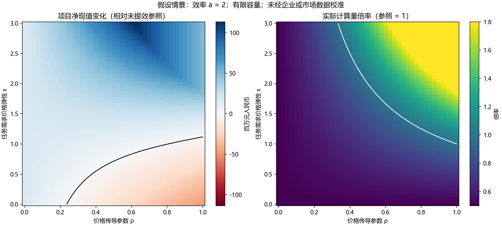

# 大模型技术进步对算力产业链企业价值的影响机制

以DeepSeek为例

> 采用文献综述、技术机制分析、公开财务案例对照与参数情景分析。资料核验截至2026年10月28日，企业比较期为2024—2025年度。文中的项目估值是条件测算，不是上市公司目标价。

## 摘要

大语言模型的技术进步降低了部分工作负载的资源消耗，但单位任务效率提高能否增加算力产业链企业价值，仍取决于需求扩张、价格竞争和资本投入。本文以DeepSeek公开技术为案例，将模型效率、实际计算需求与企业现金流纳入同一分析框架，采用定向文献综述、三类企业财务对照和有限容量项目的情景测算，分析技术收益在产业链中的传导条件。研究首先区分总参数、激活参数、计算量及有效吞吐，进而推导价格传导与需求弹性共同作用下的计算量和收入变化条件。对寒武纪、浪潮信息及优刻得2024—2025年度合并财务数据的描述性比较表明，收入增长、毛利率变化和现金回收并不同步，产业链位置及经营模式不能在分析中被省略。假设项目测算进一步显示，即使同任务效率提高，需求反应较弱与价格充分传导仍可能降低净现值；实际计算量增长也不是项目价值改善的必要条件。本文据此提出，应沿“技术效率—需求与价格—经营现金流—再投资及资产寿命”的路径评价算力投资。案例数据不识别DeepSeek对企业业绩的因果效应，情景参数也未由市场数据估计，结论适用于条件机制解释。

关键词：大语言模型；算力产业链；企业价值；需求弹性；现金流

## Abstract

Advances in large language models can reduce resource use for a given task, but their implications for firms in the computing value chain depend on demand, pricing and reinvestment. Using publicly documented DeepSeek technologies as a case, this study combines a focused literature review, descriptive financial comparisons and a capacity-constrained project model. It distinguishes parameter counts, computational work and effective throughput, and derives separate conditions for changes in computing demand and revenue. Consolidated financial statements for Cambricon, IEIT Systems and UCloud illustrate differences between revenue growth, profitability and cash generation. Explicitly hypothetical scenarios show that higher efficiency may reduce project net present value when price reductions are accompanied by a weak demand response. Conversely, an increase in computational work is not necessary for project value to improve. The analysis connects technical efficiency to demand, prices, cash flows, reinvestment and economic asset life. The firm comparisons do not identify a causal effect of DeepSeek, and the project scenarios are neither market forecasts nor company valuations.

Keywords: large language models; computing value chain; firm value; demand elasticity; cash flow

## 第一章 绪论

### 1.1 研究背景与问题提出

大语言模型发展使计算基础设施成为企业投资的重要对象。训练需要计算设备、状态存储与跨设备协作，推理服务还受到访问量、上下文长度和服务时延约束。与此同时，稀疏模型、低精度计算及系统优化不断改变完成同一任务所需的资源。技术进步由此带来两种可能同时存在的现象：单位任务资源需求下降，以及更高能力目标和更广泛应用推动总工作量增加。[1–5]

金融分析需要进一步回答，资源层面的变化如何转化为企业价值。加速器设计企业通过产品与软件生态实现销售，服务器企业承担系统集成和供应链管理，算力服务企业则需要以设备和机房投入支撑持续服务。三类企业的收入确认、成本结构和资金占用并不相同。即使它们面对相同的技术变化，其现金流及投资回报也可能出现不同方向的变化。

据此，本文提出核心问题：**大模型单位任务效率提高，经过哪些机制和条件影响算力产业链企业的价值？** 该问题包含三个相互衔接的子问题：第一，技术进步改变的是计算工作量、资源容量还是执行效率；第二，效率节省在什么条件下被需求增长抵消，以及这种抵消是否同时意味着收入增加；第三，不同经营模式如何把需求和价格变化转化为现金流及再投资压力。

### 1.2 研究范围与方法

本文的技术案例集中于DeepSeekMoE、V2、V3与原始R1中能够支持资源机制分析的内容。V3使用技术报告第二版，R1使用第一版，以避免把后续版本修订混入历史机制。研究不追踪所有最新模型排名，也不预测某一年度的全球GPU采购总量。

企业案例采用目的性选样，分别选择AI芯片、服务器交付与云服务环节中的寒武纪、浪潮信息和优刻得。选样依据是产品位置差异、公开资料可获得性和合并财务口径的可核对性，不依据股票涨跌或预先期待的结果。三个案例没有统计代表性，也不构成彼此直接可比的估值组。[10–12]

研究由三部分组成。文献综述建立技术与经济解释；案例对照检验“同属算力产业便具有同类经营结果”的简化认识；情景模型控制任务质量与硬件投资，考察效率、价格传导和需求弹性对项目价值的影响。三类证据各有用途：技术报告支持机制，财务报告支持经营事实，数学模型给出假设成立时的条件结论。

### 1.3 研究价值与论证边界

本文的研究价值在于把资源计量与金融计量连接起来。首先，将“模型参数增长”“计算量增长”“设备采购增长”和“企业价值增长”分开，减少跨层推断。其次，将企业的再投资、资产经济寿命和营运资金纳入技术需求分析。最后，以可复算的数据和代码展示结论对参数的依赖，使机制分析能够接受核对和反例检验。

本文不提出新的模型架构或Scaling law，不以三家企业的年度变化识别技术发布的因果效应，也不将假设项目的净现值外推为企业市值。对技术进步的投资解释，应当同时保留成本改善与竞争加剧、需求扩张与资源节省、会计利润与现金投入之间的张力。

## 第二章 文献综述与理论基础

### 2.1 技术进步与计算资源

Kaplan等研究模型损失与参数、数据和计算预算的经验关系；Hoffmann等进一步讨论给定计算预算下参数量与训练数据量的配置。[1–2] 这类研究为解释性能与资源之间的约束提供依据，但其分析对象主要是特定训练条件下的模型表现，不能直接作为全行业设备销量的预测方程。

算法进步还会移动性能—资源关系。Ho等对语言模型的研究区分了达到给定表现所需的计算量与硬件投入，说明固定任务成本与前沿投入是不同度量。[3] 在生命周期层面，Sardana等将预期推理需求纳入优化问题，表明训练成本最优的模型配置未必同时使训练和服务的总成本最低。[13] 推理时计算研究则提示，任务难度和计算预算分配也会改变单次服务所需工作量。[14]

这些研究使金融分析必须明确比较对象：效率应相对于相同任务、质量与服务约束衡量。不同模型的token吞吐不能未经处理就视作同等任务产出；更多推理token也可能代表更复杂的目标，而不是执行效率下降。

### 2.2 通用技术、需求反应与收益归属

Bresnahan与Trajtenberg关于通用目的技术的研究强调技术的广泛应用、持续改进及互补创新。[6] 对算力投资而言，技术能力只有与业务流程、软件、数据和基础设施结合，才可能形成持续需求。技术可用性提升与商业需求兑现之间存在转换过程。

Bessen讨论技术变化的经济后果时突出需求条件的重要性。[7] 本文借鉴的是需求反应可能改变资源节省结果这一思路，而不是把就业研究中的经验参数移植到算力行业。大模型服务的价格弹性、质量偏好和新应用增长仍需要单独测量。

Teece从可占有性和互补资产解释创新收益为何未必完全归属于创新者。[8] 在本文中，芯片工具链、客户认证、系统交付和服务运营可以被视为需要研究的互补能力。它们是否具有稀缺性、是否能够转化为议价权，应通过实际业务证据判断，不能因为企业参与产业链就预设其必然受益。

### 2.3 企业价值与再投资

现金流折现把经营资产价值与未来现金流及风险相联系。采用企业自由现金流时，需要同时考虑税后经营收益、非现金折旧摊销、资本开支和营运资金投入，而不能只依据营业收入判断价值。[9]

常用表达为：

> FCFFₜ = EBITₜ × (1 − τ) + 折旧摊销ₜ − 资本开支ₜ − Δ经营营运资金ₜ。　（1）

该表达要求税、资本化及融资口径一致。实际使用合并现金流量表时，经营现金流与购建长期资产支付现金之差只能作为一个观察指标；它尚未完成租赁、融资分类和非经营项目等调整，不能直接当作严格FCFF。

对算力服务企业，技术进步一方面可以提高既有设备的产出，另一方面也可能加快设备经济淘汰、降低服务价格。会计折旧年限只是费用分摊安排，并不保证设备在相同期间内仍有足够竞争力。因此，资产经济寿命与再投资需求是连接技术变化和企业价值的重要变量。

### 2.4 文献评述

上述文献分别提供性能—资源关系、需求条件、收益分配和价值计量的分析基础。本文把它们组织为一个便于核对的传导框架，不主张既有研究从未讨论过类似关系。当前综述为定向文献综述，未执行穷尽检索，也不使用未经统计的文献筛选数量。文献读取层级和具体用途列于文后复核材料，全文精读范围仍须在定稿前进一步完善。

## 第三章 技术进步影响企业价值的机制

### 3.1 从模型规模到有效产出

总参数描述模型包含的权重规模，激活参数描述一次计算使用的权重路径。MoE通过路由使不同输入调用部分专家，因此总参数与每token计算量不能简单同比换算。[15] 对设备配置而言，全部权重及训练状态需要存储；对运行时间而言，还要考虑内存访问、路由、跨设备通信和负载分布。

注意力状态与数据搬运又形成不同约束。MLA等表示压缩与FlashAttention等执行优化分别涉及状态表示或访存安排，二者不能用同一个“参数节省率”概括。[16–17] 本文据此将资源分为计算工作量、峰值容量、内存搬运、网络通信和持久存储I/O。它们共同影响实际服务能力，理论计算量减少只是其中一种改善。

将固定质量标准任务的**计算工作量节省倍率**记为a，即每任务计算量由c₀降至c₀/a，并保持计算精度的计量口径及硬件执行效率不变。相同硬件在基期的任务容量为K₀；在计算瓶颈占主导、其他约束不变时，情景模型假定容量变为aK₀。只改善调度或内核速度而不减少运算量的进步，应另外计入执行效率，不能并入a后同时声称FLOPs下降。实际部署还须核对内存、通信和服务延迟是否允许吞吐同比提高。

### 3.2 价格传导与需求扩张

设a ≥ 1，单位标准任务的价格为p，价格传导参数为ρ，需求价格弹性为ε。采用如下简化关系：

> p(a) = p₀a−ρ；Q*(a) = Q₀[p(a)/p₀]−ε = Q₀aρε。　（2）

ρ反映效率变化与用户价格变化之间的情景关系；它不是由本文估计的行业参数。Q*为期望任务量，仅考虑价格引起的需求反应。用户收入增长、质量改善、新应用进入和竞争者份额变化暂时固定。标准任务的质量和服务边界保持不变，避免把能力提升与任务数量混成一个变量。

在容量未约束、单任务实际计算随a反比变化时，计算量倍率与收入倍率分别为：

> C(a)/C₀ = aρε−1；R(a)/R₀ = aρ(ε−1)。　（3）

当ρ大于零时，收入随效率上升的条件为ε大于1；实际计算量上升的条件则为ρε大于1。两个门槛不同。若ρ等于零，模型中的价格诱导需求不变，收入也不变，但单位资源节省仍可改善经营收益。若ρ在0与1之间，即使收入增加，也可能不足以抵消每任务计算节省。

上述结论是式（2）的条件推导，不是对当前行业需求弹性的估计。它说明讨论“反弹效应”时，必须指明观察的是任务量、收入还是物理计算工作量。

### 3.3 从收入到经营现金流

将每任务可变成本分为随效率下降的计算成本v_c和暂不变化的其他成本v_o，固定现金成本记为F。容量未约束时：

> EBITDA(a) = p₀Q₀aρ(ε−1) − v_cQ₀aρε−1 − v_oQ₀aρε − F。　（4）

该式将价格、计算成本和非计算成本分别处理。效率节省可能被竞争传导给客户；任务数量增长也可能增加带宽、客服和其他业务支出。在给定固定成本下，需求扩大有助于分摊成本，但低价扩张未必提高单位贡献。若设备扩容还要求追加投资，收入增长更不能直接等价于价值增长。

本文据此形成三个条件命题。**命题一：** 单任务效率提高不充分保证总计算量增加，价格传导与需求弹性共同决定其方向。**命题二：** 计算量增长与企业价值改善具有不同门槛，贡献利润、营运资金及资本投入会改变结果。**命题三：** 相同技术变化在不同产业环节中的影响不同，企业能否保留效率收益取决于产品稀缺性、竞争、合同安排与资产投入。

### 3.4 产业链位置与金融变量

| 环节 | 可能获得收益的路径 | 需要观察的金融变量 | 主要反向机制 |
|---|---|---|---|
| 芯片与软件平台 | 产品能力、模型适配和交付改善推动销售 | 产品结构、毛利、研发、库存/预付、回款 | 价格竞争、迭代成本、供应占款 |
| 服务器与系统交付 | 配置升级和集群建设扩大交付 | 收入及毛利、采购与应收、周转和服务收入 | 高价值器件成本转售、低毛利扩张、验收延后 |
| 算力服务 | 同设备承接更多任务或改善服务质量 | 付费利用、净价格、现金成本、再投资和资产寿命 | 降价超过需求反应、设备闲置、经济淘汰 |

表中关系是待案例和业务数据检验的机制，不是对三家企业收益方向的预设。完整产业链可用于识别研究对象，但不宜把所有配套企业收入相加作为同一市场规模，因为其中包含上下游采购和关联合并。

## 第四章 DeepSeek案例及企业经营对照

### 4.1 技术案例与财务解释

DeepSeek提供模型论文、配置和部分实现，适合观察资源约束如何变化。本文只纳入与财务机制直接相关的技术内容。

| 技术线索 | 资源机制 | 可以提出的金融问题 |
|---|---|---|
| MoE稀疏激活 [15] | 总容量与激活计算分离，增加路由及专家配置问题 | 采购究竟受计算还是容量限制，系统调优能否改善资产产出 |
| MLA [16] | 改变注意力状态表示和缓存资源需求 | 长上下文服务的单位成本与并发容量如何变化 |
| V3低精度及调度 [4] | 改变数值执行与计算/通信安排 | 技术收益是否转化为端到端吞吐，适配成本由谁承担 |
| R1后训练与蒸馏 [5] | 计算分布延伸至采样、更新和不同规模模型 | 前沿训练、较小模型服务和应用侧成本如何重新分配 |

V3报告披露总参数671B、每token激活37B，已经说明总参数与激活规模不是一个概念。报告披露的2.788百万H800 GPU-hours及按每小时2美元计算的训练费用，有特定作业边界并排除了前期研究与消融成本，不能用作公司总研发支出。[4] 本文不据该数字计算上市公司利润，也不将后文a = 2解释为DeepSeek已实现的通用效率倍率。

### 4.2 案例选择与数据处理

寒武纪代表芯片及软件平台，浪潮信息代表服务器与系统交付，优刻得代表云及算力服务。这些名称用于识别经营模式，不表示三家公司处于同一供应合同中，也不表示它们完全依赖DeepSeek。财务比较统一使用2025年报及其中的2024年比较列。[10–12]

数据处理包括三个步骤：核对合并口径及币种；处理比较期间的调整或更正；以原始人民币元数据计算比率后再四舍五入。浪潮信息2024年数据使用同一控制下合并调整后的比较数；优刻得使用2026年6月16日更正后的2025年报。下表毛利率按合并营业收入与营业成本计算，不能替代各公司特定AI产品毛利率。

**表1　三类企业的经营表现。金额单位：亿元人民币；期间：各完整会计年度。**

| 企业 | 年度 | 营业收入 | 毛利率 | 归母净利润 | 经营现金流净额 |
|---|---:|---:|---:|---:|---:|
| 寒武纪 | 2024 | 11.74 | 56.71% | −4.52 | −16.18 |
| 寒武纪 | 2025 | 64.97 | 55.15% | 20.59 | −4.98 |
| 浪潮信息 | 2024调整后 | 1150.29 | 6.90% | 22.94 | 0.75 |
| 浪潮信息 | 2025 | 1647.82 | 4.88% | 24.13 | 54.53 |
| 优刻得 | 2024比较列 | 15.03 | 18.86% | −2.41 | 1.22 |
| 优刻得 | 2025更正后 | 16.99 | 25.73% | −0.74 | 2.43 |

资料来源：寒武纪2025年报第9、26页；浪潮信息2025年报第7、61—63、65页；优刻得2025年报更正后第10—11、46、145、148页。[10–12] 毛利率为本文计算。会计成本分类、研发投入及产品组合不同，不据横向毛利率高低判定技术效率或估值优劣。

### 4.3 经营模式差异的解释

寒武纪2025年收入与归母利润明显增加，但经营现金流仍为负。该组合说明利润确认与现金回收可以不同步，后续分析需要进入采购、库存、预付和客户回款。负经营现金流本身不能证明客户回款失败，也不能单独判断投资价值；它提示仅以营收或净利润增长概括现金兑现仍不充分。[10]

浪潮信息2025年合并收入上升，而合并毛利率下降，经营现金流同时改善。该案例说明销售规模、产品毛利和现金周转是不同维度。系统企业交付规模扩大时，高价值部件的采购与转售可能抬高收入基数，价值分析仍要核对其保留的毛利与营运资金。这里是经营模式解释，不能把毛利率下降归因于DeepSeek技术进步。[11]

优刻得2025年毛利率和经营现金流较比较年度改善，但仍为归母亏损，且购建长期资产现金投入较大。其服务收入包含多种云业务，不能把合并数据等同于一个GPU租赁项目。财务表现为“运营现金有所改善，但持续投入仍需考察”，而不是自动证明单个算力项目已经达到投资回报要求。[12]

### 4.4 再投资与现金覆盖

**表2　长期资产现金投入及其覆盖。金额单位：亿元人民币。**

| 企业 | 年度 | 购建长期资产支付现金K | K／营业收入 | 经营现金流净额 − K |
|---|---:|---:|---:|---:|
| 寒武纪 | 2024 | 3.66 | 31.17% | −19.84 |
| 寒武纪 | 2025 | 5.69 | 8.75% | −10.67 |
| 浪潮信息 | 2024调整后 | 2.48 | 0.22% | −1.73 |
| 浪潮信息 | 2025 | 2.25 | 0.14% | 52.28 |
| 优刻得 | 2024比较列 | 6.23 | 41.48% | −5.01 |
| 优刻得 | 2025更正后 | 7.03 | 41.36% | −4.60 |

K取合并现金流量表“购建固定资产、无形资产和其他长期资产支付的现金”，并非纯AI资本开支；未包含所有租赁、并购和其他投资。最后一列仅为现金覆盖观察值，不是严格FCFF，也不是项目净现值。来源分别为年报第107、66和149页。[10–12]

表2支持的是分析口径上的结论：系统交付企业和资产运营企业的现金投入位置不同，不能给所有“算力企业”套用同一个资本密集度。低K不表示企业没有资金需求，其资金也可能体现在采购和营运资本中。三案例提供机制辨析的事实基础，并未控制宏观景气、国产份额、产品组合、融资和会计变化，因此不承担技术进步因果检验的任务。

## 第五章 有限容量下的项目价值情景分析

### 5.1 模型对象与假设

为把需求机制与财务计量连接起来，本文构造一个提供固定质量标准任务的独立服务项目。它不是对优刻得或其他公司的估值，项目参数均为分析假设，不从表1、表2反推。基期和提效情景采用相同设备投资，以比较同一投资规模在不同技术与市场条件下的价值。

考虑付费服务的容量上限，实际任务量为：

> Q(a) = min{Q₀aρε, aK₀ū}；u(a) = Q(a)/(aK₀)。　（5）

其中ū为最大利用率。利用率由需求和容量共同决定，而不是再被设为一个独立增长因子。进入容量约束后，超过容量的期望需求不计作已完成收入；模型也不自动增加设备。

项目初始投资为I₀，经营年限为n，每年直线折旧I₀/n。各年保持该情景的需求和价格，固定现金成本包含常规维修，经营期间不增加资本开支。现金税按正的息税前利润计提，亏损不产生即时退税，也不追踪亏损结转。营运资金W在期初按收入比例投入，并在项目结束时收回。项目到期停止经营，不设永续终值。

> EBITDA = [p(a) − v_c/a − v_o]Q(a) − F；T = τ max{EBITDA − I₀/n, 0}。　（6）
>
> NPV = −I₀ − W + Σₜ₌₁ⁿ(EBITDA − T)/(1+r)ᵗ + (S_net + W)/(1+r)ⁿ。　（7）

S_net为期末税后残值，基准设为零。式（7）是无融资项目现金流的简化估值，不能直接用来判断存量资产出售价格或上市公司股权价值。折旧影响税款，但不在现金流中重复扣除。

### 5.2 参数设定

**表3　全部为情景假设，未由市场或案例企业校准。**

| 参数 | 设定 | 含义 |
|---|---:|---|
| 初始设备及配套投资I₀ | 6000万元 | 相同投资规模的项目比较 |
| 基期年容量K₀／实际任务量Q₀ | 1亿／5000万标准任务 | 基期利用率50% |
| 最大利用率ū | 90% | 服务容量约束 |
| 基期价格p₀ | 1元／任务 | 固定质量标准任务，非特定API报价 |
| 基期计算可变成本v_c／其他可变成本v_o | 0.30／0.05元每任务 | 只有前者随a反比下降 |
| 年固定现金成本F | 800万元 | 含日常运营维修，未含折旧 |
| 经营年限n／折现率r | 4年／10% | 不作为任何公司的实际寿命或WACC |
| 税率τ／营运资金占收入 | 25%／5% | 不使用特定公司的税收优惠 |
| 期末残值 | 0 | 无永续增长价值 |

参数选择服务于展示机制。效率a = 2不对应DeepSeek的已验证加速倍数；标准任务也不等于一个token或一次任意长度调用。不同质量、输入长度和服务等级的任务必须先标准化，才能在同一模型中计量。

### 5.3 情景结果

**表4　模型计算结果。NPV单位：万元人民币；参照项目NPV为934.08万元。**

| 情景 | a | ρ | ε | 实际计算量倍率 | 利用率 | 项目NPV |
|---|---:|---:|---:|---:|---:|---:|
| 未提效参照 | 1 | 0.8 | 0.6 | 1.000 | 50.00% | 934.08 |
| 提效但需求反应弱 | 2 | 0.8 | 0.6 | 0.697 | 34.87% | −570.25 |
| 计算量恰好抵消 | 2 | 0.8 | 1.25 | 1.000 | 50.00% | 2095.52 |
| 需求反应较强 | 2 | 0.8 | 1.8 | 1.357 | 67.83% | 5236.76 |
| 价格充分传导且需求弱 | 2 | 1.0 | 0.6 | 0.758 | 37.89% | −1389.02 |
| 期望需求触及容量上限 | 2 | 0.8 | 3.0 | 1.800 | 90.00% | 9142.52 |

第一，在需求反应弱的情景中，服务任务量虽有所增加，却未同比吸收效率释放的容量，利用率随之下降。价格降低和非计算成本共同作用，使NPV由正转负。这个结果并不是说效率改进有害，而是说明效率收益与竞争性降价必须共同评估。

第二，ρε = 1时，实际计算量保持不变，但项目NPV高于参照。其原因在于价格传导、可变成本和任务规模的组合改变了经营贡献。由此可见，计算量增长不是价值改善的必要条件。

第三，需求反应足够强时，任务增长可以改善项目现金流；但当容量达到上限，继续把所有期望需求计为收入会高估价值。容量约束同样说明，市场需求增长和可交付收入之间还存在设备、网络与服务能力的限制。

**图1　假设情景的联合敏感性。** 横轴为价格传导参数，纵轴为需求弹性。左图黑线为相对参照的NPV变化等于零，右图白线为实际计算量倍率等于1。两条边界不重合。颜色代表模型结果，不是概率、置信区间或企业预测；其余参数同表3。

### 5.4 资产寿命与折现率

对“提效但需求反应弱”情景改变经济寿命和折现率，可以进一步观察结论对财务参数的依赖。寿命变化时同步改变直线折旧，保持初始投资和经营条件不变。

**表5　经济寿命与折现率敏感性。NPV单位：万元人民币。**

| 年限 | 折现率 | 未提效项目NPV | 提效项目NPV | 提效后变化 |
|---|---:|---:|---:|---:|
| 3年 | 10% | −249.15 | −1547.10 | −1297.94 |
| 4年 | 8% | 1261.84 | −313.30 | −1575.14 |
| 4年 | 10% | 934.08 | −570.25 | −1504.33 |
| 4年 | 12% | 629.01 | −809.41 | −1438.42 |
| 5年 | 10% | 2008.04 | 209.03 | −1799.00 |

在上述参数组中，较长寿命可使提效项目的绝对NPV转正，但其价值仍低于对应未提效项目。这说明“项目可以投资”和“技术变化提高项目价值”是不同判断。经济寿命不能仅从会计折旧政策推定，折现率也需要与现金流风险匹配。

### 5.5 模型适用范围

模型中，价格传导和弹性被外生设定，未估计竞争均衡、客户质量选择或市场份额迁移。实际单位成本包含不随计算量同比变化的多种支出，且性能提升可能被内存和互联约束削弱。设备更新、追加投资、通胀、税收优惠和亏损结转也可能改变结果。因此，表4和表5用于识别条件及敏感方向，不能作为企业经营预测。

若开展后续验证，应获得同任务质量的设备有效吞吐、净价格、付费任务量和成本数据，先校准效率与价格关系，再估计需求反应。财务报表能约束合并经营结果，但通常不足以单独识别一项模型技术的价格弹性。将合并年报直接拟合成单一GPU项目，会产生口径错误。

## 第六章 研究结论与局限

### 6.1 主要结论

本文围绕大模型技术进步与算力产业链企业价值的关系，形成三个条件性结论。

首先，固定任务效率提高与总计算量增长可以同时发生，也可以方向相反。在未达到容量上限的简化模型中，实际计算量增长取决于ρε是否大于1，而收入增长具有不同条件。Scaling law本身不提供需求弹性、价格竞争或企业利润参数，因而不能独立推出投资收益。

其次，价值分析需要进入经营模式和现金流。三家企业的公开数据表明，收入、毛利率、会计利润和现金回收存在不同组合，长期资产现金投入也有显著差异。这些事实支持分别研究芯片平台、系统交付和服务运营，但不支持从年度业绩变化直接识别DeepSeek的因果影响。

最后，技术收益能否被投资者保留，取决于需求、价格传导、非计算成本、营运资金和资产经济寿命。假设项目中，效率提高可以伴随NPV下降，也可以在计算量不增加时改善NPV。以“算力需求是否增长”作为唯一投资判断，遗漏了企业保留收益和承担再投资的过程。

### 6.2 金融分析启示

企业分析可以从三个可观察问题展开：服务是否以同等质量完成；降价后是否带来足够的付费需求；新增现金贡献能否覆盖投入及风险。芯片与系统企业还需要把收入增长拆成数量、配置、价格和供货份额，服务企业需要把设备在线率与付费使用分开。对资产运营项目，使用有限经济寿命和现金流敏感性，有助于避免用长期增长假设掩盖设备迭代风险。

这些启示不能替代个别公司的完整估值。本文没有测算股票目标价，也未据模型结果对企业进行投资排序。企业价值最终需要以其业务分部、财务口径、竞争地位和实际投资计划为基础。

### 6.3 局限与后续研究

研究局限包括：定向综述尚非系统综述；案例仅覆盖三个经营模式且比较期间较短；合并财务数据无法完整区分AI与非AI、国产与海外硬件；技术材料中的作者实验尚未独立复现；情景参数未经市场估计。以上限制决定本文的贡献主要是机制组织、口径澄清与可复核条件计算。

后续研究可沿两个方向推进：一是取得任务级价格与使用数据，识别需求反应并检验模型边界；二是在事先界定事件和样本的前提下研究技术发布的股票市场反应。后者衡量市场预期变化，仍需处理同期信息、交易日和混杂事件，不能与本文的物理资源需求或现金流测算混为一谈。

## 参考文献

1. KAPLAN J, et al. Scaling Laws for Neural Language Models[EB/OL]. 2020. [arXiv:2001.08361](https://arxiv.org/abs/2001.08361).
2. HOFFMANN J, et al. Training Compute-Optimal Large Language Models[EB/OL]. 2022. [arXiv:2203.15556](https://arxiv.org/abs/2203.15556).
3. HO A, et al. Algorithmic progress in language models[EB/OL]. 2024. [arXiv:2403.05812](https://arxiv.org/abs/2403.05812).
4. DEEPSEEK-AI. DeepSeek-V3 Technical Report[EB/OL]. 2024，采用2025-02-18修订的v2. [arXiv:2412.19437v2](https://arxiv.org/html/2412.19437v2).
5. DEEPSEEK-AI. DeepSeek-R1: Incentivizing Reasoning Capability in LLMs via Reinforcement Learning[EB/OL]. 2025，采用v1. [arXiv:2501.12948v1](https://arxiv.org/html/2501.12948v1).
6. BRESNAHAN T F, TRAJTENBERG M. General Purpose Technologies “Engines of Growth?”[R]. NBER Working Paper 4148, 1992. [doi:10.3386/w4148](https://www.nber.org/papers/w4148).
7. BESSEN J. AI and Jobs: the role of demand[R]. NBER Working Paper 24235, 2018. [doi:10.3386/w24235](https://www.nber.org/papers/w24235).
8. TEECE D J. Profiting from technological innovation: Implications for integration, collaboration, licensing and public policy[J]. Research Policy, 1986, 15(6): 285–305. [doi:10.1016/0048-7333(86)90027-2](https://www.sciencedirect.com/science/article/pii/0048733386900272).
9. DAMODARAN A. An Introduction to Valuation[EB/OL]. New York University，发布日期未注明，访问2026-10-28. [课程资料](https://pages.stern.nyu.edu/~adamodar/New_Home_Page/background/valintro.htm).
10. 中科寒武纪科技股份有限公司. 2025年年度报告[R]. 2026-03-13. [公司披露](https://static.cninfo.com.cn/finalpage/2026-03-13/1225007336.PDF).
11. 浪潮电子信息产业股份有限公司. 2025年年度报告[R]. 2026-04-11. [公司披露](https://static.cninfo.com.cn/finalpage/2026-04-11/1225096638.PDF).
12. 优刻得科技股份有限公司. 2025年年度报告 更正后[R]. 2026-06-16. [公司披露](https://static.cninfo.com.cn/finalpage/2026-06-16/1225371524.PDF).
13. SARDANA N, et al. Beyond Chinchilla-Optimal: Accounting for Inference in Language Model Scaling Laws[C]. ICML, PMLR 235, 2024. [会议论文](https://proceedings.mlr.press/v235/sardana24a.html).
14. SNELL C, et al. Scaling LLM Test-Time Compute Optimally can be More Effective than Scaling Model Parameters[EB/OL]. 2024. [arXiv:2408.03314](https://arxiv.org/abs/2408.03314).
15. DAI D, et al. DeepSeekMoE: Towards Ultimate Expert Specialization in Mixture-of-Experts Language Models[EB/OL]. 2024. [arXiv:2401.06066](https://arxiv.org/abs/2401.06066).
16. DEEPSEEK-AI. DeepSeek-V2: A Strong, Economical, and Efficient Mixture-of-Experts Language Model[EB/OL]. 2024. [arXiv:2405.04434](https://arxiv.org/abs/2405.04434).
17. DAO T, et al. FlashAttention: Fast and Memory-Efficient Exact Attention with IO-Awareness[EB/OL]. 2022. [arXiv:2205.14135](https://arxiv.org/abs/2205.14135).

## 附录 数据与复核材料

财务数据、情景假设和计算结果分别保存，避免把假设混入公司披露。财报原件、页码、下载链接及SHA-256记录位于本地参考财报目录；学术文献读取深度逐项登记。经济文献[6–8]本轮主要核验官方摘要/书目信息，正文精读尚需补齐，本文仅使用其摘要所支持的理论定位。

- <a :href="dataUrl" download="金融案例数据.json">案例原始数据与财报页码</a>
- <a :href="parameterUrl" download="金融机制参数.json">项目情景参数及全部假设</a>
- <a :href="resultUrl" download="金融机制结果.json">财务指标、项目结果与敏感性数据</a>
- <a :href="scriptUrl" download="金融机制计算.py">可复算Python脚本</a>
- <a :href="bibliographyUrl" download="金融论文参考文献.bib">参考文献BibTeX</a>
- <a :href="evidenceUrl" download="金融论文证据台账.json">证据台账与读取范围</a>

计算命令：`python 金融机制计算.py`；加`--plots`重新生成图1，绘图需要Matplotlib。原始公司数据使用人民币元，表1—2转换为亿元；项目程序内部单位为百万元，表3—5按标注转换。代码检验包括效率不变时结果一致、容量上限、ρε等于1时的计算量恒等式和NPV的独立年金计算。

研究范围、数据口径和后续验证安排见[研究方案](研究方案.md)。
