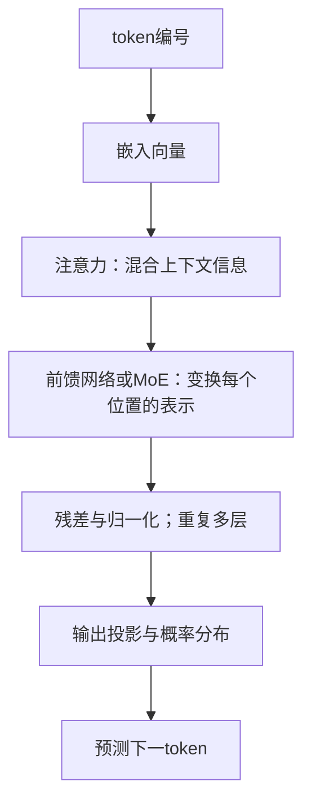

# 算力如何参与LLM训练与推理：以DeepSeek公开技术为参照

研究日期：2026-10-25。用途：综述＋机制分析论文的调研底稿与入门读物。本文是定向文献综述，尚未完成穷尽检索、同行评审或独立GPU复现实验。

> **2026-10-28研究主线：** 当前研究主线见[大模型技术进步对算力产业链企业价值的影响机制](大模型技术进步对算力产业链企业价值的影响机制.md)与[研究方案](研究方案.md)。本页保留为技术背景资料，正式正文围绕企业价值、财务案例和条件情景组织。

> **2026-10-27补充：[相关ETF与主动基金布局](相关ETF与主动基金布局.md)**。附录按芯片、互联、服务器、云与应用映射基金，并核对已披露持仓。投资布局作为产业观察，不作为本文技术机制有效性的证据。

> **新增研究课题：[Scaling law与未来算力预估](Scaling%20law与未来算力预估.md)**。将技术机制延伸到2027—2030年计算需求的方法研究，附可重算情景。当前情景未经市场数据校准，不作为确定预测。

## 1. 论文应回答什么

> **2026-10-28产业分工补充：** [国产算力分别负责什么](../../../产业链研究/国产算力替代产业/2026-09-01/国产算力替代产业.md#compute-roles)沿着一次MoE训练更新，解释芯片、CPU、内存、网络、软件、系统及运营的职责；[主要公司分工](../../../产业链研究/国产算力替代产业/2026-09-01/国产算力替代产业.md#company-roles)用于理解技术如何落到产品。案例是通用机制映射，不是DeepSeek的实际采购关系。

建议题目：**《面向大语言模型的计算、存储与通信协同优化：基于DeepSeek公开技术的机制综述》**。

核心问题：模型参数、训练数据与推理长度增长后，成本如何分别落到浮点运算、显存容量、数据搬运、网络通信和实际运行时间？DeepSeek的不同技术分别改变哪一项，代价又是什么？

本文主张的分析框架是：**模型架构决定需要执行的运算和保存的状态；训练与推理算法决定执行多少次；系统实现决定这些工作能多快、以多少硬件完成。** 这是一种组织文献的方法，不声称是新提出的物理定律。

“Scaling law仍有效”只回答部分性能—资源关系，不能单独推导未来GPU销量或产业增长。论文应把技术机制、作者实验结果与市场预测分开。主要教学案例使用V3与原始R1流程，V3.2/V4/V4.1单列演进。[R02][R06][R07]

## 2. 先认识训练里真正存在的东西

| 对象 | 是什么 | 什么时候变化 | 占用什么资源 |
|---|---|---|---|
| 训练数据/token | 分词后的整数序列；一个token不固定等于一个汉字或单词 | 数据批次不断切换 | 数据读取、CPU处理、传输 |
| 参数/权重 | 网络中的可学习矩阵与向量 | 训练更新；常规推理保持固定 | 权重存储、矩阵乘法 |
| 激活值 | 当前输入在网络各层产生的中间结果 | 每次前向都重新计算 | 训练显存、反向所需中间状态 |
| 梯度 | 损失对参数的导数 | 反向传播计算，可累积多个微批次 | 显存、反向运算、同步通信 |
| 优化器状态 | 如Adam类方法的历史一阶、二阶统计 | 随更新步变化 | 额外存储与更新开销 |
| KV cache | 推理时保存历史上下文对应的注意力状态 | 随上下文累积或压缩/淘汰 | 推理显存、带宽；不是模型权重 |
| Checkpoint | 某个训练时刻的权重及可选优化器/调度状态 | 定期保存 | 存储容量、检查点I/O |

必须区分“激活参数”和“激活值”：前者是这次参与计算的权重数量，后者是计算产生的中间张量。它们不是一个东西。

## 3. 一次预训练更新究竟做什么

### 3.1 把文本变成预测任务

假设文本被示意性地切成 `[今天, 天气, 很, 好]`。实际分词器未必这样切。

```text
输入位置： 今天       天气       很
预测目标： 天气       很         好
```

模型在每个位置输出词表上的概率分布。因果掩码保证当前位置不能偷看后面的答案。标签直接来自原始文本向后移一位，因此预训练通常不需要人为为每个位置写答案。

在训练时，整段正确历史已经给定，可以在一次前向中并行计算多个位置的预测，这通常称为teacher forcing。它与推理时必须等上一个新token生成后才能继续的情形不同。长文本并行处理不等于取消因果掩码。[R01]

### 3.2 从预测到修改参数


1. **前向传播**：把token映射成向量，经过多层网络，输出下一token的概率。
2. **计算损失**：常见目标是负对数似然；真实下一个token的概率越小，损失越大。
3. **反向传播**：用链式法则计算每个可训练参数对损失的影响。它在求导，不是在把模型的文字答案“倒着读”。
4. **累积/同步梯度**：多个微批次或多个设备对更新作出贡献；具体通信取决于并行方案。
5. **更新权重**：优化器依据梯度调整参数；再处理下一批数据。[R22]

最简单的表达为：

$$
\mathcal L=-\frac{1}{|\mathcal T|}\sum_{t\in\mathcal T}\log p_\theta(x_{t+1}\mid x_{\le t}),\qquad
\theta_{new}=\theta-\eta\nabla_\theta\mathcal L.
$$

这里theta是所有可训练参数，eta是学习率；第二式只是普通梯度下降的教学形式，实际大模型常用带状态和调度的优化器。集合T只包含本次计入损失的位置。

**一个数字例子：** 只考虑一个二分类参数w，正确标签为1，预测概率p=sigmoid(w)。从w=0开始，p=0.5，损失约0.693；梯度为p−1=−0.5。若学习率0.1，则w更新到0.05，p约0.5125，损失约0.668。训练就是在非常多的参数、样本和步骤上进行这种求导与更新。这个例子不代表LLM能力测量。

### 3.3 几个容易误解的词

- **Step**：通常指一次优化器更新；梯度累积时可能包含多个微批次。
- **Batch**：一组样本；真正决定很多算量的是其中有效token总数，而不只是样本条数。
- **Epoch**：遍历一遍数据。大模型文献也常用总训练token数和steps描述预算。
- **Loss下降**：表示预测分布更符合目标；是否改善事实性、推理或真实任务，需要另外评测。
- **“学过”数据**：参数受其梯度影响，不等于逐字存入一个可检索数据库。

## 4. 预训练、SFT、RL和蒸馏分别在做什么

| 阶段 | 输入/信号 | 是否修改权重 | 计算主要花在哪里 |
|---|---|---|---|
| 预训练 | 大量文本/代码/其他模态数据的预测目标 | 是 | 海量前向、反向和同步 |
| SFT监督微调 | 高质量问题—回答或轨迹示例 | 是 | 与监督训练相似的梯度更新；常只在回答区间计损失 |
| RL后训练 | 模型采样的回答＋奖励/验证结果 | 是 | 回答生成、奖励评估、策略更新；生成部分也可能很贵 |
| 蒸馏 | 教师的回答、概率或轨迹等监督信号 | 通常更新学生；教师通常固定 | 教师生成/评分＋学生训练 |
| 常规推理 | 用户输入 | 通常否 | 前向计算、KV读写、路由与通信 |

**R1案例：** 原始R1-Zero以已经预训练的V3-Base为起点，直接做RL；“没有前置SFT”不等于“没有预训练”。R1引入冷启动SFT、推理导向RL、筛选样本后的SFT和进一步RL。GRPO通过同一问题的一组候选回报形成相对优势信号，仍需要反向更新策略。它减少了某些传统RL实现中的价值模型负担，不意味着训练不需要梯度。[R07]

流程还有一个容易漏掉的细节：原始报告在推理RL后采样并筛选训练数据，再用整理出的推理/非推理数据对V3-Base做SFT。因此不应把整个流程画成同一个checkpoint从头到尾无分支连续训练。[R07]

R1-Distill-Qwen/Llama是不同底座的小模型。对它们做单卡微调，不能据此宣称复现了671B MoE模型的训练系统。蒸馏学生成本、教师生成成本和教师最初训练成本，应分开计账。[R24]

## 5. 当前LLM架构应怎样理解

主流生成式语言模型常以因果Transformer为基础；当前还存在MoE、不同注意力、混合序列模块、多模态前端等路线。以下是用于理解V3的示意，不宣称覆盖全部模型。



- **注意力（Attention）**：使一个位置从上下文其他位置取得信息。Q/K/V分别参与匹配与信息聚合；它们是张量变换，不是数据库查询字段。
- **前馈网络（FFN）**：对每个位置的表示进行非线性变换，通常包含大矩阵乘法。
- **残差/归一化**：帮助深层网络保持数值和优化稳定性；不会直接提供新的训练样本。
- **MoE**：在部分FFN层放置多个专家，路由器为token选择少数专家。专家通常没有人为指定的学科名称。
- **多模态**：把图像/声音等转换为模型能处理的表示；数据、编码器和训练目标都可能改变，不能直接套用纯文本token的成本。[R01][R04]

## 6. 以V3为例看模型架构

V3作者报告披露的基本规模为671B总参数、37B每token激活参数、14.8T预训练token。B表示十亿、T表示万亿。这三项分别描述模型容量、活跃计算路径和处理数据总量，不能互相替代。[R06]

### 6.1 DeepSeekMoE：扩大容量与稀疏计算

V3官方推理配置显示：61层，前3层采用稠密FFN；其余MoE层含256个路由专家、1个共享专家，每token选择8个路由专家。配置中的“8”不包含共享专家；共享层、注意力等也会计算，不能用8/256直接乘总参数来求实际激活参数。[R08]

机制可写为：

$$y=f_{shared}(x)+\sum_{i\in TopK(g(x))}a_i(x)f_i(x).$$

这个示意省略了残差与具体归一化。路由决定token去哪些专家，combine再合并输出。多个token可以去不同专家，因此一个大batch可能覆盖很多甚至全部专家。路由不均会让少数GPU繁忙、其余等待；训练中的路由均衡与部署时专家放置均衡也不是同一个问题。[R04][R14]

### 6.2 MLA：主要解决注意力状态的存储与搬运

Multi-head Latent Attention以低秩潜在表示压缩部分K/V状态，减少缓存与相关搬运需求。它改的是注意力表示和实现；与MoE节省FFN计算属于不同方向。分析时必须区分训练激活、推理KV cache和参数权重，不能用“显存下降”一词混写。[R05]

FlashMLA是实现注意力运算的高性能kernel库；MLA是模型机制。类似地，FlashAttention的经典价值是减少注意力计算过程中的HBM读写，并不把所有精确注意力运算自动变成线性复杂度。[R13][R23]

### 6.3 MTP：训练目标与推理解码的连接

Multi-Token Prediction增加对后续多个token的辅助预测目标，给训练增加监督信号和额外计算。在合适实现中，这些模块可用于推测解码；推测结果仍需要验证，不能理解为任意长答案一次并行生成。[R06]

## 7. 系统怎样让训练真正跑起来

| 技术层 | 机制 | 主要改善什么 | 不能直接推出什么 |
|---|---|---|---|
| 混合精度 | 部分运算使用低精度，同时保留必要的高精度累积/状态 | 吞吐、存储、带宽 | 不能把“FP8训练”理解为所有张量都是1字节 |
| DeepGEMM | 优化矩阵乘法及相关算子 | 实际kernel效率 | kernel峰值不等于整模型训练吞吐 |
| DeepEP | 优化专家分发与合并等通信 | 通信时间、重叠空间 | 通信库不增加模型参数容量或推理能力本身 |
| DualPipe | 调度前向/反向及通信，减少流水线空闲 | 时间利用率 | 不能假定任意硬件/批量都完全隐藏通信 |
| EPLB | 复制热点专家、调整专家放置 | 设备负载均衡 | 复制专家不等于增加新的独立学习参数 |

上述软件层各有独立目标，不能把某个库的加速百分比相加得出端到端加速。[R10-R14]

四类常用并行方式：

- **数据并行DP**：不同设备处理不同数据，协调梯度或分片状态。
- **张量并行TP**：把单个大矩阵运算切给多个设备。
- **流水线并行PP**：把不同网络层放在不同设备，分微批次流水执行。
- **专家并行EP**：把不同专家放在不同设备，需要按路由发送token表示。

分片与重计算是一种取舍：把状态分布到更多设备或重新计算部分激活，可以减少单卡显存压力，但会增加通信或计算。真实训练时长由关键路径决定；不能将理论峰值直接乘卡数当实际吞吐。[R10][R12]

**版本复现风险已核实：** 截至本次访问，FlashMLA main明确写了2026-09-30兼容性变更，并链接旧提交 `ba89a3466e9470ad08ab39738d4e7bb66989e1e7`。DeepEP main也显示API和依赖已演进。2025年V3/R1技术文章不能直接搭配2026年所有库的main分支运行。正式论文应固定模型revision、仓库commit、CUDA/PyTorch/驱动和硬件配置。[R12][R13]

## 8. 推理过程中发生什么

**2026-10-25补核：** 初版调研遗漏了近期公开的DeepInfer。现将其纳入V4.1推理框架的核心案例；V3/R1在线系统说明保留为历史设计参照。框架开源提供了更完整的引擎观察入口，但需按发布范围区分引擎与完整在线服务。[R26]

### 8.1 Prefill：处理用户已经给出的输入

系统并行处理提示词，得到注意力状态并准备生成。长输入时算量、缓存构建和搬运可能都很重。通常用首token延迟TTFT衡量用户等多久开始看到回答。

### 8.2 Decode：逐步生成新token

常规自回归生成中，每次产生下一个token，读取已有KV状态，再把新状态加入缓存。生成长度增加会带来更多步骤，历史上下文增长也影响注意力成本。低批量decode常受带宽约束，但高批量MoE专家矩阵计算也可能形成计算瓶颈，不能把所有decode都称为“只受显存限制”。

官方V3/R1在线系统采用Prefill/Decode分离，并配合跨节点EP、计算通信重叠与负载均衡。它展示的是系统设计案例，不能把公布的节点配置当所有场景的最小部署要求。[R15]

### 8.3 长思考与推测解码

- **推理时扩展**：多生成候选、搜索、校验或更长推理，通常不改权重，但可能提高任务成功率，也消耗额外计算。[R21]
- **推测解码**：先提出若干候选token，由目标模型验证可接受部分；收益取决于接受率、批量和验证开销，不等于每次多写token就一定更快。[R06]
- **KV压缩/缓存复用**：减轻状态存储和搬运，需区分精确复用、量化误差与有损压缩，评测质量是否受损。[R05][R18]

### 8.4 DeepInfer：从底层组件到推理引擎

DeepInfer官方README将其定位为支撑DeepSeek生产服务的高性能推理框架，本次公开范围是离线推理及规模化服务的核心能力。当前列出的模型为V4.1-Flash，硬件为NVIDIA SM100与Ascend 950，采用Apache-2.0许可证。它整合了此前分别公开的计算、注意力和通信组件，并提供调度、并行和采样等运行时能力。[R26]

| 层次 | 项目 | 本论文应观察什么 |
|---|---|---|
| 模型 | V4.1-Flash权重与结构 | 计算图、注意力、MoE及缓存表示 |
| 输入输出适配 | deepseek-recipe | 请求、对话、提示词/token及输出格式的转换 |
| 推理引擎 | DeepInfer | 工作如何形成批次、调度、采样并在设备上执行 |
| 底层算子/通信 | FlashMLA、DeepGEMM、DeepEP等 | 具体运算与数据传输怎样实现 |
| 完整在线服务 | 缓存系统、阶段分离及跨副本调度等 | 引擎之外仍需的系统能力 |

README列出了Attention DP/平衡CP、MoE EP与EPLB、DSpark及置信度调度验证、SWA bounded replay、异步调度等。它还明确列出本次发布未包含完整KV缓存系统、VE/Prefill/Decode分离部署及跨DP副本的负载均衡；“未包含完整KV缓存系统”不等于模型完全不使用KV缓存。部分引擎功能已具备，也不等于完整部署系统已经全部公开。[R26]

deepseek-recipe承担格式转换与token编解码适配；其README说明模型推理、工具执行和HTTP传输由调用者提供。因此不能将它当作模型执行引擎或独立完整服务。[R27]

### 8.5 DeepInfer基准口径：综述不能只引用吞吐图

官方示例文档分别定义prefill吞吐、decode steps/s和折算token吞吐。文档中的decode throughput采用草稿**全接受**计数，绘图又可传入接受率缩放；论文应区分该计数/估计与实际验证后输出token吞吐。另需区分GPU侧阶段耗时与客户端端到端时延。[R28]

主README的展示基准分别使用4张SM100做prefill、64张做decode，且各自位于一个scale-up域；这不是“运行项目最少需要这些卡”的通用要求。归纳作者结果时应同时记录模型revision、并行规模、上下文、缓存命中、batch、推测长度和接受率口径。[R26][R28]

**论文调整：** 推理章节采用“V3/R1历史设计 → V4.1结构 → DeepInfer引擎与公开范围 → 基准计量”这条线。以DeepInfer解释组件如何组成系统，同时保留对训练架构与推理架构的区分。本轮只核对官方材料，未安装或运行该框架。

## 9. 新版本演进：哪些机制发生了变化

| 版本/材料 | 本轮核实的变化 | 在本文中的位置 |
|---|---|---|
| V2（2024） | MLA与DeepSeekMoE的组合 | 注意力与FFN两条优化轴的起点 |
| V3（2024发布，报告v2为2025） | MoE/MLA基础上的训练目标、均衡与系统优化 | 主教学案例 |
| R1（2025原始流程） | 基于V3-Base的后训练与蒸馏 | 学习算法，而非另一个基础骨干 |
| V3.2（2025） | DSA稀疏注意力、RL和Agent训练数据 | 长上下文与后训练演进 |
| V4（2026报告） | CSA/HCA混合注意力、mHC连接、Muon优化器 | 同时改变架构和优化，不能只用参数量解释结果 |
| V4.1-Flash（2026报告） | CED、CSA2及跨层KV复用/低精度缓存；prefill/decode激活规模不对称 | “一个激活参数数字描述全部推理”的反例 |

V4报告的CSA/HCA分别强调压缩后的选择性读取与较强压缩路径，mHC涉及残差/连接结构，Muon属于优化器；不能把这些统称为“推理框架”。Hugging Face实现文档可辅助理解计算模块，但它不代表DeepSeek内部生产系统的完整实现。[R16-R18][R25]

V4.1论文摘要使用“552B backbone参数”，并给出prefill 8B、decode 16B的激活口径。**backbone不应不加说明地等同包含所有组件的总参数**；本稿不据模型文件总量反推唯一参数数目，也不将这几个值与其他版本直接当同口径排名。[R18]

V4 arXiv页面本轮显示的提交日期与编号月份不一致；引用保留稳定标识2606.19348并标注年份2026，首发日暂不作为时间序列证据。正式投稿前需核对作者原PDF版本与日期。

## 10. 怎样把机制转化为资源模型

### 10.1 定义量纲

| 符号 | 含义 | 单位 |
|---|---|---|
| N_total | 模型全部参数数目 | parameters |
| N_active | 每token参与主要计算的参数数目 | parameters/token路径口径 |
| D | 训练所处理的token总数，含重复与应计生成 | tokens |
| C | 总运算量 | FLOP |
| P_eff | 实际有效计算速率 | FLOP/s |
| T | 运行时间 | 秒或小时 |
| q | 每参数存储字节数 | bytes/parameter |

FLOP是工作总量，FLOP/s是速度；GPU-hours是设备数乘时间，既不等于FLOP，也不能脱离GPU型号比较。

### 10.2 计算：近似式有适用范围

对以大矩阵乘法为主要开销的训练，可用下式做一阶估算：

$$C_{train}\approx6N_{active}D+C_{attention}+C_{router}+C_{aux}+C_{recompute}+C_{optimizer}.$$

6的来源是一次前向约2ND、反向两类主要矩阵乘法约4ND的粗略计账，不是所有架构通用常数。使用时应明确N_active是否排除了需要单列的attention、embedding/head等部分，避免重复计数；也可直接逐算子统计FLOPs，后者更适合正式结果。MTP、RL采样、长上下文、重计算会改变额外项。[R02][R20]

粗略时间关系`T≈C/P_eff`只适用于已把通信、等待等体现在有效速率里的计量。更细的分解应记录计算、数据搬运、通信与空闲重叠后的关键路径，不能把可重叠时间简单相加。

### 10.3 存储：总参数只解释其中一项

推理权重存储约为`M_weights=N_total*q`；另有量化元数据、KV cache、工作区及副本。训练还需要梯度、优化器状态、保存的激活与通信缓冲。优化器状态可以分片或卸载，不能把单卡显存直接等同完整模型状态。

普通GQA类KV缓存的示意式为`M_KV≈2*B*S*L*h_kv*d_head*q_kv`，其中2表示K和V。MLA/CSA/跨层共享使用不同缓存表示，必须按实际保存张量重算，不能直接沿用这一公式。[R05][R18]

### 10.4 通信：不要用总参数倍率直接外推

EP的dispatch/combine主要搬运token表示，而非每个token发送完整专家权重。通信受token数量、top-k、隐藏维度、专家布局、网络拓扑与副本策略影响。固定top-k时增加专家数，不一定同比增加逻辑字节数，但可能降低每专家batch、改变跨机比例和等待时间。[R12][R14][R15]

**示意：** 一个MoE层的每专家平均token分配数约为`T_batch*k/E`。固定batch和k，把专家数E翻倍，平均分到每个专家的token约减半。这不是实际路由均衡保证；它提示矩阵运算可能变小、效率可能下降，需要系统实测。

### 10.5 同精度、同任务的算术对照

| 情景（假设） | 总参数 | 激活参数 | D | 主要参数矩阵训练FLOPs倍率 | 权重字节倍率 |
|---|---:|---:|---:|---:|---:|
| A | 1T | 50B | 1T token | 1 | 1 |
| B：只扩大专家库 | 2T | 50B | 1T token | 1 | 2 |
| C：激活路径变大 | 2T | 100B | 1T token | 2 | 2 |
| D：激活与数据都扩大 | 2T | 100B | 2T token | 4 | 2 |

这是机制隔离的算术例子，不声称相同训练token足以把新增专家训练到相同质量，也不预测时延、GPU采购量或模型能力。

### 10.6 Scaling law在框架中的位置

经典经验式可写成`L(N,D)≈E+A/N^α+B/D^β`，配合训练计算预算约束选择参数和数据规模。这里L是特定评测分布上的预测损失；系数由实验拟合，架构、数据质量和训练配方变化后需要重新校准。对MoE还需考虑激活参数、专家数、内存约束等，不能直接把稠密公式中的N换成总参数就结束。[R02][R03][R20]

当服务调用量进入优化目标，最小训练损失的配置不一定具有最低生命周期成本。较小模型训练更多数据后，可能用更便宜的推理摊销额外训练投入；这一结果依赖质量目标和服务量假设。[R19]

## 11. DeepSeek训练成本数字应该怎样使用

V3报告表1披露：预训练2.664M、上下文扩展0.119M、后训练0.005M H800 GPU-hours，合计2.788M；美元数采用2美元/GPU-hour的假设，得到5.576M美元。报告明确排除前期研究与架构/算法/数据消融成本。[R06]

因此这些数字属于特定版本官方训练作业的作者披露；不能写成公司全部研发支出，也不是R1独立训练成本。本文不将它与不同GPU、不同任务或不同费用边界的其他模型金额直接排名。

公开权重、推理示例、部分kernel和技术报告提供了很好的研究入口，但没有自动补齐全部训练数据、实验失败记录、内部调度和端到端成本。论文应区分“机制公开”“组件可复现”和“完整训练可复现”。[R09][R10][R12]

## 12. 综述可以形成哪些可论证结论

1. **参数规模不是单独充分的资源指标。** 总参数、激活路径、上下文状态和任务量分别驱动不同资源。
2. **稀疏化重新分配瓶颈。** MoE降低每token稠密计算比例，但会引入路由、专家状态和并行通信问题。
3. **注意力优化与MoE解决不同问题。** KV压缩、稀疏注意力和FFN稀疏化不能用一个“算力节省率”替代。
4. **架构收益须经过系统实现才能兑现。** 计算减少不保证时间同幅下降；带宽、网络和负载会改变结果。
5. **后训练与推理把计算预算延伸到新阶段。** 一次大预训练的成本并不能概括完整模型生命周期。

这些结论是现有文献的组织与机制归纳，不能直接作为“原创算法贡献”。新颖性需要通过检索同主题综述与差异化分析再确认。

## 13. 论文写作结构与阅读路线

推荐论文结构：引言与问题定义 → 文献选择方法 → 训练与资源计量基础 → DeepSeek架构演进 → 训练系统 → 推理系统 → 机制对照与边界 → 研究缺口与结论。详细提纲与证据规则见[研究方案](研究方案.md)。

阅读顺序：先读本文第2—4节和PyTorch更新循环[R22]，再读Transformer[R01]、DeepSeekMoE/V2[R04-R05]，之后读V3架构及系统章节[R06]、R1方法章节[R07]和官方推理说明[R15]，最后读V3.2/V4/V4.1[R16-R18]。不要从最新GPU kernel源码开始补训练基础。

## 14. 本轮完成范围与缺口

- 已完成：机制入门、版本区分、源码配置交叉核验、训练/推理资源框架、28项参考入口、DeepInfer引擎与基准口径补核、论文提纲、证据台账和教学算术示例。
- 证据强度：官方配置支持结构数字；作者技术报告支持其披露的机制/实验；README支持当时实现和依赖；本文公式是有边界的近似或推导。
- 未完成：完整数据集和训练流程复现、所有最新代码的安装运行、不同硬件实测、穷尽性系统综述和论文新颖性判定。
- 风险：repo main会变化，V4元数据日期存在冲突，新版本作者基准并非独立复现；投稿引用应使用冻结提交和PDF快照。

## 参考文献与实现入口

下列R编号与[证据台账](证据台账.csv)、[BibTeX文件](参考文献.bib)对应；可引用的作者/年份和读取范围见台账。

- **[R01] [Attention Is All You Need](https://arxiv.org/abs/1706.03762)** — Vaswani, Ashish and others, 2017；论文。阅读用途：因果注意力与Transformer基础。边界：原论文含encoder-decoder，本文因果生成示意为教学简化。

- **[R02] [Training Compute-Optimal Large Language Models](https://arxiv.org/abs/2203.15556)** — Hoffmann, Jordan and others, 2022；论文。阅读用途：参数/数据/训练预算配比。边界：拟合依赖数据和配方；不直接预测采购增长。

- **[R03] [Scaling Laws for Neural Language Models](https://arxiv.org/abs/2001.08361)** — Kaplan, Jared and others, 2020；论文。阅读用途：损失与资源的经验幂律。边界：loss不等于所有任务能力。

- **[R04] [DeepSeekMoE: Towards Ultimate Expert Specialization in Mixture-of-Experts Language Models](https://arxiv.org/abs/2401.06066)** — Dai, Damai and others, 2024；作者论文。阅读用途：细粒度/共享专家与稀疏计算。边界：专家不是人工标定学科；研究尺度有限。

- **[R05] [DeepSeek-V2: A Strong, Economical, and Efficient Mixture-of-Experts Language Model](https://arxiv.org/abs/2405.04434)** — DeepSeek-AI, 2024；作者报告。阅读用途：MLA与DeepSeekMoE。边界：缓存表示依实现；勿套普通GQA缓存公式。

- **[R06] [DeepSeek-V3 Technical Report](https://arxiv.org/html/2412.19437v2)** — DeepSeek-AI, 2024；作者报告。阅读用途：V3架构/MTP/混合精度/2.788M H800 GPU-hours。边界：读取v2（2025-02-18）；美元按2美元每GPU小时假设，排除先行研究和消融。

- **[R07] [DeepSeek-R1: Incentivizing Reasoning Capability in LLMs via Reinforcement Learning](https://arxiv.org/html/2501.12948v1)** — DeepSeek-AI, 2025；作者报告。阅读用途：原始R1多阶段后训练与GRPO。边界：本稿固定v1流程；不把不做SFT等同无预训练。

- **[R08] [DeepSeek-V3 inference configuration: config_671B.json](https://raw.githubusercontent.com/deepseek-ai/DeepSeek-V3/main/inference/configs/config_671B.json)** — DeepSeek-AI, 2026；官方配置。阅读用途：61层/3稠密层/256路由专家/1共享专家/激活8路由专家。边界：main访问快照，非固定commit；8不含共享专家。

- **[R09] [DeepSeek-V3 official repository](https://github.com/deepseek-ai/DeepSeek-V3)** — DeepSeek-AI, 2026；官方仓库。阅读用途：权重与推理实现入口。边界：不能由公开仓库推定内部数据与全训练栈完全复现。

- **[R10] [DualPipe](https://github.com/deepseek-ai/DualPipe)** — DeepSeek-AI, 2026；官方实现。阅读用途：双向流水线调度和通信计算重叠。边界：main包含DualPipeV演进；README提示真实模型需定制重叠方法。

- **[R11] [DeepGEMM](https://github.com/deepseek-ai/DeepGEMM)** — DeepSeek-AI, 2026；官方实现。阅读用途：矩阵计算及相关kernel优化。边界：main功能已演进；峰值算子效率非端到端吞吐。

- **[R12] [DeepEP](https://github.com/deepseek-ai/DeepEP)** — DeepSeek-AI, 2026；官方实现。阅读用途：专家dispatch/combine和其他通信原语。边界：main API/依赖已改变；版本与硬件必须冻结。

- **[R13] [FlashMLA](https://github.com/deepseek-ai/FlashMLA)** — DeepSeek-AI, 2026；官方实现。阅读用途：注意力kernel；2026-09-30兼容性公告。边界：旧模型/Hopper参考公告所指旧提交ba89a3466e9470ad08ab39738d4e7bb66989e1e7；本轮未安装测试。

- **[R14] [Expert Parallelism Load Balancer (EPLB)](https://github.com/deepseek-ai/EPLB)** — DeepSeek-AI, 2026；官方实现。阅读用途：专家复制与放置均衡。边界：工作负载预测不在仓库范围；副本不等于新增独立模型参数。

- **[R15] [DeepSeek-V3/R1 Inference System Overview](https://github.com/deepseek-ai/open-infra-index/blob/main/202502OpenSourceWeek/day_6_one_more_thing_deepseekV3R1_inference_system_overview.md)** — DeepSeek-AI, 2025；官方系统说明。阅读用途：PD分离、EP、重叠与负载均衡。边界：线上系统案例配置不是普遍最小硬件配置。

- **[R16] [DeepSeek-V3.2: Pushing the Frontier of Open Large Language Models](https://arxiv.org/abs/2512.02556)** — DeepSeek-AI, 2025；作者报告。阅读用途：DSA、RL、Agent任务合成。边界：本文只做机制定位，不独立验证作者能力对比。

- **[R17] [DeepSeek-V4: Towards Highly Efficient Million-Token Context Intelligence](https://arxiv.org/abs/2606.19348)** — DeepSeek-AI, 2026；作者报告。阅读用途：CSA/HCA、mHC和Muon。边界：页面日期与编号月份存在冲突；不将首次日期用于时间序列；版本须复核。

- **[R18] [DeepSeek-V4.1-Flash: Pushing the Limits of KV Cache Compression](https://arxiv.org/abs/2609.19969)** — DeepSeek-AI, 2026；作者报告。阅读用途：CED；prefill/decode激活参数不同；CSA2和KV压缩。边界：552B指backbone，不能直接当所有组件总参数；作者测量非独立复现。

- **[R19] [Beyond Chinchilla-Optimal: Accounting for Inference in Language Model Scaling Laws](https://proceedings.mlr.press/v235/sardana24a.html)** — Sardana, Nikhil and Portes, Jacob and Doubov, Sasha and Frankle, Jonathan, 2024；ICML论文。阅读用途：纳入预期推理量的生命周期优化。边界：需求量/目标质量为条件假设。

- **[R20] [Joint MoE Scaling Laws: Mixture of Experts Can Be Memory Efficient](https://arxiv.org/abs/2502.05172)** — Ludziejewski, Jan and others, 2025；研究论文。阅读用途：激活参数、数据、专家数与内存/计算约束联合考虑。边界：实验规模不覆盖万亿级；不外推统一系数。

- **[R21] [Scaling LLM Test-Time Compute Optimally can be More Effective than Scaling Model Parameters](https://arxiv.org/abs/2408.03314)** — Snell, Charlie and Lee, Jaehoon and Xu, Kelvin and Kumar, Aviral, 2024；研究论文。阅读用途：推理预算分配依赖题目难度。边界：更长token不保证更好答案；特定实验。

- **[R22] [Optimizing Model Parameters](https://docs.pytorch.org/tutorials/beginner/basics/optimization_tutorial.html)** — PyTorch Contributors, 2026；官方教学文档。阅读用途：forward/loss/backward/optimizer循环。边界：一般优化教学，不是DeepSeek训练实现。

- **[R23] [FlashAttention: Fast and Memory-Efficient Exact Attention with IO-Awareness](https://arxiv.org/abs/2205.14135)** — Dao, Tri and others, 2022；研究论文。阅读用途：减少HBM/SRAM搬运的精确注意力实现。边界：IO节省不等于自动把所有计算变为线性。

- **[R24] [DeepSeek-R1 official repository](https://github.com/deepseek-ai/DeepSeek-R1)** — DeepSeek-AI, 2026；官方仓库。阅读用途：R1/R1-Zero基于V3-Base，蒸馏模型为Qwen/Llama学生。边界：main访问快照；学生模型训练不复现V3 MoE系统。

- **[R25] [DeepSeek-V4 implementation documentation](https://huggingface.co/docs/transformers/main/model_doc/deepseek_v4)** — Hugging Face Contributors, 2026；框架实现文档。阅读用途：V4各类attention、连接和实现模块。边界：实现者文档不等于作者生产训练栈；main未冻结。

- **[R26] [DeepInfer: High-performance, large-scale inference framework for DeepSeek models](https://github.com/deepseek-ai/DeepInfer)** — DeepSeek-AI, 2026；官方框架。阅读用途：V4.1离线推理引擎、组件整合与支持范围。边界：完整KV系统/阶段分离/跨副本均衡未包含；主README基准硬件非通用最低配置。

- **[R27] [deepseek-recipe](https://github.com/deepseek-ai/deepseek-recipe)** — DeepSeek-AI, 2026；官方组件。阅读用途：请求/对话/提示词/token与输出格式适配。边界：调用者提供模型推理、工具执行和HTTP传输。

- **[R28] [DeepInfer examples: benchmarks and sweeps](https://github.com/deepseek-ai/DeepInfer/blob/main/examples/README.md)** — DeepSeek-AI, 2026；官方基准文档。阅读用途：阶段指标、decode全接受计数及接受率缩放口径。边界：非独立实测；main未冻结；须区分计数吞吐与有效输出及端到端时延。
